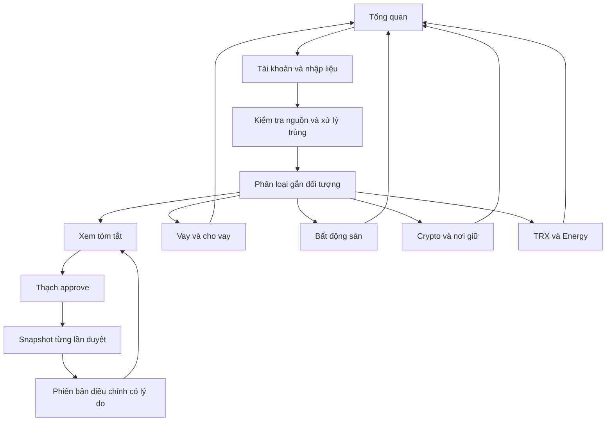

# PCMS — Đặc tả sản phẩm chính thức

Phiên bản hiện hành · 11/10/2026 · **P03–P07 đã phát hành: ngân hàng, công nợ, bảng kê lãi, tất toán và báo cáo dòng tiền khoản vay.**

## 1. Hiệu lực

### P07 — Tất toán có căn cứ và báo cáo tiền thực thu (R53)

Tất toán là thao tác xác nhận có ngày, căn cứ và lý do; không tự suy từ hết gốc. Điều kiện bản VND: gốc hợp lệ bằng0; bảng kê lãi đã duyệt bao phủ từ mốc đầu tới hết ngày tất toán, không còn phải thu/trả; không có nháp hoặc nguồn đã thay đổi cần xử lý. Không có lãi cũng cần điều khoản/bảng kê xác nhận rõ, không mặc định thiếu dữ liệu là0. Không nhận ngày tất toán trước giao dịch đã ghi của khoản. Có mở lại bằng lý do và lịch sử; dữ liệu liên quan thay đổi khiến trạng thái cần kiểm lại, không viết lại bằng chứng tất toán cũ.

Giữ người/khoản hoàn thành và toàn bộ chứng từ, lọc đang theo dõi/hoàn thành/cần kiểm tra. Báo cáo tuần thứHai–Chủnhật, tháng, quý theo ngày chọn lấy tiền thực từ phân bổ nguồn, gồm cả khoản đã tất toán. Tách lãi nhận, lãi trả, thu hồi gốc, nhận vay/giải ngân và chi phí gắn rõ khoản vay. Miễn giảm không thành tiền chi, thu gốc không thành doanh thu. Chênh tiền lãi nhận trừ lãi trả và chi phí đã gắn khoản không được gọi là lợi nhuận ròng; không tự gom mọi chi tiêu ngân hàng vào chi phí cho vay.

### P06 — Bảng kê lãi, phân bổ tiền thu và miễn giảm (R21, R42)

Hoàn thiện luồng từng khoản VND: chọn khoảng tính → xem lãi dự tính → chọn rõ phần tiền lãi nguồn trả cho khoảng này → ghi miễn giảm nếu có → duyệt giữ phiên bản. Khi duyệt phải xác nhận quy ước tính áp dụng cho bảng kê này và ghi căn cứ; xác nhận xem dự tính P05 không thay thế xác nhận đó. Bảng kê khác của cùng khoản không chồng khoảng; bản điều chỉnh cùng bảng kê giữ lịch sử.

Không tự gắn tiền nhận trong khoảng thành tiền trả kỳ đó. Chỉ chọn tiền đã phân bổ lãi vào đúng khoản, đúng chiều; cho chọn một phần, kể cả tiền nhận ngoài khoảng với ngày nguồn hiển thị. Tổng dùng trên các bản duyệt hiện hành không vượt phần lãi nguồn. Phần thừa để chưa phân bổ, không thành lợi nhuận. Số miễn giảm không vượt phần chưa thanh toán, có ngày hiệu lực/lý do và được xác nhận khi duyệt; không tạo tiền hoặc giảm gốc.

Bản nháp không thay bản duyệt. Mỗi lần điều chỉnh có lý do, bản duyệt cũ giữ điều khoản, gốc, đoạn tính, nguồn tiền và quyết định giảm tại thời điểm duyệt. Thay nguồn/điều khoản sau duyệt phải được cảnh báo và kiểm lại trước lần duyệt tiếp, không âm thầm đổi số cũ. Không tự gọi phần chưa thu là quá hạn hoặc khoản hết gốc là đã tất toán.

### P05 — Điều khoản và xem trước lãi theo R42–R43

Đợt tiếp theo triển khai điều khoản lãi VND và bảng tính xem trước theo từng đoạn dư gốc. Giữ dạng nhập VND/triệu/ngày hoặc %/tháng 30 ngày, ngày hiệu lực, căn cứ và lịch sử thay đổi. Không đoán lãi suất cho hồ sơ chưa thiết lập, không cộng hai kiểu nhập hoặc vốn hóa lãi.

Quyết định PO cho chức năng **xem trước**, không thay thế thỏa thuận khoản vay: tính ngày giải ngân, gốc trả giảm từ đầu ngày trả (dùng dư gốc cuối ngày); khoảng tính gồm ngày bắt đầu và không gồm ngày kết thúc; làm tròn tổng một lần tới đồng theo half-up. Giao diện nêu rõ và yêu cầu xác nhận quy ước khi sử dụng, không coi quy ước này đã được người dùng chốt trong phỏng vấn. Tách đoạn khi gốc hoặc lãi suất đổi, giữ độ chính xác phần gốc lẻ triệu.

Bảng hiển thị khoảng/ngày/gốc/lãi suất/lãi từng đoạn và tổng; tiền lãi thực thu/chi trong cùng khoảng là số riêng, không tự coi hiệu số là nợ lãi vì tiền có thể trả cho kỳ khác. Thiếu điều khoản, gốc không hợp lệ hoặc nguồn không đủ phải được báo rõ. Xem trước không tạo tiền, khoản phải thu, miễn giảm hoặc quá hạn. R42 về phân bổ lãi theo kỳ, miễn giảm và duyệt vẫn là phần chưa hoàn thành.

### P04 — Sổ công nợ có thể truy nguồn

PO chọn bước tiếp theo là xem phải thu và phải trả theo từng người, từng khoản vay, không bù trừ hai chiều. Mỗi khoản VND cần xác định chiều vay/cho vay, ngày bắt đầu và dư gốc đầu có nguồn (kể cả xác nhận bằng không). Hồ sơ cũ chưa có các thông tin này phải hiện cần thiết lập, không mặc định đã biết dư nợ.

Dư gốc được tính từ gốc đầu và phần giao dịch ngân hàng đã phân bổ rõ vào đúng khoản. Cho vay: chi gốc tăng phải thu, thu gốc giảm phải thu; đi vay: nhận gốc tăng phải trả, trả gốc giảm phải trả. Không tự phân bổ theo thứ tự khoản vay. Lãi thực nhận/thực trả hiện riêng và không thay đổi gốc. Cho truy từ khoản vay tới giao dịch và dòng nguồn; chỉ dùng dữ liệu đã ghi, cảnh báo dữ liệu thiếu hoặc gốc âm. Giao dịch trước mốc dư đầu phải được nhận diện để tránh cộng trùng.

Thông tin thiết lập và điều chỉnh có lịch sử, không viết lại snapshot đã duyệt. Sổ hiện hành phải nói rõ chưa phải xác nhận toàn bộ công nợ thực tế khi nguồn/phân loại còn thiếu. P04 này chưa tính lãi dự kiến, miễn giảm lãi hoặc quá hạn; các yêu cầu đó vẫn còn trong phạm vi sản phẩm về sau.

### P03 — Biết tài khoản đang thiếu gì và tiếp tục đúng việc

PO chọn hoàn thiện trạng thái vận hành ngân hàng trước mở rộng công nợ. Bổ sung tổng quan trong tài khoản: mốc theo dõi, các kỳ nguồn đã ghi, khoảng chưa có nguồn tới cuối kỳ mới nhất, nguồn mới nhất tới ngày nào, file đang chờ/bị chặn/đã loại, số dòng chưa phân loại, bản duyệt gần nhất và thay đổi sau duyệt. Không coi từ ngày cuối nguồn tới hôm nay là đã đối soát; không suy không phát sinh khi thiếu nguồn.

Hướng dẫn tiếp theo phải phản ánh trạng thái thực: file đã loại có đường mở lại, file chặn có đường kiểm lỗi, phần chưa phân loại có đường xử lý, thay đổi chưa duyệt có đường xem/duyệt, đã duyệt không đổi thì hiện Đã cập nhật và mời nhập kỳ tiếp theo thay vì yêu cầu duyệt lặp. Cho xem báo cáo cũ, chặn tạo snapshot giống hệt phiên bản gần nhất về nội dung tài chính; ghi chú khác không phải thay đổi tài chính.

Khi duyệt còn khoảng chưa có nguồn trước/giữa các kỳ đã ghi, yêu cầu xác nhận riêng và lưu rõ khoảng đó vào snapshot. Không sửa số dư đầu, không tạo giao dịch bù, không tự mở lại hoặc duyệt file thật. Đây là kiểm soát tính minh bạch, không khẳng định lịch sử đã đủ. Giới hạn định dạng VND/XLSX hiện tại giữ nguyên.

Đây là nguồn yêu cầu nghiệp vụ duy nhất. [ACCEPTANCE](ACCEPTANCE.md) quy định cách nghiệm thu; [IMPLEMENTATION-STATUS](IMPLEMENTATION-STATUS.md) ghi hiện trạng, quyết định và kết quả phỏng vấn. README chỉ dẫn đường. Tài liệu trong [kho lịch sử](docs/archive/2026-09-29/INDEX.md), mã, schema và cấu hình không được tự trở thành yêu cầu sản phẩm.

Yêu cầu trực tiếp mới của Thạch có ưu tiên cao nhất và phải được cập nhật vào bộ này trước triển khai phần liên quan. Mâu thuẫn chưa giải quyết phải được ghi lại và hỏi, không lấy hành vi demo làm quyết định nghiệp vụ.

Ba nhãn: **Đã xác nhận** là Thạch nói rõ; **Đề xuất** là phương án của người triển khai; **Còn mở** là chưa đủ thông tin. Đã xác nhận yêu cầu không đồng nghĩa đã làm hoặc đã nghiệm thu.

Theo giao quyền 08–09/10/2026, PO chủ động điều phối triển khai ứng dụng qua coder và QA, không yêu cầu người dùng quản lý dự án hoặc duyệt chi tiết kỹ thuật. Bảo toàn dữ liệu tài chính hiện có; không tự xác nhận sự thật tài chính, chính sách chưa có căn cứ hoặc thực hiện giao dịch thực. Nội dung lịch sử chỉ cho phép làm bản mẫu đã được thay bằng quyền triển khai này.

### P02 — Sửa sai tài khoản và hoàn thiện hành trình sử dụng · 09/10/2026

#### Sửa lỗi nguồn đã loại sau đổi mốc — 09/10/2026

Người dùng xác nhận mốc theo dõi tài khoản Tech-999 là ngày 09/07/2026 (9 tháng 7). File 01/08–29/09 đã loại khỏi đợt đang hiển thị lỗi mốc cũ dù tài khoản đã sửa. Lỗi tại thời điểm loại phải ghi rõ là lịch sử, không trình bày như kết quả kiểm hiện tại. Có thao tác Đưa lại vào kiểm tra, giữ file gốc, kiểm lại theo tài khoản hiện tại, không tự ghi tiền/duyệt. Nhập lại cùng file đã loại phải có đường xử lý rõ. Hiển thị mốc tài khoản và kỳ nguồn bằng ngày dễ đọc. Nguồn bắt đầu sau mốc chỉ chứng minh kỳ nguồn; khoảng trước nguồn chưa được kiểm chứng, không tự suy không có giao dịch hoặc lấy số dư đầu file làm xác nhận số dư tại mốc.

Yêu cầu người dùng: sản phẩm phải dùng được, tự xử lý các thiếu sót cơ bản; PO chịu trách nhiệm thay vì bắt người dùng kiểm thử hoặc thiết kế quy trình. Phản hồi không sửa/xóa được tài khoản nhập nhầm được tiếp nhận là lỗi khả năng sử dụng.

Quyết định triển khai của PO:

- Tên hiển thị tài khoản sửa được, có lịch sử. Số tài khoản, mốc theo dõi, số dư đầu và căn cứ sửa được trước khi có giao dịch đã ghi/bản duyệt; nếu đã nạp file chờ thì kiểm lại theo thông tin mới, không sửa file gốc. Khi đã có lịch sử, khóa các trường ảnh hưởng nguồn/tiền, giải thích rõ; không giả vờ hỗ trợ điều chỉnh số nguồn bằng cách sửa số dư đầu.
- Tài khoản rỗng tạo nhầm có Xóa, xác nhận rõ tên, xóa mềm có thể khôi phục. Tài khoản có nguồn/giao dịch/bản duyệt dùng Lưu trữ, ẩn khỏi danh sách hoạt động nhưng tra được lịch sử; có Khôi phục hoạt động. Không xóa nguồn hay snapshot. Tài khoản lưu trữ không được nhận nhập/phân loại/ghép chuyển/duyệt mới cho tới khôi phục; backend bảo vệ tương ứng.
- Hành động Sửa/Xóa/Lưu trữ dễ tìm trong tài khoản. Có danh sách lưu trữ/đã xóa và đường khôi phục. Chuyển tài khoản không mang lựa chọn hoặc biểu mẫu cũ sang tài khoản khác.
- Luồng nhập nguồn, phân loại, xem báo cáo/duyệt có các bước hoặc tab rõ; nguồn đã ghi thu gọn, mặc định ưu tiên dòng chưa phân loại. Người dùng thấy việc cần làm tiếp; bộ lọc không cắt báo cáo. Giảm thuật ngữ triển khai trên UI, giải thích định dạng hỗ trợ tại nơi nhập.
- Chưa mở rộng engine đầu tư/công nợ ở P02. Không chuyển sản phẩm sang dữ liệu tài chính thật hoặc xóa tài khoản người dùng hiện có để kiểm thử. PO tự dùng chuỗi tạo sai→sửa→nhập→phân loại→duyệt→điều chỉnh→lưu trữ→khôi phục trước bàn giao.

## 2. Sản phẩm là gì?

**Đề xuất để Thạch xác nhận:** PCMS giúp Thạch biết tiền đang ở đâu, mỗi khoản vào/ra phục vụ việc gì, liên quan tới ai hoặc tài sản nào, còn phải thu/phải trả bao nhiêu; mọi số tổng truy được về giao dịch và chứng từ.

Trọng tâm trao đổi gần nhất là lịch sử tài khoản liên tục. Tầm nhìn rộng hơn gồm BĐS, doanh nghiệp, cổ phiếu và crypto. Cổ phiếu đã được chuyển sang phase sau, pending; phạm vi chi tiết các nhóm còn lại tiếp tục phỏng vấn.

- **Đầu vào:** sao kê ngân hàng/sàn; số dư đầu có căn cứ; giao dịch bổ sung; phân loại; bên liên quan; từng khoản vay/cho vay; tài sản và định giá khi thuộc phạm vi.
- **Đầu ra:** lịch sử và số dư từng tài khoản; lỗi/nghi trùng/chưa phân loại; dòng tiền theo nhóm và đối tượng; công nợ theo người và từng món; báo cáo theo ngày hoặc khoảng ngày. Tổng tài sản quy đổi cần thêm chính sách định giá và tỷ giá được chốt.

## 3. Yêu cầu đã xác nhận

| Mã | Nội dung có hiệu lực | Căn cứ trao đổi |
|---|---|---|
| R01 | Theo dõi 2 tài khoản ngân hàng, sàn Binance, BingX và ví crypto riêng; số ví, mạng, số dư và mốc tracking chưa chốt | Xác nhận bổ sung 30/09/2026 |
| R02 | Bỏ lựa chọn “Mục đích” khi khai báo tài khoản, không thay bằng mục đích bắt buộc khác | Cập nhật UC-01 |
| R03 | Khai báo tài khoản, import và xử lý trùng ở cùng khu vực tài khoản, mục “Import lịch sử giao dịch”; UC-03 gộp UC-02 | Cập nhật UC-01/02/03 |
| R04 | Nhập và phân loại bất kỳ lúc nào; kiểm tra tính đúng đắn, xử lý trùng dựa vào lịch sử tài khoản đã có | Bỏ yêu cầu bắt buộc theo tháng |
| R05 | Có đầy đủ lịch sử sao kê từ ngày tracking tới hiện tại | Cập nhật lịch sử tài khoản |
| R06 | Giao dịch được phân loại và liên kết tới việc/đối tượng cụ thể; có nơi quản lý các danh mục | Chi tiêu, đầu tư, cho A/B vay, tài sản C |
| R07 | Quản lý tổng nợ, từng người và từng món; có mình vay và mình cho vay | Ví dụ vay bốn người, cho A/B vay |
| R08 | Shop A thuộc Thạch; Thạch thanh toán nhà cung cấp bằng tài khoản của mình | Xác nhận trực tiếp về shop |
| R09 | VND giữ VND, USDT giữ USDT; tổng hợp USDT là hướng tương lai, chưa chốt tỷ giá | Trả lời về đơn vị báo cáo |
| R10 | Người dùng hiện tại là Thạch trực tiếp bấm approve; thay xác nhận trước về Dũng trong phạm vi vận hành hiện tại | Xác nhận mới 30/09/2026 |
| R11 | Tầm nhìn gồm BĐS, doanh nghiệp, cổ phiếu, crypto; được dùng dữ liệu giả lập cho bản thử | Yêu cầu hoàn thiện bản thử |
| R12 | Nghiệm thu theo mốc và kết quả Thạch kiểm chứng được | Yêu cầu tránh đi sâu kỹ thuật |
| R13 | Gom một bộ tài liệu có hiệu lực, phỏng vấn lại trước khi triển khai lại | Yêu cầu ngày 29/09/2026 |

### Bổ sung đã xác nhận từ phỏng vấn — 29/09/2026

| Mã | Yêu cầu mới được nói rõ |
|---|---|
| R14 | Luồng thực tế: tải sao kê → đối chiếu dữ liệu/số dư với kỳ trước → phân loại → khóa sổ/chốt kỳ → xem báo cáo |
| R15 | Báo cáo cần tổng quan danh mục đầu tư, số dư từng hạng mục, tiền đang ở đâu và tỷ trọng đầu tư |
| R16 | Sao kê sàn cần theo dõi chuyển tiền đi đâu, mua coin gì, trade gì; đã xác nhận có mua/bán, futures, margin, staking và Earn; chi tiết sản phẩm/sàn và nguồn dữ liệu còn mở |

Thạch mô tả mình tải sao kê, tự đối chiếu và phân loại. Chưa rõ “tự đối chiếu” là thao tác thủ công hay muốn hệ thống tự kiểm rồi mình xác nhận. Thạch đã xác nhận trực tiếp bấm approve sau khi xem tóm tắt phân loại.

Nhập liên tục và chốt kỳ là hai nhu cầu cùng tồn tại: không tự khôi phục ràng buộc chỉ được nhập theo tháng. Đã cập nhật: tài khoản chốt theo mỗi đợt xử lý do người dùng chọn, ví dụ cách ba ngày nhập một lần, không cố định theo tuần. Người dùng nhập → phân loại → xem báo cáo tóm tắt phân loại → approve; mỗi lần duyệt lưu snapshot theo thời điểm duyệt. Chốt tháng chuyển sang pending, không là điều kiện bắt buộc cho bản dùng thử; sẽ đánh giá lại sau sử dụng thực tế. Cho approve khi còn chưa phân loại, có nhãn rõ. Nếu sai, giữ snapshot cũ và tạo phiên bản mới kèm quyết định/lý do điều chỉnh. Chính sách khi số dư lệch còn đang đề xuất.

Hai ảnh là ví dụ cách quản lý hiện tại: ảnh 1 có kỳ sao kê, số dư đầu/cuối, các dòng giao dịch; ảnh 2 có nhóm giao dịch, tổng và ghi chú riêng. Chưa xác nhận ý nghĩa các số tổng hoặc các khoản thu định kỳ ở ảnh 2; không suy ra đó là lãi, gốc, tiền thuê hay lợi nhuận. Không dùng số trong ảnh làm dữ liệu vận hành.

Trong tầm nhìn đã xác nhận cần phần quản lý riêng cho BĐS, cổ phiếu và coin (cổ phiếu pending phase sau); hiển thị đồng thời vốn bỏ vào và giá trị hiện tại. Tỷ trọng theo giá trị hiện tại. Cách tính vốn khi bán một phần, mẫu số tỷ trọng (có tiền mặt, phải thu và trừ nợ hay không), nguồn/ngày giá và quy đổi còn mở; chưa được tự chọn công thức.

### Bổ sung đã xác nhận — 30/09/2026

| Mã | Yêu cầu |
|---|---|
| R17 | Tài khoản chốt theo mốc xử lý tùy chọn, không cố định theo tuần: nhập → phân loại → xem tóm tắt phân loại → approve → lưu snapshot theo thời điểm duyệt. Chốt tháng pending, đánh giá sau dùng thử; không là điều kiện triển khai hiện tại |
| R18 | Có quản lý riêng từng nhóm BĐS, cổ phiếu, coin; hiển thị cả vốn bỏ vào và giá trị hiện tại; tỷ trọng theo giá trị hiện tại |
| R19 | Phạm vi nhu cầu sàn gồm mua/bán, futures, margin, staking và Earn; chưa mặc định chỉ làm spot |
| R20 | Giao dịch chưa phân loại được để trong mục riêng, gắn nhãn chưa phân loại và vẫn cho approve snapshot tại thời điểm đó |
| R21 | Sai sót sau duyệt: giữ nguyên snapshot cũ, tạo phiên bản mới kèm quyết định điều chỉnh và lý do |
| R22 | Chốt tháng pending; đánh giá nhu cầu sau khi vận hành bản thử, không bắt buộc làm ngay |
| R23 | Binance và BingX đều dùng trade, lưu trữ coin, Earn; tách hai sàn nhằm giảm tập trung rủi ro. Có nhiều ví riêng, trước mắt người dùng liệt kê coin của từng ví |
| R24 | Quản lý danh mục cổ phiếu pending cho phase sau; không là điều kiện nghiệm thu bản thử lần tới |

R19 xác nhận nhu cầu sản phẩm, chưa xác nhận cách chia đợt triển khai hoặc hỗ trợ mọi sàn. Cần làm rõ tài khoản/ví con, vị thế đang mở, tiền ký quỹ, khoản vay margin, phí/lãi vay/funding, phần thưởng và tiền đang khóa. Đây là danh sách cần phỏng vấn, chưa là công thức được duyệt. Không tự lấy giá trị danh nghĩa hợp đồng futures làm giá trị tài sản, hoặc cộng tiền ký quỹ hai lần; phương pháp báo cáo cần được chốt bằng ví dụ.

### Khởi tạo crypto và ví riêng — xác nhận 30/09/2026

- R25: Theo dõi crypto từ một mốc bắt đầu, không bắt buộc nhập lại toàn bộ lịch sử. Ngày/giờ cụ thể chưa chọn.
- R26: Có nhiều ví riêng; trước mắt người dùng liệt kê danh sách coin theo từng ví. Không bắt buộc người dùng tổ chức danh mục theo mạng ở bước này; chưa mở rộng thành nhập toàn bộ lịch sử on-chain hoặc DeFi.
- Đề xuất khai báo ví bằng tên dễ nhớ, tài sản và số lượng; bổ sung vốn nếu biết, nguồn và ngày xác nhận. Một ví có thể bao gồm nhiều mạng. Mạng/định danh token là chi tiết cần bổ sung khi tên coin mơ hồ, đối soát on-chain hoặc liên kết chuyển tiền; chưa yêu cầu tích hợp mạng ngay. Không gộp tự động tài sản chỉ vì trùng ticker; chưa rõ thì giữ tách và đánh dấu chờ xác minh. Không cần seed phrase/private key.
- Đề xuất danh sách đầu mốc trên sàn tách số đang giữ, đang Earn/khóa, tiền ký quỹ, vị thế đang mở và nợ margin có nguồn. Không cộng số tổng sàn thêm một lần với các thành phần của nó. Chưa chốt trường và công thức đặc thù từng sàn.
- Số dư/số lượng tại mốc là trạng thái ban đầu, không tự tính là thu nhập hoặc giao dịch mua mới. Vốn lịch sử thiếu ghi chưa xác định, không thay bằng giá tại mốc. Báo cáo lãi/lỗ chỉ hiển thị trong phạm vi có đủ căn cứ.
- Giữ chiều xem theo nơi giữ (Binance, BingX, từng ví) và theo coin; báo cáo tập trung theo nơi giữ là đề xuất phù hợp mục tiêu phân tán rủi ro, không tự đặt ngưỡng rủi ro. Nguồn định giá/quy đổi vẫn còn mở.
- Chưa có mẫu dữ liệu sàn/ví và chưa quyết định nhập file, thủ công hay kết nối. Chi tiết swap/bridge/DeFi tại ví không tự được đưa vào phase hiện tại.

## 4. Mô hình nghiệp vụ đề xuất

Đây là cách tổ chức để phỏng vấn, chưa phải schema bắt buộc. Không ép toàn bộ thông tin vào một danh sách “danh mục”.

| Khái niệm | Ý nghĩa | Ví dụ |
|---|---|---|
| Chủ sở hữu — Entity | Ai sở hữu hoặc chịu nghĩa vụ | Thạch; công ty nếu có |
| Tài khoản — Account | Nơi giữ tiền/tài sản, không phải Entity | Ngân hàng 1, sàn 1 |
| Giao dịch nguồn | Sự kiện gốc từ sao kê hoặc nhập tay có căn cứ | Một lần chuyển 22 triệu |
| Phần phân loại | Ý nghĩa nghiệp vụ của một phần giao dịch | 20 triệu gốc, 2 triệu lãi |
| Danh mục nghiệp vụ | Loại việc đã phát sinh | Chi sinh hoạt, nhận vay, mua hàng |
| Bên liên quan — Party | Người/tổ chức liên quan | Người cho vay, nhà cung cấp |
| Khoản vay/cho vay | Một nghĩa vụ riêng, có chiều và nguyên tệ | Vay A lần 1, vay A lần 2 |
| Tài sản | Đối tượng đầu tư/sở hữu | Căn hộ C, cổ phiếu, BTC |
| Hoạt động kinh doanh | Nơi tập hợp nghiệp vụ kinh doanh | Shop A; không tự suy ra pháp nhân riêng |
| Nguồn/chứng từ | Bằng chứng giải thích số liệu | File sao kê, hợp đồng, hóa đơn |
| Mốc tracking | Ngày bắt đầu và số dư có căn cứ | Số dư trước giao dịch đầu theo dõi |
| Đối soát | So sánh số tính với nguồn | Số cuối ngày hệ thống và ngân hàng |

Tên người chuyển trên sao kê không nhất thiết là chủ nợ: có thể chuyển hộ. Shop không tự động là khoản nợ, tài khoản ngân hàng hoặc một khoản đầu tư. Cách liên kết pháp nhân, shop và quyền sở hữu còn phải hỏi.

## 5. Các luồng nghiệp vụ để xác nhận

Các luồng cụ thể hóa yêu cầu mục 3. Chi tiết chưa được người dùng nói rõ là **đề xuất**, cần chốt trước triển khai.

### F01 — Tài khoản, import và lịch sử (R01–R05, R09)

1. Chọn/tạo tài khoản: tên, loại, chủ sở hữu, nguyên tệ, mốc tracking và nguồn số dư đầu; không hỏi mục đích.
2. Trong tài khoản chọn “Import lịch sử giao dịch”. Giữ file/dòng gốc, so với lịch sử đã có và các dòng trong file.
3. Hiển thị dòng mới, đã có, nghi trùng, mâu thuẫn và lỗi. Người dùng xử lý phần chưa chắc chắn.
4. Ghi nhận dữ liệu hợp lệ theo chính sách import sẽ chốt. Đề xuất: chưa phân loại vẫn phản ánh tiền nhưng hiện trạng thái chưa rõ.
5. Xem lịch sử tracking → hôm nay, số dư và nguồn. Hiển thị riêng nguồn mới nhất đến ngày nào và khoảng thiếu; không có file mới không chứng minh không phát sinh giao dịch.

Đề xuất: nhập lại không cộng tiền lần nữa; cùng ngày/cùng tiền chưa đủ kết luận trùng; file mới không đặt lại số dư đầu; mỗi giao dịch nguồn là một dòng lịch sử mở được các phần phân loại. Dữ liệu nhập muộn cập nhật lịch sử bị ảnh hưởng, không âm thầm viết lại báo cáo đã chốt.

**Còn mở:** chặn cả file lỗi hay nhận phần hợp lệ; tiêu chí xác nhận trùng; xử lý lịch sử trước tracking; nhiều đồng tiền trong một tài khoản sàn; cách chứng minh độ phủ sao kê.

### F02 — Phân loại và danh mục (R06)

1. Chọn giao dịch chưa rõ hoặc đã có.
2. Chọn nghiệp vụ, bên liên quan, khoản vay/tài sản/shop phù hợp và chứng từ. Có nơi thêm/sửa đối tượng còn thiếu.
3. Nếu phục vụ nhiều việc, tách phần; tổng các phần phải bằng giao dịch nguồn.
4. Xác nhận, cập nhật báo cáo và giữ lịch sử trước/sau. Phân loại lại không tạo thêm tiền.

Đề xuất quản lý riêng “loại nghiệp vụ”, “người A” và “khoản vay A lần 1”, thay vì chỉ tạo một nhãn “Cho A vay”. Cây danh mục, quyền sửa và bước duyệt còn mở.

Chuyển giữa hai tài khoản của mình cần liên kết hai đầu, giữ ngày thực tế và phí; không tự thành thu nhập/chi tiêu. Cách xử lý đầu chuyển chưa xuất hiện cần chốt.

### F03 — Vay và cho vay (R07, R09, R29)

1. Chọn người, tạo/chọn từng khoản và nguyên tệ; số dư ban đầu có nguồn.
2. Gắn giao dịch nhận vay/giải ngân đúng khoản.
3. Khi trả/thu, tách gốc, lãi và phí; chỉ gốc làm giảm dư nợ gốc.
4. Xem tổng theo nguyên tệ → từng người → từng khoản → giao dịch/chứng từ.

Đề xuất không bù trừ tự động mình vay và mình cho vay. Đã xác nhận thu lãi thường hằng tháng, chọn từng khoản để trả/tất toán và tính tiếp trên gốc còn lại sau trả một phần. Đã xác nhận tính lãi theo ngày từ ngày giải ngân; hệ số quy đổi lãi tháng ra ngày, biên ngày trả, hạn thu, quá hạn và chuyển hộ còn mở. Không suy ra dư nợ thật từ ảnh Sheet thiếu tiêu đề cột.

### F04 — Shop: PENDING, chưa triển khai (R08, R28)

Theo yêu cầu mới, toàn bộ thiết kế shop bên dưới chỉ giữ để dùng lại sau; không là phạm vi hoặc điều kiện nghiệm thu bản đầu. Không bỏ các dòng sao kê liên quan shop: vẫn giữ tiền thực và nhãn phù hợp/chưa phân loại.

1. Chọn giao dịch thanh toán, gắn Shop A và nhà cung cấp.
2. Gắn chứng từ/đơn hàng, xác định đặt cọc, trả tiền hàng hoặc trả nợ nếu cần mức chi tiết này.
3. Xem tiền đã chi cho shop và mở từng giao dịch.
4. Đã xác nhận shop nhập hàng theo đợt, cần công nợ và lợi nhuận. Đề xuất theo dõi lô nhập, hàng nhận, tiền thanh toán/ứng trước, phải trả nhà cung cấp, doanh thu, giá vốn hàng đã bán và chi phí. Mức chi tiết tồn kho, phải thu khách và phần mềm bán hàng đang dùng chưa rõ. Không coi tiền thu trừ tiền chi là lợi nhuận khi còn tồn kho/công nợ.

Ví dụ giả lập: chuyển 30 triệu mua hàng cho shop chứng minh dòng tiền ra 30 triệu. Sao kê riêng lẻ chưa đủ xác định chi phí, giá vốn hoặc lợi nhuận. Không tự mặc định shop nợ lại Thạch hoặc toàn bộ tiền mua hàng là chi phí kỳ hiện tại.

### F05 — Tài sản và báo cáo (R09, R11)

1. Xác định tài sản trong phạm vi, quyền sở hữu, số lượng/giá trị đầu có nguồn.
2. Liên kết mua, bán, thu nhập, chi phí với đúng tài sản theo quy tắc được chốt.
3. Quản lý riêng BĐS và coin; cổ phiếu giữ trong tầm nhìn nhưng pending phase sau; hiển thị vốn bỏ vào và giá trị hiện tại. Cập nhật định giá có ngày và nguồn; xem tiền/tài sản theo nơi giữ. Tỷ trọng dùng giá trị hiện tại, còn cách tổng hợp chờ xác nhận.
4. Xem báo cáo ngày/khoảng ngày, mở được giao dịch tạo ra số tổng, thấy phần thiếu hoặc chưa kiểm tra.

Chưa chốt giá vốn, lợi nhuận, định giá BĐS/doanh nghiệp, tỷ lệ sở hữu, nợ gắn tài sản, phí mạng và quy đổi. Không cộng VND với USDT khi chưa có quy tắc; không cộng trùng tiền mua với giá trị tài sản. Danh sách báo cáo ưu tiên phải hỏi lại.

### F06 — Kiểm tra, duyệt, khóa sổ, sửa và truy vết (R04, R10, R12, R14)

Đã xác nhận: duyệt theo từng đợt xử lý tài khoản, không cố định theo tuần. Luồng: tải sao kê → đối chiếu → phân loại → xem báo cáo tóm tắt phân loại → approve → lưu snapshot tại thời điểm duyệt. Báo cáo tóm tắt trước duyệt là một bước bắt buộc trong luồng người dùng mô tả. Snapshot lưu từng lần duyệt; không chỉ giữ trạng thái mới nhất.

Điểm duyệt là sau xem báo cáo tóm tắt phân loại của đợt xử lý, do Thạch bấm. Có thể approve khi còn giao dịch chưa phân loại, nhưng phải có mục và nhãn chưa phân loại. Approve không đồng nghĩa mọi ý nghĩa nghiệp vụ đã hoàn tất. Không bắt buộc đóng tháng mới nhập tiếp; chốt tháng pending.

Đề xuất nội dung snapshot: tài khoản, mã lần duyệt, người duyệt, thời điểm duyệt, khoảng dữ liệu/ngày cuối sao kê, số dư đầu/cuối, giao dịch cùng phiên bản phân loại và tổng theo hạng mục. Phải phân biệt thời điểm bấm duyệt với thời điểm dữ liệu: duyệt ngày 30/09 sao kê tới 28/09 không có nghĩa số dư đã được đối soát tới 30/09. Đây là cách thể hiện đề xuất, chưa chốt đầy đủ trường.

Đã xác nhận: giữ nguyên snapshot cũ; tạo phiên bản mới kèm quyết định điều chỉnh và lý do. Đề xuất bản mới liên kết bản cũ, ghi thay đổi trước/sau và được xem lại/approve; báo cáo mặc định dùng phiên bản có hiệu lực, không cộng các snapshot với nhau. Việc chỉ hoàn thiện phân loại cũng không được làm thay đổi snapshot cũ.

### Chính sách chất lượng đề xuất — chưa coi là đã xác nhận

Tách ba trạng thái độc lập: đối soát (khớp/lệch/chưa đủ nguồn), phân loại (đủ/còn thiếu), duyệt (nháp/đã duyệt). Khớp số dư không chứng minh mọi giao dịch và mọi phân loại đều đúng.

- Cho approve khi số dư đã đối soát nhưng còn chưa phân loại theo R20. Tóm tắt và snapshot giữ số lượng, tổng tiền vào/ra chưa phân loại riêng, không bù trừ che khuất tồn đọng. Đề xuất hàng chờ hiển thị tuổi tồn đọng.
- Không tự coi khoản chưa rõ là chi phí, thu nhập, đầu tư hay nợ. Số dư tiền vẫn phản ánh giao dịch; giá trị/tỷ trọng danh mục, nợ, thu nhập và lời/lỗ có thể chưa đầy đủ, phải hiện giới hạn tại báo cáo và bản xuất liên quan.
- Đề xuất chặn approve chính thức phần tài khoản có lệch tiền chưa giải thích; cho lưu bản nháp và phân loại tiếp. Nếu thiếu nguồn đối chiếu, ghi chưa đủ bằng chứng, không ghi là khớp. Không tự thêm dòng cân số dư. Đây là đề xuất đang chờ Thạch quyết định, khác với quyền approve khi chỉ thiếu phân loại đã được chốt.
- Đối soát ngân hàng theo đúng tài khoản, nguyên tệ, mốc thời gian: số đầu + tiền vào - tiền ra = số cuối nguồn. File chồng kỳ so khớp vùng chồng tại cùng mốc; không so số đầu file tùy ý với snapshot gần nhất. Kiểm từng dòng nếu nguồn có số dư và thứ tự đáng tin.
- Lệch có thể do thiếu/trùng giao dịch, số dư đầu sai, đọc nhầm cột/dấu/đơn vị, phí/lãi thiếu, khác ngày hạch toán/múi giờ, so số khả dụng với số dư sổ, hoặc nguồn tự mâu thuẫn. Hệ thống cần chỉ vị trí lệch đầu tiên và dữ liệu liên quan, không tự đoán sửa nguồn.
- Sàn cần đối soát riêng số lượng từng đồng và phạm vi ví, tiền vay, vị thế, phí/funding/phần thưởng theo nguồn phù hợp. Giá thị trường thay đổi hoặc tiền chuyển sang ký quỹ/Earn không tự là thất thoát. Chưa có mẫu sàn nên chưa chốt công thức đặc thù.

Phạm vi snapshot là đợt mới hay toàn bộ lịch sử tới mốc, chính sách thiếu nguồn/sai lệch và cách tổng hợp tài khoản khác mốc vẫn cần làm rõ. Chốt tháng không chặn phỏng vấn/triển khai phần đã chốt.

### BĐS và hai hoạt động kinh doanh — xác nhận 30/09/2026

| Mã | Yêu cầu đã xác nhận |
|---|---|
| R27 | BĐS phần lớn sở hữu toàn bộ, có hai mảnh góp vốn, một mảnh thế chấp để vay tiền, một căn chung cư thanh toán theo tiến độ. Chưa biết tổng số BĐS hoặc các nhóm có giao nhau không |
| R28 | Shop nhập hàng theo đợt cần công nợ/lợi nhuận, nhưng hiện PENDING theo yêu cầu mới; giữ thiết kế để dùng sau |
| R29 | Có hoạt động cho vay lấy lãi 1,5%/tháng, người dùng xem là một business. Thường thu lãi hằng tháng, nguồn vốn thường là tiền riêng; tính tiếp trên gốc còn lại sau trả một phần. Ngày lẻ và ngoại lệ còn mở |

**Đề xuất tổ chức:** một hệ thống giao dịch chung liên kết sổ chi tiết BĐS, Shop và Cho vay; không tạo ba bộ giao dịch nhập lặp. Business là chiều quản lý hiệu quả, không mặc định một pháp nhân hoặc tài khoản ngân hàng riêng.

**BĐS:** mỗi tài sản có vốn đã góp/thanh toán, chi phí, quyền lợi của Thạch, giá trị hiện tại có ngày/nguồn. Hai tài sản góp vốn cần hồ sơ người góp và quyền lợi thực tế; không tự suy tỷ lệ sở hữu từ tiền đã chuyển. Tài sản thế chấp liên kết khoản vay riêng, lưu cả tài sản bảo đảm và mục đích sử dụng tiền vay (có thể khác nhau); tiền vay không phải thu nhập, tránh trừ nợ hai lần. Chung cư theo tiến độ cần giá hợp đồng, đã trả, nghĩa vụ đến hạn, còn cam kết, lịch thanh toán và trạng thái nhận bàn giao/quyền lợi; không tự cộng toàn giá căn hộ vào tài sản đã sở hữu chỉ từ sao kê. Các công thức báo cáo quyền lợi/nợ còn chờ chốt.

**Shop:** đề xuất quy trình lô/đơn nhập → nhận hàng → ghi nghĩa vụ nhà cung cấp → trả tiền → bán/ghi doanh thu và giá vốn → thu tiền → tổng hợp. Có thể trả trước nhận hàng hoặc nhận trước trả tiền. Tiền chủ đưa vào/rút ra tách khỏi doanh thu/chi phí kinh doanh. Lợi nhuận quản trị cần doanh thu, giá vốn hàng đã bán và chi phí; thiếu dữ liệu thì báo chưa đủ, không suy từ dòng tiền. Có thể nhận dữ liệu tổng hợp có nguồn từ sổ/phần mềm shop thay vì xây POS; phương án chưa chốt. Không cộng giá trị shop và toàn bộ tài sản thành phần hai lần trên tổng tài sản cá nhân.

**Cho vay:** đề xuất người vay → từng hợp đồng/khoản vay → các lần giải ngân → lịch lãi/gốc → tiền thu phân bổ gốc/lãi → quá hạn/điều chỉnh → tất toán. Tách gốc còn phải thu, lãi tính đến ngày xem, lãi đã đến hạn, lãi đã thu, lãi đến hạn chưa thu. Thu hồi gốc không là doanh thu lãi. Lãi tính được chưa mặc định là tiền đã thu hoặc lợi nhuận chắc chắn; khoản có nguy cơ không thu được cần trạng thái và điều chỉnh có căn cứ.

1,5%/tháng là mức người dùng cung cấp; chưa coi là xác nhận pháp lý/thuế hoặc quy ước ngày lẻ. Nguồn vốn thường là tiền riêng, không mặc định mọi khoản đều vốn riêng; chưa cần mô-đun phân bổ chi phí vốn vay trong bản đầu nếu không phát sinh.

### Chi tiết khoản vay và shop đơn giản — xác nhận 30/09/2026

- R30: Mỗi lần vay theo dõi thành khoản riêng. Cùng người vay có thể vay 100 triệu ngày 20, thêm 100 triệu ngày 30 và trả khoản ngày 30 trước. Không tự phân bổ tiền trả vào khoản cũ nhất hoặc gộp mọi khoản thành một số dư mất chi tiết.
- R31: Người vay có quyền trả trước một phần gốc. Khi vay 300 triệu rồi trả 100 triệu, thanh toán lãi trên gốc 300 triệu tới mốc trả; sau đó tính lãi tiếp trên gốc còn lại 200 triệu. Chỉ thu phần lãi chưa thanh toán, không thu lại lãi kỳ đã trả. Tính từ ngày giải ngân đã xác nhận; cách quy đổi lãi ngày và xử lý ngày trả còn phải xác nhận.
- R32: Trước đây người dùng giao thiết kế shop đơn giản, nay chuyển PENDING; không triển khai hoặc yêu cầu hoàn thiện dữ liệu shop lúc này. Phương án tối giản dưới đây do người triển khai chọn làm đề xuất thiết kế, không đồng nghĩa đã được phép code hoặc người dùng có sẵn dữ liệu hàng bán/tồn.

**Luồng cho vay đề xuất:** tạo khoản → giải ngân → sinh bảng lãi theo các đoạn có cùng dư gốc → ghi nhận tiền thu → chọn khoản và phân bổ gốc/lãi → xem dư gốc/lãi trước-sau → approve. Một tiền chuyển có thể chia vào nhiều khoản nhưng tổng phân bổ phải khớp nguồn. Số tiền không đủ hoặc khác dự kiến phải có phân bổ được xác nhận; không tự nhập lãi thiếu vào gốc, không tự áp phí trả trước hoặc lãi phạt. Tất toán chỉ khi gốc và lãi phải thu đã xử lý đủ, hoặc có quyết định miễn/điều chỉnh rõ.

**Công thức lãi ngày đã xác nhận:** 500 VND/1.000.000 VND gốc/ngày = 0,05%/ngày = 1,5% cho 30 ngày. Lãi từng đoạn = dư gốc đoạn / 1.000.000 × 500 × số ngày thực tế; cộng các đoạn để ra lãi dự tính. Không làm tròn gốc thành số triệu nguyên. Tháng là đơn vị nhập lãi suất quy ước 30 ngày, không ép số ngày vay thực tế thành 30. Ví dụ 31 ngày là 1,55% và 28 ngày là 1,4% khi gốc không đổi. Quy ước biên đề xuất tính ngày giải ngân, không tính ngày trả trên phần gốc trả, dư gốc còn lại có hiệu lực từ ngày trả; quy tắc làm tròn và nhiều giao dịch cùng ngày chưa chốt riêng.

**Shop tối giản đề xuất:** (1) danh mục hàng và nhà cung cấp; (2) phiếu nhận hàng theo đợt với số lượng/giá nhập và khoản thanh toán liên kết; (3) ghi bán tổng hợp theo ngày hoặc đợt với số lượng từng mặt hàng, doanh thu và tiền đã thu; (4) chi phí vận hành; (5) báo cáo hàng còn, nợ nhà cung cấp/khách, lãi gộp và lãi sau chi phí trước thuế. Không yêu cầu hóa đơn bán lẻ cho từng khách nếu chỉ cần tổng hợp. Giá vốn đề xuất bình quân sau mỗi lần nhập; chưa triển khai POS/barcode, nhiều kho, thuế hoặc phần mềm bán hàng đầy đủ. Nếu chưa có số lượng bán/tồn có căn cứ thì chưa thể xác nhận lợi nhuận; không bịa giá vốn. Tiền ứng trước, hàng trả lại/giảm giá và tồn đầu cần giữ riêng và làm rõ khi phát sinh. Phần đưa vốn/rút vốn của chủ tách khỏi doanh thu/chi phí. Thiết kế này giữ đủ thông tin để không tính lợi nhuận bằng tiền vào trừ tiền ra.

Đề xuất bản thử có ba sổ chi tiết, báo cáo và liên kết giao dịch chung; phạm vi triển khai cuối vẫn chờ hoàn tất phỏng vấn, không tự mở rộng thành phần mềm kế toán/POS hay hệ thống cho vay tự động đầy đủ.

### F07 — Kinh doanh TRX: thưởng staking, cho thuê Energy và bán TRX

R33 (cập nhật xác nhận): sản phẩm là Energy trên TRON, phục vụ giảm chi phí sử dụng mạng. Thưởng staking là coin trả thêm riêng, người dùng mô tả theo APY năm và có thể claim hằng ngày. Người dùng còn bán TRX trong ví cho khách; một lần khách thanh toán có thể gộp tiền TRX với tiền thuê Energy. Không còn mô hình mặc định sản phẩm tồn kho được tạo theo tháng.

R34 (đã xác nhận): cần phân biệt phần thưởng coin, dịch vụ thuê Energy, bán TRX và phân bổ một khoản thu chung vào các nghiệp vụ đó. Có đơn Energy tính theo lượng cho một lần và gói 1 triệu Energy theo tháng. Thu chủ yếu USDT, cũng nhận VND. Gói tháng có phí cố định theo thời hạn thuê, không giảm khi khách không dùng; trả trước hoặc sau tùy khách. Giá vốn/định giá thưởng, đơn vị báo giá USD/USDT, chi tiết hạn mức và quy đổi còn mở.

**Cơ chế đã tra cứu, không phải chính sách kinh doanh đã được duyệt:** Energy là tài nguyên mạng; việc sử dụng phục hồi theo thời gian, không phải hàng hóa tự cộng dồn mỗi tháng. Với Stake 2.0, ủy quyền tài nguyên cho khách không chuyển quyền sở hữu TRX stake. Phần thưởng mạng liên quan việc bỏ phiếu/SR; không giả định APY hiển thị là lợi suất cố định hoặc APY/365 là coin thực nhận. Nguồn chính thức: [Resource Model](https://developers.tron.network/docs/resource-model), [Delegation](https://developers.tron.network/docs/delegation), [Rewards](https://developers.tron.network/docs/reward-calculation). Đã xác nhận tự stake và cấp Energy từ ví cho khách; chi tiết nguồn thưởng/vote và ví cụ thể chưa cung cấp.

**Đề xuất sổ chi tiết cùng một hoạt động kinh doanh:**

1. TRX: số tự do, stake, chờ rút, thưởng có thể claim và thưởng đã nhận; nơi giữ và nguồn. Các trạng thái loại trừ/phân bổ rõ, không cộng tổng ví thêm với thành phần. Bán TRX chỉ giảm lượng thực chuyển bán, không tự lấy TRX đang stake làm khả dụng.
2. Thưởng: ngày/nguồn, lượng thưởng, lượng đã claim, txid nhận và phí. Nếu đã ghi quyền nhận thưởng trước thì claim chỉ chuyển trạng thái, không ghi thu nhập lần thứ hai. APY dùng tham khảo/dự báo có nhãn; thực tế theo nguồn. Giá trị thưởng và cơ sở giá vốn bán sau cần chốt để không tính cùng giá trị hai lần.
3. Energy: theo dõi nguồn lực khả dụng/đang ủy quyền và đơn dịch vụ, không định giá một kho Energy để cộng thêm vào tổng tài sản. Đơn ghi khách, địa chỉ nhận nếu cần, lượng/gói Energy, thời gian dịch vụ, giá, đơn vị tiền, trạng thái giao/thu hồi và giao dịch bằng chứng. Phân biệt thời hạn thuê, thời hạn khóa và thời điểm thực tế thu hồi; không mặc định hết thuê là tự thu hồi hoặc hết khả dụng mãi mãi. Năng lực Energy cần số tại thời điểm/nguồn, không tỷ lệ cố định theo TRX.
4. Bán TRX: đơn ghi số TRX thực bán, đơn giá, tiền phải thu, ví gửi/nhận, bằng chứng giao, phí và giá vốn nếu có. Tiền bán khác lợi nhuận; thiếu giá vốn thì chưa kết luận lãi.
5. Thu chung: một đơn/bảng kê khách có dòng thuê Energy và dòng bán TRX riêng. Một giao dịch thu phân bổ vào các dòng hoặc nhiều đơn; tổng khớp nguồn, không ghi tiền lần hai. Thu thiếu còn phải thu, thu thừa/đặt trước chờ phân bổ, khác đồng phải có thỏa thuận quy đổi. Tiền nhận trước chưa tự chứng minh dịch vụ đã hoàn tất.
6. Báo cáo: coin stake/tự do, thưởng thực nhận/chưa claim, doanh thu dịch vụ theo cơ sở được chọn và tiền thực thu, tiền bán TRX và lãi bán khi đủ vốn, công nợ khách, phí và biến động giá nắm giữ tách riêng. Không cộng TRX gốc hai lần giữa business và danh mục crypto.

Luồng đề xuất: số đầu theo mốc → cập nhật stake/thưởng → tạo đơn Energy và/hoặc bán TRX → xác nhận giao dịch vụ/coin → ghép tiền thu và phân bổ → xem báo cáo tóm tắt → approve snapshot. Khi điều chỉnh vẫn giữ bản cũ, thêm phiên bản/quyết định/lý do theo R21. Bản đầu là quản lý/ghi nhận, không tự claim, delegate, unstake hoặc chuyển tài sản.

Đã rõ gói tháng tính phí cố định dù khách không dùng, trả trước/sau tùy khách. Còn hỏi: lượng ghi trên gói là mức cấp duy trì hay tổng giới hạn tiêu thụ; đơn lẻ kết thúc/thu hồi theo điều kiện nào; đơn vị giá USD/USDT, ngày đến hạn và quy đổi VND. Không tự mở rộng tích hợp blockchain; nguồn có thể nhập tay/chứng từ trước. Shop vẫn pending. Chính sách lợi nhuận/kế toán cụ thể còn phải chốt trước triển khai.

#### Bổ sung đã xác nhận — đơn Energy và tiền thanh toán

R35: tự stake và cấp Energy trực tiếp từ ví cho khách. Có hai kiểu bán dịch vụ: theo lượng Energy cho một lần, hoặc gói 1 triệu Energy theo tháng; chưa khẳng định mức tháng là tổng lượng tiêu thụ, lượng phục hồi hằng ngày hay mức cấp duy trì.

R36: khách chủ yếu thanh toán USDT, đôi lúc VND. Đã xác nhận khi trả VND thì lấy số USDT nhân tỷ giá tại lúc thanh toán. Nguồn tỷ giá/ai nhập còn chưa chốt; chưa suy mọi hợp đồng đều cùng đơn vị. Đồng tiền thanh toán khác với đơn vị báo giá và đơn vị báo cáo tổng.

Đề xuất tối giản: hồ sơ khách → đơn gồm các dòng Energy một lần/thuê tháng/bán TRX → bằng chứng cấp tài nguyên/giao coin → khoản thu → phân bổ công nợ. Mỗi dòng giữ đơn vị, lượng, giá thỏa thuận và khoảng dịch vụ; bản thân trạng thái đã thanh toán không chứng minh dịch vụ tháng đã hoàn tất. Ngày hết hợp đồng, thời hạn khóa on-chain và ngày thực thu hồi là thông tin khác nhau. Bản đầu ghi nhận thủ công kèm bằng chứng, không tự điều khiển ví.

Đề xuất với VND: nếu đơn báo giá USDT, lưu USDT phải thu, VND thực nhận, tỷ giá và thời điểm thỏa thuận, USDT tương đương được dùng tất toán. Ví dụ giả lập 100 USDT, thỏa thuận 25.000 VND/USDT, nhận 2.500.000 VND thì giảm nợ 100 USDT nhưng tài khoản ngân hàng chỉ tăng VND, không tạo thêm tiền USDT. Tỷ giá ví dụ không là policy thực. Nếu đơn báo giá VND thì theo dõi nợ VND. Chưa có thỏa thuận quy đổi thì khoản tiền đã nhận ở trạng thái chờ phân bổ, không tự ép tất toán. Phí, thu thiếu, trả nhiều lần hoặc nhận cả hai đồng được ghi riêng. Không trộn cơ chế quy đổi thanh toán này với tỷ giá định giá danh mục.

#### Gói tháng và điều khoản thanh toán — xác nhận tiếp

R37: gói thuê Energy một tháng thu phí cố định cho lượng thuê đã thỏa thuận; khách không sử dụng vẫn trả phí, ví dụ người dùng nêu 100 USD/tháng. Đây không phải tính tiền theo tiêu thụ thực tế. Chưa tự coi 100 USD là 100 USDT, chưa áp giá này cho mọi gói hoặc khách. Chưa xác định lượng Energy là năng lực cấp duy trì hay tổng hạn mức, không tự suy từ ví dụ data 3G.

R38: có khách thu trước, khách quen được thu sau. Phương án đề xuất: điều khoản theo từng khách, lưu bản điều khoản trên mỗi đơn để đổi điều khoản khách sau này không làm thay đổi đơn cũ. Thu sau cần ngày đến hạn cụ thể, không tự mặc định ngày cuối tháng dương lịch.

Đề xuất luồng ghi nhận gói tháng: ghi khách/địa chỉ/lượng thuê/phí/đồng tiền/khoảng dịch vụ và hạn trả nếu có → ghi nhận khoản phí được người dùng xác nhận → đối chiếu công nợ/tiền thu → approve snapshot. Gia hạn, tiếp tục cấp hoặc thu hồi do người dùng quản lý bên ngoài hệ thống. Trả trước ghi tiền thực nhận và phần dịch vụ chưa thực hiện; không coi cả tiền là lợi nhuận tại ngày thu. Trả sau vẫn theo dõi dịch vụ đã cung cấp và nghĩa vụ khách, tiền chỉ tăng khi thực nhận. Báo cáo đề xuất phân biệt giá trị hợp đồng, tiền đã thu, dịch vụ đã thực hiện, phần chưa thực hiện, tiền tới hạn và quá hạn. Phương pháp phân bổ doanh thu theo thời gian chưa chốt.

Không dùng hết Energy không tự giảm phí hoặc hoàn tiền. Điều này chưa quyết định quyền hủy sớm, mất dịch vụ, hoàn tiền, gia hạn hoặc chuyển lượng chưa dùng sang kỳ sau; giữ mở và không tự bật gia hạn/thu hồi on-chain. Ngày hết gói và ngày thực thu hồi có thể khác; lưu riêng. 100 USD chỉ là ví dụ người dùng, không phải chính sách tỷ giá/giá niêm yết toàn hệ thống.

#### Quy đổi tiền khách thanh toán — đã xác nhận

R39: khách trả VND thì lấy số USDT được thanh toán nhân tỷ giá tại thời điểm thanh toán. Mỗi lần trả lưu riêng số VND thực nhận, tỷ giá dùng, thời điểm và số USDT được cấn vào công nợ; trả nhiều lần có thể có tỷ giá khác nhau. Không sửa lại khoản đã thanh toán khi giá thị trường thay đổi. Nguồn tỷ giá chưa được nêu; đề xuất người dùng nhập/xác nhận tỷ giá thực tế của lần thu trong bản đầu, không mặc định tỷ giá thị trường tự động. Ngân hàng tăng VND, không tạo số dư USDT giả. Phí/làm tròn/chênh lệch phải ghi rõ, không âm thầm xóa nợ thiếu. Lời gọi “100 USD” trước đó giữ là ví dụ cần chuẩn hóa đơn vị; câu mới xác nhận USDT là cơ sở quy đổi các khoản thu VND này.

#### Thu tiền không định kỳ — xác nhận và đề xuất

R40: Thạch thu tiền linh hoạt theo khả năng vận hành, có thể gom ba tháng mới thu một lần. Không bắt buộc thu mỗi tháng hoặc tự tạo hạn thanh toán cuối tháng. Câu trả lời chưa xác định hạn khách đã cam kết hoặc quyền tự động gia hạn dịch vụ.

Đề xuất tách ba mốc: kỳ dịch vụ phát sinh phí; hạn thanh toán nếu hai bên có thỏa thuận; ngày thực tế thu tiền. Phí từng kỳ do người dùng nhập/xác nhận; không tự sinh kỳ hoặc phí từ việc hợp đồng chưa đóng. Kỳ tính phí không tự trở thành lần approve snapshot hoặc khóa sổ tháng. Danh sách phải thu dùng trạng thái chưa thu/thu một phần/đã thu, kèm tuổi khoản phải thu; chỉ gắn quá hạn khi đã có hạn cam kết và đã qua hạn.

Đề xuất một thao tác lập bảng kê theo khách: chọn các kỳ Energy và đơn TRX chưa thanh toán → xem chi tiết/tổng USDT → ghi tiền thu USDT hoặc VND theo tỷ giá lần trả → phân bổ từng khoản → approve. Khách trả một phần: đề xuất phân bổ vào khoản cũ nhất, nhưng cho Thạch đổi theo chỉ định khách trước xác nhận; không áp quy tắc này vào các khoản cho vay độc lập R30. Ghi rõ chưa phân bổ/thu thừa nếu chưa biết khoản nào được trả. Không tự gửi nhắc khách hoặc thực hiện thu tiền; nhắc việc nội bộ là tùy chọn đề xuất.

Ví dụ giả lập: ba kỳ hợp lệ, mỗi kỳ 100 USDT → phải thu tổng 300 USDT; thu 200 còn 100. Tiền chỉ ghi một lần ở ngày nhận, không chia thành ba khoản tiền nhận giả ở ba tháng trước. Doanh thu theo dịch vụ và tiền thu vẫn tách; phương pháp ghi nhận doanh thu cần hoàn thiện. Không đổi tỷ giá khoản đã thanh toán, không suy ra miễn nợ chỉ vì thu muộn.

#### Ranh giới vận hành Energy — đã xác nhận

R41: việc gia hạn hoặc quyết định tiếp tục cấp Energy do Thạch tự quản lý, không đưa vào nghiệp vụ PCMS. Không yêu cầu xác nhận gia hạn trong app, không tự sinh phí kỳ sau, không tự nhắc gia hạn/cắt/cấp/thu hồi tài nguyên. Các mô tả đề xuất trước về quy trình gia hạn không còn thuộc phạm vi.

PCMS giữ phần tài chính: người dùng nhập/xác nhận khoản thuê thực tế (khoảng dịch vụ, phí, khách), đơn bán TRX, công nợ, tiền thu và phân bổ, thưởng stake, báo cáo và snapshot. Khoảng thời gian thuê chỉ mô tả khoản thu, không điều khiển cung cấp dịch vụ. Các quyết định tự quản lý này không loại bỏ việc theo dõi công nợ/thu gộp nhiều kỳ đã chốt.

#### Lãi dự tính, thực thu và miễn giảm — xác nhận 30/09/2026

R42: lãi tính theo ngày, bắt đầu từ ngày phát sinh cho vay. Có chênh lệch giữa lãi dự tính và thực thu; người dùng ưu tiên lãi thực thu vì có thể đồng ý giảm một phần lãi cho khách. Điều này không có nghĩa thu lãi hằng ngày. Giữ nguyên nguyên tắc tính trên gốc còn lại theo từng đoạn sau trả gốc.

Đề xuất báo cáo ưu tiên chỉ tiêu lãi thực thu có giao dịch nguồn, đồng thời giữ lãi dự tính, lãi được miễn/giảm và phần chưa thu. Không sửa lịch tính ban đầu để ép bằng tiền nhận. Khoản miễn/giảm phải được Thạch xác nhận, có số tiền, phạm vi ngày/kỳ, lý do, ngày hiệu lực và lịch sử; nếu đã có snapshot thì tạo phiên bản/quyết định điều chỉnh theo R21. Giảm lãi không làm giảm gốc hoặc tự đổi lãi suất tương lai.

Đề xuất luồng: chọn khoản và khoảng tính → tính lãi theo các đoạn dư gốc → nhập/ghép tiền thực nhận, phân bổ gốc/lãi → phần chênh lệch chọn còn phải thu hoặc miễn/giảm có lý do → xem trước/sau → approve. Không tự coi tiền thiếu là miễn giảm, không coi dự tính là tiền thực nhận, không phân bổ tiền trả vào nhiều món nếu chưa xác nhận. Thu vượt phải được xử lý như trả trước/chờ phân bổ hoặc điều chỉnh có căn cứ, không tự tăng lợi nhuận.

Ví dụ quản trị giả lập: lãi tính đến mốc 1.500.000, nhận 1.200.000; nếu Thạch duyệt giảm 300.000 thì phần lãi còn phải thu của phạm vi đó bằng 0; nếu chưa duyệt giảm thì còn 300.000 chưa thu. Không tự gọi phần này quá hạn khi chưa có hạn trả. Báo cáo lãi thực thu hiển thị 1.200.000, không phải 1.500.000; lợi nhuận sau chi phí vẫn là chỉ tiêu khác.

R43 (đã xác nhận): cho nhập lãi suất bằng đơn giá VND/triệu/ngày (ví dụ 500) hoặc %/tháng quy ước 30 ngày (ví dụ 1,5%). Hai cách là một điều khoản, hệ thống quy đổi hiển thị tương đương, không cộng hai loại lãi. Phải phân biệt trường lãi suất thỏa thuận với số tiền lãi thực thu từng giao dịch. Đơn giá 500 áp dụng cho khoản VND, không tự áp cho nợ USDT. Lãi tính trên dư gốc thực tế từng đoạn, không tự nhập lãi vào gốc. Giữ lịch sử dạng nhập ban đầu và ngày hiệu lực nếu thay đổi; không làm thay đổi snapshot cũ.

Còn cần xác định quy tắc làm tròn và biên ngày khi hoàn thiện đặc tả kiểm thử. Không tiếp tục hỏi lại hệ số /30: đã được xác nhận.

### Rà soát giao diện vòng 2 — yêu cầu xác nhận 05/10/2026

| Mã | Yêu cầu có hiệu lực |
|---|---|
| R44 | Tài khoản & nhập liệu phải chọn được tài khoản đích. Mặc định hiển thị lịch sử 7 ngày gần nhất và số dư ở lần chốt/duyệt gần nhất trước đợt, kèm mốc nguồn. Giữ khả năng xem toàn lịch sử đã chốt ở R05 |
| R45 | Có checkbox chọn nhiều giao dịch (ví dụ 5–10) để áp một danh mục. Chọn theo phạm vi hiển thị phải ghi rõ, không tự chọn các dòng khác hoặc thay tiền nguồn |
| R46 | Tóm tắt duyệt là báo cáo tổng theo danh mục: số giao dịch, số đối tượng liên quan, tiền vào/ra và chi tiết mở được. Toàn đợt phải kiểm đủ số giao dịch gốc, tổng tiền và không trùng/thiếu; gồm cả chưa phân loại. Bộ lọc giao diện không làm thay đổi phạm vi duyệt |
| R47 | Vay/cho vay có danh sách người, tổng người còn nợ, dư nợ từng người; mở từng người tới từng món và lịch sử vay/trả, giao dịch cấu thành. Các ô nhập số tiền có phân cách hàng nghìn |
| R48 | TRX/Energy mở bằng danh sách khách sử dụng dịch vụ, thông tin gói và công nợ. Ghi thanh toán phải chọn/xác định rõ khách, bảng kê phân bổ và lịch sử tiền nhận của đúng khách |

Đề xuất triển khai kiểm soát R46: đối chiếu số mã giao dịch duy nhất trong đợt nguồn với các mã đã vào báo cáo; kiểm tiền vào và tiền ra riêng (không chỉ net); mở từng nhóm ra từng giao dịch, đối tượng và khoản liên kết. Với giao dịch tách nhiều phần, kiểm tổng phần bằng tiền nguồn và đếm mã nguồn duy nhất; không cộng số dòng phân bổ thành số giao dịch. Tổng số người giữa các nhóm không cộng máy móc vì một người có thể xuất hiện ở nhiều nhóm. Khớp tổng không chứng minh phân loại có đúng bản chất, nên vẫn cần kiểm nội dung/đối tượng.

Tài khoản mặc định 7 ngày theo ngày xem hiện tại, không theo ngày nguồn mới nhất; phải hiện mốc nguồn riêng để biết thiếu dữ liệu. Bản mẫu cố định ngày xem 05/10/2026 nhằm tái lập kết quả. Số dư chốt cũ không được thay bằng số dư của dòng đầu trong cửa sổ 7 ngày; nhập file mới không reset số đầu mốc. Mỗi tài khoản có đợt, dòng chọn, bản duyệt và số dư riêng.

## 6. AI và chính sách

**Đề xuất:** dữ liệu được kiểm tra → phép tính/quy tắc công khai → AI giải thích hoặc gợi ý. Người triển khai viết logic; Thạch xác nhận nhu cầu và hiện trực tiếp duyệt số liệu. Ai phê duyệt công thức/chính sách cụ thể sẽ hỏi trong phỏng vấn.

AI không tự sửa nguồn, tự xác nhận phần chưa rõ, tự duyệt tài chính hoặc thực hiện giao dịch. Demo hiện dùng quy tắc cố định, chưa có LLM thật. Có cần AI trong lần tới chưa chốt.

Không kế thừa mặc định: Sheets-only; vận hành bắt buộc theo tháng; mục đích/pool tài khoản; tỷ giá demo 25.000 VND/USDT hoặc USD=USDT; ngưỡng rủi ro/dự phòng; công thức tài sản thanh khoản; stress test/kế hoạch 1/3/5 năm; quyền duyệt mô phỏng. Các lựa chọn này chỉ quay lại phạm vi khi được xác nhận.

## 7. Kết thúc phỏng vấn rộng và điều kiện triển khai lại

| Vòng | Cần làm rõ | Kết quả |
|---|---|---|
| I1 | Ưu tiên đầu ra, mức quản lý shop, ai vận hành và điểm duyệt | Phạm vi và hành trình thực tế |
| I2 | Tracking, lịch sử cũ, trùng/lỗi, danh mục | Quy tắc F01/F02 |
| I3 | Công nợ, shop và tài sản trong phạm vi | Ví dụ đầu vào → thao tác → kết quả |
| I4 | Báo cáo, cách tính, quyền, sao lưu, nghiệm thu | Phạm vi bàn giao và DoD cuối |

Đã dừng phỏng vấn rộng theo yêu cầu Thạch. Các mục trên giữ làm bản đồ yêu cầu. Từ đây review trên bản mẫu, chỉ hỏi thêm khi có tình huống cụ thể ảnh hưởng số tiền hoặc phạm vi; không bắt Thạch chọn công nghệ. Các giả định mở có thể dùng trong dữ liệu giả lập nếu được ghi rõ, nhưng không ngầm áp vào dữ liệu thật.

**Cập nhật quyền điều phối 08/10/2026:** Thạch giao trợ lý vai trò PO, chủ động quản lý phạm vi, ưu tiên, trải nghiệm và chất lượng; Thạch tham gia với vai trò người dùng, không phải người điều phối dự án. Đã yêu cầu bắt đầu công việc PO và báo khi cần tách coder/tester. PO không trực tiếp viết mã ứng dụng. Quy định cũ yêu cầu Thạch duyệt từng phạm vi/mốc trước triển khai được thay bằng quy trình PO giao việc, QA kiểm chứng và PO đánh giá phát hành. Đây không phải xác nhận đã nghiệm thu bản mẫu hoặc cho phép tự duyệt số liệu tài chính. Quy tắc ảnh hưởng số tiền phải có căn cứ; sự thật cá nhân chưa biết giữ trạng thái chưa xác định.

### 7.1. Đợt P01 — Lịch sử ngân hàng vận hành liên tục

PO chọn mục tiêu: người dùng xử lý hai đợt sao kê nối tiếp, duyệt và sửa phân loại sau duyệt, đóng/mở lại ứng dụng vẫn giữ đúng tiền, nguồn và phiên bản. Đây là lát cắt N1/N2 kèm khôi phục dữ liệu của N5; không tuyên bố hoàn thành toàn bộ N1–N5.

Phạm vi: tài khoản ngân hàng VND không bắt buộc mục đích; nhập file XLSX theo mẫu (44) đã biết; giữ file/vị trí nguồn; kiểm tra số dư và nhập lặp/chồng kỳ; phân loại/tách khoản/gắn hồ sơ; báo cáo toàn đợt; duyệt có nhãn chưa phân loại; điều chỉnh có lý do; lưu bền vững; backup/restore vào bộ riêng. Hai tài khoản phải cách ly dữ liệu, có ca chuyển nội bộ cùng VND. Mẫu ngân hàng khác phải báo chưa hỗ trợ, không đoán cấu trúc. Hồ sơ người/vay/BĐS phục vụ liên kết, chưa bao gồm engine tính lãi hoặc định giá.

Quyết định PO cho P01: file có lỗi cấu trúc, xung đột hoặc chênh số dư được giữ ở vùng nhập chờ xử lý, không ghi một phần vào lịch sử chính thức và không cho duyệt. Khoản chưa phân loại không chặn duyệt khi nguồn đã hợp lệ và người dùng xác nhận phần còn thiếu. Không suy khoảng thiếu chỉ từ ngày không phát sinh giao dịch; hiển thị kỳ nguồn và những giới hạn đã biết. Không tự sửa số dư để làm khớp. Các quyết định này là lựa chọn sản phẩm của PO, không gắn nhãn Thạch đã xác nhận.

Ngoài P01: tính lãi tự động, Energy, định giá/tỷ trọng, futures/margin, tích hợp sàn, AI gợi ý đầu tư và di chuyển dữ liệu vận hành cũ. Không mở rộng các mục này để hoàn thành P01. Dùng dữ liệu thử riêng; sao kê thật chỉ làm nguồn kiểm chứng được bảo toàn, không suy phân loại thật từ diễn giải.

## 8. Thiết kế bản dùng thử — bản mẫu 04

[Bấm mở bản mẫu tương tác](outputs/design-review-v1/index.html). Đây là bản thiết kế độc lập, không nối app cũ hay tài khoản thật. Dữ liệu trong bộ nhớ phiên trang; tải lại sẽ đặt lại. Chín màn hình thể hiện bố cục sản phẩm; bản 02 bổ sung tài khoản có dữ liệu riêng, báo cáo kiểm đủ 50 dòng, danh sách người vay và khách Energy; không coi các trang bố cục là tính năng đã vận hành.

### 8.1. Phạm vi thiết kế hiện hành

Có: tài khoản/import/đối soát/phân loại; approve/snapshot/điều chỉnh; vay và cho vay; BĐS; crypto theo nơi giữ; hoạt động TRX/Energy; báo cáo. Pending: shop, cổ phiếu, khóa sổ tháng. Không có tự động giao dịch, cấp/thu hồi Energy, gia hạn dịch vụ, gửi nhắc khách hoặc một hệ thống POS/kế toán doanh nghiệp đầy đủ.

### 8.2. Sơ đồ màn hình

Sơ đồ màn hình và Mốc nghiệm thu trong bản mẫu là trang hướng dẫn review, không phải hai phân hệ tài chính mới.

| Màn hình | Đầu vào/thao tác | Đầu ra người dùng thấy | Mức độ bản mẫu |
|---|---|---|---|
| Tổng quan | Chọn phạm vi VND hoặc crypto USDT | Giá trị, nơi giữ, tỷ trọng trong phạm vi, việc cần xử lý | Tương tác phạm vi, số liệu minh họa |
| Tài khoản & nhập liệu | Chọn 1/4 tài khoản; xem 7 ngày/toàn bộ; nạp mẫu, tick nhiều dòng, phân loại và xem báo cáo | Mốc/số dư chốt riêng, kiểm số giao dịch và tiền theo danh mục, mở đầy đủ dòng cấu thành | Dữ liệu riêng theo tài khoản; ngân hàng 1 có đợt 50 dòng; chưa đọc XLSX thật |
| Vay & cho vay | Chọn người → chọn khoản → xem lịch sử → ghi gốc/lãi thu và giảm lãi | Tổng theo người và khoản tính từ giao dịch, lịch sử vay/trả cập nhật đúng món | 3 người, 4 khoản mẫu; có ghi thu, chưa tự tính các đoạn lãi từ lịch sử |
| BĐS | Mở hồ sơ trong bộ mẫu | Vốn, phần quyền lợi, định giá, khoản vay/tiến độ | Xem chi tiết, chưa thêm/sửa hồ sơ |
| Crypto & nơi giữ | Xem Binance/BingX/ví riêng | Phạm vi dữ liệu đầu mốc, nơi giữ, không đếm trùng | Bố cục; chưa tính/nhập dữ liệu sàn thực |
| TRX / Energy | Danh sách khách/gói → chọn khách → bảng kê → ghi tiền trả và tỷ giá | Hiện tên người trả, phân bổ, công nợ và lịch sử riêng từng khách | 3 khách độc lập, thu VND/USDT; chưa kết nối nguồn thật |
| Lịch sử duyệt | Mở S1, tạo điều chỉnh, sửa phân loại và approve S2 | Hai bản trước/sau, thời điểm và lý do | Snapshot ngân hàng trong phiên; không có lưu bền vững |

### 8.3. Cách review cơ sở (bản 02; thay đổi bản 03 ở R49–R53)

**A — chọn tài khoản:** mở Tài khoản & nhập liệu (trang đầu mặc định), đổi giữa Ngân hàng 1, Ngân hàng 2, Binance và BingX. Mỗi tài khoản có số dư tại S0 và lịch sử 7 ngày riêng. Thử Toàn bộ để mở dòng cũ ngoài 7 ngày. Ngày xem mẫu cố định 05/10, cửa sổ 29/09–05/10; số dư chốt cũ tại 30/09.

**B — 50 giao dịch và phân loại hàng loạt:** nạp mẫu Ngân hàng 1. Đợt có 20 chi tiêu, 5 cho vay (3 người), 8 thu gốc, 5 thu lãi, 4 chuyển nội bộ, 3 mua BĐS, 5 chưa phân loại. Nạp lại không tăng số dòng. Lọc Chưa phân loại → tick chọn 5 dòng đang hiện → áp Chi tiêu. Tiền giữ nguyên, chi tiêu thành 25 dòng, cả đợt vẫn 50. Chọn tài khoản khác không mang chọn dòng của tài khoản trước.

**C — báo cáo kiểm soát và snapshot:** trước thay phân loại, nhóm Cho vay có 5 dòng/3 người, mở được 5 dòng. Báo cáo luôn đủ 50 bất kể bộ lọc. Tổng vào 71 triệu, ra 597 triệu; đầu đợt 1,5 tỷ → cuối 974 triệu. Kiểm đủ mã nguồn, không trùng mã, tổng danh mục bằng nguồn cả vào và ra. Giữ nhãn chưa rõ vẫn approve được khi khớp tiền; nếu bật thử lệch, mẫu chặn. Snapshot lưu báo cáo đầy đủ; tạo điều chỉnh cần lý do, bản cũ giữ nguyên. Số dư lần duyệt gần nhất đổi theo bản mới của đúng tài khoản.

**D — người vay:** danh sách 3 người, gốc tổng 470 triệu. Anh An có A-01 còn 200 triệu và A-02 còn 60 triệu, tổng 260 triệu; mở để thấy 4 giao dịch cấu thành. Chọn A-02 và thu 10 triệu gốc sẽ giảm riêng A-02 còn 50 triệu; An còn 250 triệu, A-01 và các người khác không đổi. Ô nhập 10000000 hiển thị 10.000.000. Lịch sử thêm đúng người/khoản và cập nhật tổng. Công cụ lãi vẫn nhập số ngày để thử thiết kế, chưa là engine lãi đầy đủ.

**E — khách Energy:** danh sách Anh Minh (gói 1 triệu/tháng, nợ 330 USDT gồm TRX), Chị Lan (gói 500 nghìn/tháng, nợ 60), Anh Huy (đơn lẻ 65 nghìn Energy, nợ 10). Chỉ sau chọn khách mới có biểu mẫu ghi thu với tên khách rõ ràng. Thu cho Minh 200 USDT tương đương 5 triệu VND theo tỷ giá 25.000 thì Minh còn 130; Lan/Huy không đổi. Chuyển sang Lan không thấy tiền của Minh; mỗi người có lịch sử và phân bổ riêng.

Các bộ tài khoản, người vay và khách Energy vẫn là tình huống giả lập độc lập, không coi đã tích hợp một sổ tài chính. Mọi số là dữ liệu mẫu. Phiên bản 01 và script kiểm cũ lưu tại `outputs/design-review-v1/archive-v1/` làm lịch sử, không phải bản thiết kế hiện hành.

### 8.4. Giả định cần review, không tự áp dụng thật

| Điểm | Phương án bản mẫu | Trước dùng thật |
|---|---|---|
| Lệch tiền | Chặn approve, vẫn giữ nháp | Xác nhận chính sách đối soát và trường hợp thiếu nguồn |
| Ngày lãi | Nhập số ngày đoạn, dùng 500 đồng/triệu/ngày | Chốt biên ngày trả, làm tròn, giao dịch cùng ngày |
| Tỷ trọng | Tài sản dương theo giá hiện tại trong cùng tiền; nợ riêng | Chốt mẫu số, vốn, định giá quyền lợi và FX toàn danh mục |
| Giá thị trường | Giá minh họa, có nhãn | Chọn nguồn/ngày giá và quy tắc giá thiếu/cũ |
| Chung cư tiến độ | Hiện đã trả/cam kết, chưa đưa giá chưa xác định vào tổng | Chốt cách định giá quyền lợi và nghĩa vụ |
| Futures/margin | Chỉ bố cục, không lấy quy mô hợp đồng làm tài sản | Có mẫu dữ liệu và ca tính đúng về vị thế/ký quỹ/nợ/PNL |
| Energy | Thu theo bảng kê đã xác nhận; không quản gia hạn | Chốt cách ghi nhận dịch vụ, phí và giá vốn TRX/phần thưởng |

### 8.5. Thứ tự triển khai đề xuất

N0 duyệt thiết kế → N1 tài khoản → N2 snapshot/điều chỉnh → N3 công nợ và business → N4 tài sản/nơi giữ → N5 dùng thử xuyên suốt. DoD duy nhất nằm ở ACCEPTANCE. Không có deadline tự đặt, không bỏ nghiệp vụ phức tạp chỉ vì đã có trang minh họa.

### R49–R53 — Review bản mẫu 04 · 05/10/2026

- **R49 · Đối chiếu cũ/mới:** lịch sử đã duyệt và đợt mới là hai khu riêng có nhãn trạng thái. Điểm nối cuối cũ = đầu mới; hiện tiền vào/ra, cuối mới, số nguồn và chênh lệch từng dòng. Bộ lọc 7 ngày/3/6/12 tháng/toàn bộ chỉ đổi phạm vi xem. Thông báo mốc dữ liệu thực có; không coi khoảng thiếu nguồn là không phát sinh. Bản mẫu hiện chỉ có dữ liệu từ 20/09/2026, các khoảng dài có thể cùng số dòng. Khoảng tháng là cửa sổ cuốn chiếu đến ngày xem; ngày xem của mẫu cố định 05/10/2026.
- **R50 · Phân loại có đối tượng:** Cho vay → người vay → mã món vay; thu gốc/lãi → đúng người/món. Mua BĐS → tài sản cụ thể. Đổi danh mục xóa liên kết không còn phù hợp. Phân loại hàng loạt đặt danh mục; từng dòng bổ sung liên kết riêng, không mặc định mọi dòng thuộc cùng người. Món mới có thể tạo mã nháp cho người đã có. Thiếu liên kết phải bổ sung hoặc chuyển Chưa phân loại trước approve. Chưa phân loại vẫn được duyệt theo quy tắc đã thống nhất. Bản mẫu chưa ghi giải ngân từ đợt sao kê vào bộ sổ vay độc lập.
- **R51 · Báo cáo duyệt riêng:** mở thành màn riêng, giữ nguyên tài khoản và phạm vi toàn đợt; quay về sửa được. Thứ tự đọc: kiểm dòng/tiền → danh mục/đối tượng → chi tiết → approve. Lọc giao dịch không cắt báo cáo; snapshot giữ liên kết đã duyệt.
- **R52 · Truy nguyên khoản vay:** mỗi giao dịch của món vay mở được tài khoản nguồn, ngày, tham chiếu, mô tả, tiền/chiều, file/sheet/dòng và phần phân bổ gốc/lãi. Phiếu nhập tay chưa liên kết sao kê phải ghi rõ, không giả chứng từ. Bản mẫu dùng chứng từ giả lập, cho tải phiếu đối chiếu mẫu; chưa có file ngân hàng thật hoặc tự gửi cho khách.
- **R53 · Tất toán và hiệu quả:** giữ người/món đã tất toán cùng lịch sử. Hết gốc chưa đủ: không còn lãi phải thu, xác nhận và căn cứ tất toán. Báo cáo tuần (thứ Hai–Chủ nhật), tháng, quý theo ngày chọn; bao gồm khoản đang hoạt động và đã tất toán. Tách lãi thực thu, thu hồi gốc, chi phí đã ghi và phần lãi thu trừ chi phí. Không coi tiền gốc thu hồi là doanh thu, không trừ miễn giảm lãi như tiền chi. Chưa xác nhận đủ chi phí vốn, vận hành, tổn thất thì chưa kết luận lợi nhuận ròng. Mẫu dùng chi phí giả lập để duyệt cách hiển thị, chưa có phân hệ chi phí/lãi dồn tích hoàn chỉnh.

Bản mẫu 04 tiếp nối bản mẫu 02 tại cùng đường dẫn. Bản 02 lưu trong `outputs/design-review-v1/archive-v2/`. Không thay ứng dụng vận hành. Bản mẫu tải lại sẽ đặt lại dữ liệu.

### R54–R57 — Review bản mẫu 04 · 05/10/2026

- **R54 · Khởi tạo tài khoản:** tạo tên, loại, định danh, chủ tài khoản, nguyên tệ, ngày theo dõi và số dư đầu. Sau tạo sửa được thông tin mô tả; số dư đầu, nguyên tệ và mốc đầu bị khóa. Không dùng sửa hồ sơ để thay số dư; sai số đầu phải theo quy trình điều chỉnh có lý do. Mẫu chưa triển khai phiên điều chỉnh số dư đầu hoặc đọc file thật cho tài khoản mới, không sinh nguồn giả thay thế.
- **R55 · Cây danh mục:** tạo danh mục gốc/con, sửa tên/mô tả/cha của danh mục tự tạo, ngăn vòng lặp và tên trùng. Danh mục nghiệp vụ gốc giữ tên và cấp cha, sửa được mô tả. BĐS con dưới Mua BĐS là đối tượng có thể chọn khi phân loại, tự gắn tên tài sản; quy tắc công nợ kế thừa nhóm gốc. Tên duyệt trong snapshot cũ giữ nguyên. Mẫu chưa tính tổng gộp cây nhiều cấp; báo cáo đợt đếm đúng mỗi giao dịch ở nhóm trực tiếp. Không đồng nhất mọi danh mục con với hồ sơ tài sản đầy đủ.
- **R56 · Tổng chi tiết:** đầu bảng chi tiết từng danh mục, gồm Chi tiêu, có tổng tiền vào, tổng tiền ra, chênh vào–ra, nguyên tệ và số giao dịch. Hoàn tiền không bị ẩn do bù trừ.
- **R57 · Chuyển nội bộ:** giữ hai dòng nguồn riêng, liên kết bằng một mã cặp, không tạo dòng tiền mới. Gợi ý từ hai tài khoản khác nhau, cùng nguyên tệ, bằng số tiền, ngược chiều, cách tối đa ba ngày trong mẫu. Người dùng kiểm tra nội dung/ngày/mã rồi xác nhận; không tự ghép khi trùng ứng viên. Mỗi dòng chỉ thuộc một cặp, thiếu bên nhận giữ chờ đối ứng. Cặp nháp hủy được; đầu đã duyệt khóa thao tác, cần phiên điều chỉnh các đầu liên quan. Snapshot giữ mã cặp tại lúc duyệt. Chuyển nội bộ không tạo doanh thu/chi tiêu hợp nhất, nhưng mỗi tài khoản vẫn có dòng vào/ra và đầy đủ số lượng nguồn. Phí riêng là chi phí; trường hợp nhận ròng sau phí, ngoại tệ, nhiều dòng đối ứng hoặc lệch hơn ba ngày chưa được ghép bằng mẫu này, phải xử lý riêng khi triển khai. Không tự coi chênh tiền là phí.

Bản mẫu 04 dùng cùng URL/path; bản 03 giữ ở `outputs/design-review-v1/archive-v3/`. Tài khoản, danh mục, cặp ghép chỉ lưu trong phiên thử; không là dữ liệu vận hành bền vững.

### R58 — Mọi danh mục phải truy nguyên được giao dịch · 05/10/2026

Thạch yêu cầu mọi danh mục luôn có lịch sử giao dịch; ví dụ vốn mua Đất A 600 triệu phải liệt kê đủ các lần thanh toán cấu thành và mở được giao dịch nguồn. Đây là quy tắc chung, không chỉ cho vay hoặc chi tiêu.

- Trang danh mục luôn có khu lịch sử, chọn từng danh mục để xem cả giao dịch của con; hiển thị mã nguồn, ngày, tài khoản, nội dung, đối tượng, trạng thái, vào/ra theo nguyên tệ, mở chứng từ dòng nguồn.
- Tổng có thể truy nguyên về đúng tập dòng gốc; không đếm đôi khi xem nhóm cha. Danh mục chưa có nguồn vẫn hiển thị lịch sử rỗng và thiếu dữ liệu, không tạo giao dịch giả hoặc mặc định vốn bằng không.
- Bản mẫu Đất A có lịch sử cũ tại ngân hàng 1: 200 triệu ngày 01/07, 150 triệu ngày 15/07, 250 triệu ngày 01/08, cộng 600 triệu. Các dòng này xuất hiện cả ở lịch sử tài khoản lẫn hồ sơ tài sản qua cùng nguồn, không sao chép thành dòng tiền mới. Ngày bắt đầu dữ liệu ngân hàng 1 được mở về 01/07/2026; các khoảng 3/6/12 tháng vì vậy có thể khác nhau.
- Nếu nhập đợt mẫu mới gồm ba khoản mua Đất A 100 triệu/khỏan, vốn có nguồn thành 900 triệu, hiển thị riêng trạng thái chờ duyệt của các dòng mới. Không giữ cứng 600 triệu khi có thêm giao dịch.
- Thay bảng vốn BĐS nhập tay trước đây bằng vốn thanh toán có nguồn. BĐS B/C/D chưa có giao dịch mẫu thể hiện thiếu nguồn. Vốn thanh toán khác giá hợp đồng, vốn còn cam kết hoặc giá thị trường; định giá hiện tại cần bằng chứng định giá riêng, không bắt buộc suy ra từ sao kê. Nguồn giả lập được ghi rõ.

### R59 — Chuẩn giao dịch nhiều ngân hàng và chứng từ nguồn · 06/10/2026

Mỗi giao dịch gồm ba lớp: (1) chứng từ nguồn bất biến, (2) bản ghi chuẩn hóa dùng chung, (3) phân loại/phân bổ nghiệp vụ có lịch sử phiên bản. Không sửa nội dung nguồn để phù hợp phân loại.

Nguồn phải giữ file gốc nguyên trạng, dấu kiểm tra nội dung (hash), lần nhập, tên file, sheet/dòng/ô và toàn bộ giá trị gốc. Một giao dịch chuẩn có ID nội bộ ổn định, tài khoản, ngân hàng, nguyên tệ, ngày giao dịch/ngày hạch toán/ngày giá trị nếu nguồn có, giờ và múi giờ nếu có, độ chính xác thời gian, tham chiếu gốc dạng chuỗi, diễn giải nguyên văn, tiền vào/ra, số dư sau giao dịch nếu có. Trường thiếu ghi thiếu, không suy giờ từ mã FT, không dùng giờ import thay giờ ngân hàng. Giữ thứ tự dòng nguồn khi chỉ có ngày. Bộ chuyển đổi từng bank định nghĩa ý nghĩa Nợ/Có và định dạng số/ngày; trường nguồn ngoài chuẩn vẫn được giữ.

Một giao dịch chuẩn có thể được chứng minh bởi nhiều lần xuất sao kê chồng kỳ; lưu tất cả liên kết nguồn nhưng không tạo thêm dòng tiền. Không dùng mã bank làm ID toàn cục hoặc chỉ dùng ngày+số tiền để tự xóa trùng. Dùng tài khoản+tham chiếu và các trường nguồn để kiểm chứng; ứng viên không đủ chắc phải review. Mã trùng mà tiền khác là xung đột, không ghi đè. Nhập lại cùng file nhận diện bằng hash; không coi hash là xác thực ngân hàng.

Phân bổ giữ riêng loại nghiệp vụ, danh mục, đối tượng, hồ sơ/món vay/tài sản, gốc/lãi/phí, số tiền phân bổ, người và thời điểm thay đổi, lý do, phiên bản duyệt. Tổng các phần bằng số tiền nguồn, dùng độ chính xác nguyên tệ, không nhân đôi giao dịch khi chia gốc/lãi hoặc ghép nội bộ. Đối tác suy từ diễn giải chỉ là gợi ý, không coi là định danh xác nhận.

Màn chi tiết có Thông tin ngân hàng / Phân bổ nghiệp vụ / Lịch sử thay đổi. Cho mở đúng file và dòng gốc. Phiếu đối chiếu dành cho khách chỉ chứa giao dịch liên quan, định danh chứng từ và các trường nguồn có thật, ghi rõ trích xuất từ nguồn nào; không là sao kê ngân hàng tự phát hành. Không tự gửi toàn bộ sao kê hoặc thông tin khách khác. Bản che thông tin là bản xuất riêng, không thay file gốc. Chứng từ ngân hàng xác nhận phải lấy từ ngân hàng nếu cần.

Đã đọc Account statement (44).xlsx, sheet Account statement: A1:D4 kỳ 01/08–29/09/2026; A8:F8 gồm NGAY, DIEN GIAI, CHI TIET, NO, CO, SO DU. Có 163 dòng A9:F171, không có trường giờ/múi giờ/ngày giá trị riêng. Theo đối chiếu nguồn: Nợ là tiền ra, Có là tiền vào. Đầu 215.875.951 VND + vào 956.528.226 − ra 951.087.926 = cuối 221.316.251 VND; cả 163 dòng khớp liên tục, tham chiếu không trùng trong file này. Đây chỉ là kiểm tra nội bộ file, chưa chứng minh đủ lịch sử tài khoản hoặc nội dung phân loại. Ảnh 08/10/2023 là ví dụ khác thời kỳ, không thuộc file này. Không sửa workbook hoặc nhập dữ liệu thật vào bản mẫu.

### R60 — Chốt mô hình và bản mẫu nguồn thật · 06/10/2026

Thạch xác nhận mô hình: danh mục → đối tượng → hồ sơ nghiệp vụ → giao dịch/chứng từ, phân loại nghiệp vụ tách nguồn ngân hàng; Long Debt và Bad Debt là hai góc nhìn trên cùng món; nhiều phần phân bổ vẫn một giao dịch gốc. Yêu cầu cập nhật bản mẫu áp dụng định dạng file (44).

Bản 05 tại URL hiện hành dùng đúng 163 dòng trích xuất file (44), số dư đầu/cuối và tổng nguồn, không tự gán người hoặc món từ diễn giải. File được sao lưu nguyên trạng trong thư mục nguồn của bản mẫu, hash và vị trí A:F từng dòng được giữ. Phần cũ trước kỳ để trống, không tạo số dư duyệt giả. Có tạo đối tượng/hồ sơ, phân loại và tách khoản theo gốc/lãi/BĐS, lịch sử theo hồ sơ/danh mục, hai góc Long/Bad trên cùng ID, báo cáo đếm giao dịch duy nhất, snapshot phiên và tải phiếu trích xuất đúng một giao dịch.

Giới hạn: đây là một nguồn được trích xuất sẵn, chưa phải bộ upload/parser nhiều bank. Không tự xác nhận tên ngân hàng, dư nợ đầu mốc, lãi dồn tích, tỷ giá, định giá, miễn giảm hay tổn thất từ sao kê. Tạo tài khoản khác, ghép 2 bank, Energy và các luồng giả lập trước đó còn ở liên kết “Các luồng mẫu 04”, chưa nối vào dữ liệu thật. Không có lưu bền vững; thao tác thử mất khi reload. File nguồn được giữ trên máy, không tải lên dịch vụ bên ngoài. Không gửi phiếu cho khách. Phiếu đối chiếu TXT chỉ chứa thông tin giao dịch được chọn, không chứa số dư tài khoản và giao dịch khác.

### R61 — Tài khoản và phân loại theo bố cục V4 · 06/10/2026

Theo yêu cầu Thạch, bản 05.1 đưa tài khoản, thông tin/số dư, nhập nguồn, đối chiếu, dữ liệu cũ/mới và bảng phân loại cùng một màn. Khôi phục tạo/sửa tài khoản, khóa số dư đầu, lọc nghiệp vụ, tick các dòng đang hiện, phân loại chi tiêu hàng loạt, chọn nghiệp vụ tại dòng; khi cần hồ sơ/tách khoản mở màn chi tiết V5 để xác nhận và trở lại. Dữ liệu nguồn thật, hồ sơ, audit và snapshot của V5 giữ nguyên. Tài khoản mới rỗng, chưa có bộ nhập file khác; không nhận nhầm file (44) vào tài khoản mới. Báo cáo vẫn là màn riêng và luôn toàn đợt.

### R62 — Quản lý giai đoạn và trạng thái giao dịch · 06/10/2026

Bản 05.2: nạp nguồn ở giai đoạn Đang nhập liệu, chưa được phân loại/approve. Người dùng kiểm số dư rồi bấm Nhập liệu OK; ghi thời điểm, khóa nhập lại/thay nguồn trong đợt và chuyển sang bảng phân loại. Thông tin nguồn được thu gọn, bảng nguồn nằm trong mục mở rộng; không phải cuộn qua lịch sử để phân loại. Mỗi trang phân loại 20 dòng, chọn tất cả chỉ chọn trang hiện tại.

Trạng thái phân loại từng dòng độc lập với trạng thái duyệt: còn bất kỳ phần Chưa phân loại thì dòng vẫn Chưa phân loại; lưu đầy đủ hợp lệ mới là Đã phân loại. Mặc định nhóm chưa phân loại, có nhóm Đã phân loại/Tất cả và bộ đếm, thao tác lưu xong quay về danh sách. Đổi dropdown chưa lưu không chuyển trạng thái. Bulk thành công chuyển các dòng đã chọn. Báo cáo luôn bao gồm toàn bộ đợt, không chỉ trang hoặc bộ lọc.

Approve vẫn được phép khi còn chưa phân loại theo quyết định trước, nhưng phải tick xác nhận số dòng còn thiếu. Snapshot giữ cả trạng thái còn chưa rõ; Approved không được diễn giải là mọi giao dịch đã phân loại. Bản đã duyệt chỉ xem, sửa qua phiên điều chỉnh; nguồn ngân hàng không đổi. Toàn bộ khóa và trạng thái hiện là hành vi bản mẫu trong phiên, chưa lưu bền vững.

### R63–R66 — Chốt phạm vi TRX/Energy bản đầu · 11/10/2026 (Thạch trả lời phỏng vấn)

| Mã | Yêu cầu đã xác nhận |
|---|---|
| R63 | Gói Energy tháng (ví dụ 1 triệu Energy) là **mức cấp duy trì**. App ghi tên gói, mức cấp, phí cố định, khoảng dịch vụ; không điều khiển cấp/thu hồi (R41). |
| R64 | **Đơn vị báo giá và công nợ là USDT.** Khách trả VND thì ghi VND thực nhận, tỷ giá người dùng nhập ở lần thu và USDT được cấn (R39). |
| R65 | **Doanh thu theo tiền thực thu**: báo cáo chỉ hiện tiền đã thu theo ngày nhận và công nợ còn lại; không chia doanh thu theo thời gian dịch vụ. Quá hạn chỉ khi có hạn cam kết đã qua (R40). |
| R66 | **Bán TRX và thưởng staking bản đầu chỉ ghi số lượng và tiền thu**; không tính lãi/lỗ khi chưa có giá vốn đáng tin. |

Triển khai: [specs/006-trx-energy](specs/006-trx-energy/spec.md).

### R67–R69 — Phản hồi màn Phân loại giao dịch · 11/10/2026 (Thạch)

| Mã | Yêu cầu đã xác nhận |
|---|---|
| R67 | Trường lý do khi phân loại chỉ là tùy chọn (lý do khi duyệt phiên bản mới vẫn theo R21). |
| R68 | Danh sách giao dịch sắp xếp được theo số tiền để gom các giao dịch nhỏ đặc thù (thường là Chi tiêu) và phân loại hàng loạt. |
| R69 | Khi chọn danh mục, tạo nhanh "đối tượng" ngay trong hộp thoại phân loại để gắn giao dịch (người/khoản vay, BĐS, danh mục con) mà không phải rời màn. |

Triển khai: [specs/009-classification-ux](specs/009-classification-ux/spec.md).

### R70 — Hoàn chi tiêu · 11/10/2026 (Thạch)

Khi Thạch chi trả hộ nhiều người rồi những người còn lại hoàn tiền (ví dụ cơm 1.000.000, hai người trả lại 300.000), các khoản tiền vào là **hoàn chi tiêu**: giảm chi tiêu ròng, không phải thu nhập. Chi tiêu nhận cả tiền ra (chi) và tiền vào (hoàn chi); Thu nhập chỉ nhận tiền vào. Mọi báo cáo và tổng danh mục hiển thị riêng chi, hoàn chi và chi ròng (không bù trừ âm thầm, R56). Bản đầu chưa gắn từng khoản hoàn vào khoản chi cụ thể. Triển khai: [specs/010-expense-refund](specs/010-expense-refund/spec.md).

### R71–R73 — Chốt phạm vi Bất động sản bản đầu · 11/10/2026 (Thạch trả lời phỏng vấn)

| Mã | Yêu cầu đã xác nhận |
|---|---|
| R71 | Bản đầu phần BĐS gồm hồ sơ cơ bản (vốn đã thanh toán có nguồn từ sao kê, chi phí gắn BĐS, giá trị hiện tại nhập tay kèm ngày và nguồn) **cộng thế chấp** (liên kết khoản vay, mục đích dùng tiền vay; tiền vay không là thu nhập, không trừ nợ hai lần) **và góp vốn nhiều người**. Chung cư theo tiến độ để đợt sau. |
| R72 | Quyền lợi trong BĐS góp vốn ghi bằng **số tiền góp của từng người**, hiển thị riêng, không quy đổi ra tỷ lệ và không tự suy từ tiền đã chuyển (R27). |
| R73 | Vốn đã thanh toán và giá trị hiện tại hiện **cạnh nhau**; chênh lệch có nhãn "chưa thực hiện", không gọi là lãi/lỗ (R18). |

Triển khai: [specs/011-realty](specs/011-realty/spec.md).

### R74–R76 — Chốt phạm vi Crypto / ví bản đầu · 12/10/2026 (Thạch trả lời phỏng vấn)

| Mã | Yêu cầu đã xác nhận |
|---|---|
| R74 | Số lượng coin theo từng nơi giữ (ví riêng, Binance, BingX) được cập nhật bằng **xác nhận số dư theo ngày** (số lượng, ngày, nguồn); app giữ lịch sử từng lần xác nhận, không tự cộng trừ từ giao dịch. Theo dõi từ một mốc bắt đầu, không nhập lại toàn bộ lịch sử (R25, R26). |
| R75 | Bản đầu gồm **giá hiện tại nhập tay** (USDT, kèm ngày và nguồn, không lấy giá tự động) và **tách trạng thái trên sàn**: đang giữ, đang Earn/khóa, ký quỹ, vị thế đang mở, nợ margin — hiển thị riêng, không cộng đôi tổng sàn với thành phần (R19). Vốn bỏ vào ghi theo từng coin nếu biết; thiếu vốn là "chưa xác định", không tính lãi/lỗ (R18). |
| R76 | Giá trị hiển thị bằng **USDT**; tỷ trọng theo nơi giữ và theo coin, chỉ trong phạm vi tài sản crypto có giá; không đặt ngưỡng rủi ro. Không gộp tài sản chỉ vì trùng ticker (khác mạng thì tách). |

Triển khai: [specs/012-crypto-wallets](specs/012-crypto-wallets/spec.md).

### R77–R80 — Chốt phạm vi Tổng hợp tài sản bản đầu · 12/10/2026 (Thạch trả lời phỏng vấn; PO quyết định phần giao theo nghiệp vụ kế toán)

| Mã | Yêu cầu đã xác nhận |
|---|---|
| R77 | **Không quy đổi tiền tệ**: hiển thị hai tổng riêng, tổng VND và tổng USDT, không có một con số hợp nhất và không cần tỷ giá (R09 giữ nguyên). |
| R78 | **Tài sản, nợ và tài sản ròng hiển thị riêng** trong từng đồng tiền. Tài sản VND = tiền ngân hàng + phải thu (gốc cho vay) + bất động sản; nợ VND = phải trả (gốc đi vay); tài sản USDT = crypto có giá + phải thu khách TRX/Energy; nợ USDT = tiền khách nhận trước chờ phân bổ. Khoản vay thế chấp chỉ tính ở phần nợ, không trừ vào giá trị BĐS (không trừ hai lần); nợ margin và vị thế sàn không cộng/trừ (R19). |
| R79 | Thạch giao PO quyết định theo nghiệp vụ kế toán cách tính BĐS chưa có giá trị hiện tại: **theo nguyên tắc giá gốc**, dùng vốn đã thanh toán ròng làm giá trị ghi sổ và ghi rõ cơ sở "theo giá gốc, chưa định giá"; khi có giá trị hiện tại do Thạch nhập thì dùng giá trị đó, cơ sở "giá trị hiện tại". Tổng hiển thị tách theo cơ sở để thấy phần nào theo giá gốc. Không dồn tích lãi cho vay (lãi ghi theo tiền thực thu, R42). |
| R80 | Có **lưu bản chụp tổng tài sản** theo ngày: bấm lưu để ghi bất biến tổng, từng thành phần, cơ sở tính, cảnh báo và ngày; xem lại các lần và chênh lệch so với lần trước. |

Triển khai: [specs/013-asset-overview](specs/013-asset-overview/spec.md).

### R81–R83 — Hoàn thiện Danh mục · 12/10/2026 (Thạch trả lời phỏng vấn)

| Mã | Yêu cầu đã xác nhận |
|---|---|
| R81 | Cho tự tạo **danh mục gốc mới**, bắt buộc chọn loại kế thừa quy tắc: nhóm thu (như Thu nhập), nhóm chi (như Chi tiêu, có hoàn chi), nhóm đầu tư (gắn hồ sơ BĐS). Gốc mới hiển thị ngang hàng 7 gốc hệ thống, tổng riêng; loại không đổi sau khi tạo. (Loại "trung tính" nhận cả hai chiều: Chi tiêu đã nhận cả chi và hoàn chi nên chưa thêm loại riêng.) |
| R82 | **Xem tổng theo kỳ**: bộ lọc tháng/quý/tùy chọn trên màn Danh mục và lịch sử từng danh mục (theo ngày giao dịch). |
| R83 | **Báo cáo duyệt theo danh mục** (R46): từng danh mục và danh mục con kèm số giao dịch, số đối tượng liên quan, tiền vào/ra (Chi tiêu: chi, hoàn chi, chi ròng), mở được chi tiết; có kiểm đối chiếu đủ số giao dịch gốc và tổng tiền, không trùng/thiếu. |

Triển khai: [specs/014-category-completion](specs/014-category-completion/spec.md).

### R84–R86 — Màn Kiểm tra phân loại · 12/10/2026 (Thạch phản hồi qua bản nháp)

| Mã | Yêu cầu đã xác nhận |
|---|---|
| R84 | Sau khi phân loại, có **màn chỉ xem "Kiểm tra phân loại"** để rà xem giao dịch đã vào danh mục nào và gắn đúng đối tượng chưa: mỗi danh mục (và đối tượng như người/khoản vay/BĐS) là một nhóm liệt kê **tất cả giao dịch kèm theo**; ví dụ nhóm "Gốc vay · Kết" chứa 3 giao dịch 500 triệu, 200 triệu, 300 triệu. |
| R85 | **Phạm vi mặc định là cả tài khoản**; **ưu tiên giao dịch vừa được phân loại lên đầu** (nhóm và dòng sắp theo thời điểm phân loại mới nhất) vì Thạch thường xuyên rà lại việc mình phân loại. Có thể chọn "24 giờ qua" hoặc khoảng ngày. |
| R86 | Hiển thị **kiểu sao kê ngân hàng**: mỗi dòng gồm ngày kèm mã tham chiếu, nội dung kèm "Xem nguồn", số tiền (ra/vào), trạng thái phân loại; **mặc định mở sẵn mọi giao dịch**; chỉ cần thấy tên danh mục, giao dịch và **tổng** (từng nhóm, tổng toàn bộ, kiểm khớp đủ số giao dịch và tiền). Chỉ xem, không sửa ở màn này; không có nút "đã kiểm" ở bản đầu. |

Triển khai: [specs/015-classification-review](specs/015-classification-review/spec.md).

### R87–R93 — Phỏng vấn quản lý danh mục, đối tượng, khoản vay · 12/10/2026 (Thạch trả lời trực tiếp)

| Mã | Yêu cầu đã xác nhận |
|---|---|
| R87 | **Danh mục con của Gốc/Lãi/Đầu tư là tùy chọn** (không bắt buộc). Có thể tạo cây danh mục theo cách Thạch vận hành thực tế, ví dụ nhóm "Loans" chứa "Long debt" (khoản cho người cần vay lâu dài 2–3 năm hoặc chưa có hướng trả). Nhóm này do Thạch tự quyết theo tình hình thực tế, hệ thống không tự suy ra. |
| R88 | **Một người có thể có nhiều khoản vay**, mỗi khoản có điều khoản lãi và ngày phát sinh riêng. Khi phân loại, **Thạch tự chọn khoản có sẵn hoặc tạo khoản mới** (hệ thống chỉ gợi ý khoản của người đã chọn; không tự gộp). |
| R89 | **Tên hiển thị khoản vay** khi chọn: tên người · ngày · gốc · dư hiện tại (không hiện chữ PERSON/LOAN). |
| R90 | **Không cần loại/kỳ hạn riêng** cho khoản vay (giữ tên + lãi như hiện tại). Phân biệt dài hạn/ngắn hạn là việc của danh mục (R87). |
| R91 | **Đối tượng chỉ dành cho khoản vay và BĐS.** Chi tiêu/Thu nhập không gắn đối tượng người. |
| R92 | **Màn Kiểm tra phân loại**: khi có đối tượng, gom nhóm theo **danh mục gốc + đối tượng**, danh mục con chỉ là nhãn trên dòng (thay quy tắc gom theo đường dẫn ở R84–R86 cho giao dịch có đối tượng). |
| R93 | **Chuyển cả khoản vay sang danh mục khác** (ví dụ từ nhóm Loans sang Long debt khi thành nợ dài hạn): một thao tác có lý do và ngày, mọi giao dịch của khoản đó hiện dưới danh mục mới; dư gốc, lãi, lịch sử không đổi; giữ lịch sử chuyển. **Xóa hẳn danh mục chưa từng dùng** (kể cả lịch sử); danh mục đã dùng chỉ lưu trữ. *(Mặc định đề xuất cho phần xóa, Thạch chưa xác nhận riêng.)* |

Triển khai: [specs/016-loan-category-management](specs/016-loan-category-management/spec.md). Điều chỉnh khi làm: Chi tiêu vẫn gắn được khoản vay/BĐS (chi hộ khoản vay, chi phí BĐS — hành vi từ spec 004/010/011); R91 chỉ chặn hồ sơ người gắn trực tiếp và Thu nhập/Chuyển nội bộ có đối tượng. Chuyển nhóm ban đầu chỉ áp dụng phần Gốc vay; lãi cũng đi cùng khoản vay từ R96.

### R94 — Định dạng lịch sử giao dịch chuẩn · 12/10/2026 (Thạch: "mày chốt một định dạng tiêu chuẩn")

| Mã | Yêu cầu đã xác nhận |
|---|---|
| R94 | Lịch sử giao dịch của **mọi danh mục và đối tượng** (danh mục, gốc/lãi của khoản vay, BĐS) dùng **một định dạng chuẩn giống màn Kiểm tra phân loại**: tóm tắt tổng ở đầu, mỗi giao dịch một dòng kiểu sao kê (ngày + mã tham chiếu, nội dung + "Xem nguồn · n liên kết", số tiền ra/vào có màu, nhãn danh mục/đối tượng + trạng thái nháp/đã duyệt), mới nhất lên trên, tổng cuối. PO chốt chi tiết (Thạch ủy quyền). |

Triển khai: [specs/017-history-format](specs/017-history-format/spec.md).

### R95 — Lịch sử rộng, mỗi giao dịch một dòng · 12/10/2026 (Thạch phản hồi sau khi xem R94)

| Mã | Yêu cầu đã xác nhận |
|---|---|
| R95 | Hộp lịch sử (danh mục, khoản vay, BĐS) **rộng hơn** và **mỗi giao dịch nằm trọn trên một dòng**: ngày, mã tham chiếu, nội dung (kèm tài khoản), Xem nguồn, số tiền, nhãn/trạng thái. Chỗ hẹp (điện thoại, màn nhỏ) tự xếp hai ba dòng. |

Triển khai: [specs/018-history-wide](specs/018-history-wide/spec.md).

### R96 — Lãi vay đi cùng khoản vay khi chuyển danh mục · 13/10/2026 (Thạch trả lời)

| Mã | Yêu cầu đã xác nhận |
|---|---|
| R96 | Khi chuyển khoản vay sang danh mục khác (R93), **cả phần lãi vay của khoản đó cũng đi cùng** và hiện dưới danh mục mới; danh mục đích có thể chứa cả gốc lẫn lãi. Thay giả định "lãi ở lại Lãi vay" của spec 016. Dư gốc, công nợ, bảng kê lãi và báo cáo đã duyệt không đổi. |

Triển khai: [specs/019-loan-interest-follows](specs/019-loan-interest-follows/spec.md).

### R97–R100 — Mua/bán/chuyển crypto · 13/10/2026 (Thạch trả lời phỏng vấn)

| Mã | Yêu cầu đã xác nhận |
|---|---|
| R97 | **Sổ cái số lượng**: số dư coin ở một nơi giữ = **mốc xác nhận gần nhất + các giao dịch mua/bán/chuyển có ngày sau mốc**. Thạch vẫn xác nhận số dư theo ngày làm mốc; xác nhận mới lệch với số sổ cái thì **báo chênh lệch, không tự sửa**. |
| R98 | Giao dịch **chỉ bằng USDT** (cặp coin/USDT), **không liên kết sao kê ngân hàng VND**, không quy đổi VND/USDT. Mua/bán/chuyển là nhập tay kèm ngày và nguồn, hủy được (giữ bản ghi). |
| R99 | **Chưa tính lãi/lỗ đã thực hiện**: bán chỉ ghi số lượng, giá và USDT nhận/trả. Nguyên tắc cũ giữ: giá và vốn nhập tay, chênh lệch chưa thực hiện không phải lãi/lỗ. |
| R100 | **Phí** nhập riêng cho từng lần (USDT hoặc bằng chính coin), trừ vào số dư của tài sản đó và hiển thị riêng, không cộng vào giá. Chuyển giữa hai nơi giữ: nhập số gửi và số nhận, phần chênh là phí mạng. |

Triển khai: [specs/020-crypto-movements](specs/020-crypto-movements/spec.md).

### R101–R104 — Chung cư theo tiến độ · 13/10/2026 (Thạch trả lời phỏng vấn)

| Mã | Yêu cầu đã xác nhận |
|---|---|
| R101 | Mỗi BĐS có **giá hợp đồng nhập có ngày và lý do, cập nhật được, giữ lịch sử** (phụ lục, chiết khấu), kèm **ngày bàn giao dự kiến tùy chọn** (chỉ hiển thị). |
| R102 | **Lịch thanh toán nhập từng đợt**: tên đợt, ngày dự kiến, số tiền, ghi chú. Một đợt được coi là đã trả khi Thạch **gắn giao dịch ngân hàng đã phân loại Đầu tư BĐS vào đúng đợt**; có thể trả từng phần (nhiều giao dịch một đợt). Hệ thống không tự gắn. |
| R103 | **Phần chưa thanh toán theo hợp đồng là cam kết, hiển thị riêng, không cộng vào nợ** và không trừ giá trị BĐS (không bù trừ). Đợt quá ngày dự kiến mà chưa đủ hiển thị "quá hạn" (chỉ nhắc). Tổng các đợt khác giá hợp đồng thì hiện chênh lệch, không tự sửa. |
| R104 | Khoản vay ngân hàng giải ngân theo tiến độ **dùng liên kết thế chấp hiện có**, không gắn từng đợt. |

Triển khai: [specs/021-realty-progress](specs/021-realty-progress/spec.md).

### R105–R110 — Nguồn liền mạch theo số dư và mốc snapshot · 14/10/2026 (Thạch định hướng và trả lời phỏng vấn)

| Mã | Yêu cầu đã xác nhận |
|---|---|
| R105 | Hệ thống **tập trung vào quản lý giao dịch và tính liền mạch của chuỗi giao dịch**. Liền mạch xét theo **số dư**, không theo ngày (sao kê chỉ có ngày, không có giờ). |
| R106 | **Mốc snapshot** = mỗi lần Thạch tải file, phân loại rồi bấm **"Chốt mốc"**. Mốc ghi **giao dịch cuối cùng và số dư sau giao dịch đó** làm điểm tham chiếu; các giao dịch **sau mốc** là phần nối tiếp cần phân loại. Mốc bất biến; mốc sau nối tiếp mốc trước. |
| R107 | File mới nối tiếp theo số dư: chứa lại giao dịch mốc (rồi các dòng mới sau đó), hoặc không chứa lại nhưng số dư đầu bằng đúng số dư sau giao dịch mốc. Dòng trùng khớp giữ nguyên; dòng sau giao dịch cuối là giao dịch mới **kể cả cùng ngày** với giao dịch cuối. **Không còn** quy tắc "nguồn mới làm lệch kỳ đã ghi" theo ngày. |
| R108 | **Chặn cả hai** khi không liền mạch: số dư chuỗi lệch, hoặc file không nối vào giao dịch cuối (hở, chồng sai chỗ, có giao dịch mới xen trước/giữa). Khoảng ngày không có nguồn không còn là cảnh báo riêng vì chuỗi số dư liên tục là điều kiện bắt buộc. |
| R109 | **Tạo tài khoản từ file sao kê đầu tiên**: số tài khoản, số dư đầu và ngày bắt đầu lấy từ file nguồn; file đầu tiên của tài khoản là điểm bắt đầu (số dư đầu của chính file). Tài khoản tạo tay vẫn dùng số dư đầu đã khai và file đầu phải khớp. |
| R110 | Phân loại danh mục và nghiệp vụ (cho vay, BĐS, TRX, crypto, kinh doanh) đã có **tích hợp vào sau**; đợt này chỉ làm nhập nguồn, snapshot và phân loại danh mục. |

Triển khai: [specs/022-source-continuity](specs/022-source-continuity/spec.md).

### R111–R114 — Lịch sử sao kê theo mốc snapshot · 14/10/2026 (Thạch yêu cầu)

| Mã | Yêu cầu đã xác nhận |
|---|---|
| R111 | Trong giao diện tài khoản có **lịch sử sao kê của từng tài khoản**: danh sách mọi file sao kê đã ghi **tới mốc snapshot gần nhất** (ví dụ Tech-999: tới sao kê 44), kèm kỳ, số dòng, trạng thái; file nối tiếp chưa chốt hiển thị riêng. |
| R112 | **Ưu tiên mốc snapshot gần nhất** nhưng **lấy được toàn bộ lịch sử từ ngày đầu theo dõi**; có **bộ lọc**: khoảng ngày và chiều tiền (vào/ra) (Thạch chọn; các bộ lọc khác bỏ). |
| R113 | **Mốc gần nhất là tham chiếu để xét dữ liệu mới**: với file mới nhập, hiển thị nó có **liền mạch** (nối vào giao dịch cuối/số dư) và **đúng đắn** (số dư khớp, không xung đột) hay không. |
| R114 | **Mặc định hiển thị 10 giao dịch cuối cùng của mốc gần nhất** (chỉ mốc gần nhất; Thạch xác nhận) để gọn giao diện; xem thêm theo trang hoặc toàn bộ lịch sử khi cần. Khối đặt ngay trang tài khoản, phía trên bước Nhập sao kê. |

Triển khai: [specs/023-account-history](specs/023-account-history/spec.md).

### R115–R117 — Xem trước giao dịch sẽ nhập · 14/10/2026 (Thạch yêu cầu và trả lời phỏng vấn)

| Mã | Yêu cầu đã xác nhận |
|---|---|
| R115 | Ở bước **Nhập và kiểm nguồn**, với file hợp lệ (chờ ghi) có nút **xem trước các giao dịch sẽ được nhập** (ví dụ 52 giao dịch mới của file 46) cạnh nút "Xem dòng nguồn", để nhìn chúng nối vào chuỗi lịch sử như thế nào trước khi bấm ghi. |
| R116 | Danh sách xem trước gồm **giao dịch cuối đã ghi làm mốc** (kèm số dư) rồi **các giao dịch mới theo đúng thứ tự nối tiếp**; các dòng trùng không hiện. Mỗi dòng có **số dư sau giao dịch do hệ thống tính**, **số dư trong file** và dấu **✔/✘**; cuối danh sách có tổng vào/ra và số dư cuối dự kiến so với số dư cuối file. |
| R117 | **File bị chặn (không liền mạch) không có xem trước**; chỉ hiện danh sách lỗi như hiện nay. |

Triển khai: [specs/024-import-preview](specs/024-import-preview/spec.md).

### R118–R122 — Phân loại theo danh mục, danh mục con, đối tượng · 14/10/2026 (Thạch yêu cầu và trả lời phỏng vấn)

| Mã | Yêu cầu đã xác nhận |
|---|---|
| R118 | Giao diện **phân loại / phiên điều chỉnh phân loại** chỉ quan tâm: chọn **danh mục cha → danh mục con (nếu có) → đối tượng (nếu danh mục có đối tượng, hiện hết ra để chọn)**. Không đưa nghiệp vụ tài chính (vay, cho vay, tách gốc/lãi, mua bán) vào giao diện này. |
| R119 | **Mỗi danh mục tự khai báo loại đối tượng của mình** (Không có / Người / Khoản vay / BĐS) ở **bất kỳ cấp nào**; danh mục con **kế thừa từ cha** trừ khi tự đặt. **Mặc định mọi danh mục hệ thống không có đối tượng**; Thạch tự khai. Ví dụ: danh mục cho vay có Kết, Tươi, Thái; danh mục vay có Mama, Papa, người A, người B (đối tượng là người). |
| R120 | **Tạm tách nghiệp vụ**: giao dịch thuộc (danh mục, đối tượng); quy tắc nghiệp vụ cũ giữ nguyên nhưng **không còn bắt buộc đối tượng khi phân loại**; đối tượng phải đúng loại danh mục đã khai (danh mục chưa khai thì giữ quy tắc cũ cho dữ liệu đã có). Công nợ/vốn BĐS tích hợp sau: giao dịch gắn người chưa tự cập nhật Công nợ. Dữ liệu đã phân loại không đổi. |
| R121 | **Tách phần giữ chức năng** nhưng **ẩn ở giao diện phân loại** (chỉ hiện khi giao dịch đã được tách trước đó). |
| R122 | **Mọi popup có nút ✕ ở góc trên bên phải** (UX); màn Kiểm tra phân loại có nút "✕ Đóng" góc trên phải. |

Triển khai: [specs/025-classify-objects](specs/025-classify-objects/spec.md).

### R123–R128 — Quản lý danh mục có đối tượng riêng cho từng danh mục · 14/10/2026 (Thạch mô tả mô hình và trả lời phỏng vấn)

| Mã | Yêu cầu đã xác nhận |
|---|---|
| R123 | Màn Quản lý danh mục hiển thị **mọi danh mục gốc đã tạo** (hệ thống và tự tạo) với **cây danh mục con nhiều cấp, mỗi danh mục có nhiều danh mục con** (ví dụ Cho vay › Cho vay dài hạn, Vay ngắn hạn; Nợ › Nợ xấu, Nợ không thu hồi được; Bất động sản › Chung cư, Đất nền). |
| R124 | **Mỗi danh mục (ở bất kỳ cấp) có danh sách đối tượng của chính nó** (ví dụ Cho vay dài hạn: người A, B, C; Chung cư: Chung cư A, B, C; Đất nền: Mảnh đất A, B, C). Chưa liên quan nghiệp vụ riêng của từng đối tượng. |
| R125 | **Đối tượng là hồ sơ chung, gán được vào nhiều danh mục.** Trước mắt đối tượng **chỉ cần có tên**; loại nghiệp vụ (ví dụ Kết: vay) Thạch sẽ quyết định và bổ sung sau. Hồ sơ đang có (người, khoản vay, BĐS) giữ nguyên và gán được vào danh mục. |
| R126 | Khi phân loại vào một danh mục, **danh sách đối tượng chỉ gồm đối tượng của chính danh mục đã chọn** (danh mục con thì của danh mục con). Thay khai báo "loại đối tượng" của đợt trước (R119). |
| R127 | Trên màn Quản lý danh mục: **thêm đối tượng** (tạo mới hoặc chọn hồ sơ có sẵn), **đổi tên**, **gỡ khỏi danh mục / xóa** (xóa chỉ khi chưa dùng), **chuyển đối tượng sang danh mục khác kèm lý do và lịch sử** (giao dịch của đối tượng ở danh mục cũ đi theo, cùng loại danh mục gốc), **xem số giao dịch và tổng vào/ra từng đối tượng** và lịch sử giao dịch. |
| R128 | Giữ các điểm còn lại: đối tượng không bắt buộc khi phân loại; hồ sơ cũ gắn từ trước vẫn hiển thị; dữ liệu đã phân loại không đổi. |

Triển khai: [specs/026-category-objects](specs/026-category-objects/spec.md).

### R129–R134 — Migrate lịch sử cũ từ Excel/Google Sheets · 15/10/2026 (Thạch yêu cầu, chọn phương án 1)

| Mã | Yêu cầu đã xác nhận |
|---|---|
| R129 | **Migrate lịch sử giao dịch cũ** (ví dụ lịch sử vay của một người trong file "Long Debt", tab "Mỹ") sang hệ thống bằng cách **dán trực tiếp từ Google Sheets**, mỗi lần một đối tượng/tab; chọn danh mục (ví dụ Long debt) và đối tượng (ví dụ Mỹ, tạo mới nếu chưa có và gán vào danh mục). |
| R130 | **Mẫu cột "Long Debt"**: ngày (dd/mm/yyyy) \| nội dung \| mã tham chiếu \| tiền ra (D) \| tiền vào (E) \| số dư tài khoản lúc đó (F, chỉ tham khảo). Cho **ánh xạ cột** tùy chỉnh để dùng mẫu khác sau này. Bỏ dòng trống và màu ô; **dòng tổng** (không có ngày) dùng để đối chiếu. |
| R131 | **Xem trước bắt buộc** trước khi ghi: danh sách dòng sẽ nhập, lỗi từng dòng, tổng ra/vào so với dòng tổng; có lỗi thì chặn; tổng lệch thì chặn trừ khi Thạch xác nhận. |
| R132 | Lịch sử cũ là **bản ghi nằm ngoài chuỗi sao kê**: tính vào tổng và lịch sử của đối tượng và danh mục (vào, ra, ròng) với nhãn "Lịch sử cũ"; **không đổi** số dư tài khoản, mốc snapshot, kiểm liền mạch hay kiểm khớp sao kê. Công nợ chưa tích hợp. |
| R133 | **Tự nhận trùng**: dòng cũ có mã tham chiếu trùng một giao dịch trong sao kê (hiện tại hoặc nhập sau, so sau khi bỏ phần đuôi từ `\`) thì đánh dấu "đã có trong sao kê" và không tính hai lần; dòng trùng lần migrate trước thì bỏ qua. |
| R134 | **Hủy cả một lần migrate** kèm lý do, giữ bản ghi; giữ nguyên bản dán và số dòng nguồn để truy nguyên. |

Triển khai: [specs/027-legacy-import](specs/027-legacy-import/spec.md).

### R135 — Hộp migrate chọn danh mục theo cấp và đối tượng của danh mục · 15/10/2026 (Thạch yêu cầu)

| Mã | Yêu cầu đã xác nhận |
|---|---|
| R135 | Trong hộp **Migrate lịch sử cũ**, chọn danh mục **theo cấp**: chọn danh mục cha thì hiện tiếp danh mục con (và con của con nếu có); ô **đối tượng chỉ liệt kê đối tượng của chính danh mục đã chọn**, không tải mọi danh mục hay mọi hồ sơ. Muốn dùng đối tượng chưa thuộc danh mục thì nhập tên mới (tự tạo và gán vào danh mục đang chọn). |

| R136 | **Quyết định cấu trúc**: cách quản lý danh mục ở R123–R128 và R135 (cây cha → con nhiều cấp; đối tượng thuộc danh mục; chọn danh mục theo cấp và chỉ tải đối tượng của danh mục đã chọn; nghiệp vụ là lớp song song tích hợp sau) **áp dụng cho mọi tính năng liên quan danh mục về phía sau**. Đã ghi vào Constitution (nguyên tắc VII). |

Triển khai: [specs/028-legacy-cascade](specs/028-legacy-cascade/spec.md).

### R137 — Nghiệp vụ kế toán là chuẩn cho mọi business logic · 15/10/2026 (Thạch yêu cầu)

| Mã | Yêu cầu đã xác nhận |
|---|---|
| R137 | Thạch **không am hiểu nghiệp vụ kế toán**; hệ thống phải **vận hành đúng nghiệp vụ kế toán**. Mọi quyết định business logic về sau **phải có tư vấn kế toán** (phương án đúng kế toán làm đề xuất, lý do, hệ quả); spec có business logic có mục "Tư vấn kế toán"; thuế/pháp lý đánh dấu cần kế toán viên xác nhận. Đã ghi vào Constitution (nguyên tắc VIII). |

### R138–R140 — Tên đối tượng duy nhất và gộp đối tượng trùng · 15/10/2026 (Thạch phát hiện hai "Xuân Mai")

| Mã | Yêu cầu đã xác nhận |
|---|---|
| R138 | **Tên hồ sơ/đối tượng duy nhất trên toàn hệ thống, mọi loại** (người, khoản vay, BĐS, đối tượng): so sánh sau khi chuẩn hóa (bỏ khoảng trắng thừa, không phân biệt hoa/thường). Mọi đường tạo hoặc đổi tên (thêm đối tượng, tạo nhanh, tạo hồ sơ, đổi tên, migrate lịch sử cũ theo tên) đều kiểm; migrate theo tên **dùng lại hồ sơ có sẵn** thay vì tạo mới. |
| R139 | Đối tượng trùng tên đã tồn tại **được cảnh báo** ngay trong danh sách đối tượng của danh mục ("Trùng tên với …"). |
| R140 | **Gộp đối tượng trùng**: gộp một đối tượng loại "đối tượng" vào hồ sơ khác (ví dụ vào BĐS cùng tên), kèm lý do; thành viên danh mục và lịch sử cũ chuyển sang hồ sơ đích, phân loại gốc không bị sửa; có bản ghi gộp; hồ sơ bị gộp ẩn khỏi mọi danh sách. Không gộp hai hồ sơ nghiệp vụ (người, khoản vay, BĐS) với nhau. |

Triển khai: [specs/029-object-unique](specs/029-object-unique/spec.md).

### R141–R145 — Ghi chú giao dịch, chi phí mua BĐS vốn hóa, chi không chứng từ · 15/10/2026 (Thạch hỏi tư vấn kế toán và chọn phương án đề xuất)

| Mã | Yêu cầu đã xác nhận |
|---|---|
| R141 | Mỗi giao dịch có **ghi chú / diễn giải riêng** (chữ tự do) và **số chứng từ tùy chọn** (biên lai/hóa đơn), lưu bền kèm lịch sử thay đổi, hiện ở mọi lịch sử và màn Kiểm tra; ghi chú không đổi số tiền hay cách ghi nhận. Mục đích làm đổi cách ghi nhận thì là danh mục/đối tượng; mục đích chỉ mô tả thì là ghi chú. |
| R142 | **Danh mục mẫu "Chi phí mua BĐS (vốn hóa)"** với con Công chứng, Thuế trước bạ, Môi giới, Khác: phần chi (và hoàn) phân loại vào đây và gắn BĐS được **cộng vào giá gốc BĐS**; chi phí sửa chữa/vận hành vẫn là chi phí kỳ, không vào giá gốc. |
| R143 | **Giá gốc ghi sổ của BĐS = vốn đã thanh toán ròng + chi phí mua vốn hóa ròng**; chênh lệch chưa thực hiện so với giá trị hiện tại tính trên giá gốc này; Tổng tài sản dùng giá gốc này khi BĐS chưa định giá. |
| R144 | **Danh mục mẫu "Chi khác không chứng từ"**: hiển thị riêng, **không vốn hóa**, **ghi chú bắt buộc** khi phân loại; ghi trung thực dòng tiền ra, không gộp vào phí có chứng từ. Thuế/pháp lý của khoản chi này do Thạch hỏi kế toán viên/luật sư; hệ thống không khẳng định. |
| R145 | Tạo hai danh mục mẫu bằng một thao tác trên màn Danh mục; dữ liệu đã phân loại không bị đổi. |
| R146 | **[Pending 21/10/2026 — xem R186]** **Vai trò danh mục** suy từ gốc hệ thống: Thu nhập/Chi tiêu = dòng tiền thường (không cần đối tượng hay nghiệp vụ); Gốc vay, Lãi vay = vai trò cho vay/đi vay; Đầu tư BĐS = vai trò BĐS; hiển thị ở màn Danh mục. |
| R147 | **[Pending 21/10/2026 — xem R186]** **Nghiệp vụ gắn vào cặp (đối tượng, danh mục)**, không gắn toàn cục: Cho vay (Phải thu), Đi vay (Phải trả), Bất động sản; kèm tham số ghi nhận (lãi suất thỏa thuận, đáo hạn, ghi chú). Một người vừa cho vay vừa đi vay = hai cặp, hai sổ, không bù trừ. |
| R148 | **[Pending 21/10/2026 — xem R186]** **Chặn hẳn** gắn sai vai trò: danh mục thu/chi thường không mang nghiệp vụ; loại phải hợp gốc danh mục; khoản vay thiết lập Phải thu không gắn Đi vay (và ngược lại); BĐS không gắn nghiệp vụ vay. |
| R149 | **[Pending 21/10/2026 — xem R186]** Đổi tham số có ngày hiệu lực + lý do + lịch sử; cặp đã có giao dịch **không đổi loại, không gỡ nghiệp vụ** (giữ nguyên sổ cũ). |
| R150 | **[Pending 21/10/2026 — xem R186]** **Sổ cho vay theo cặp** (chỉ đọc): giải ngân/nhận vay, thu/trả gốc, dư nợ gốc, lãi thu/trả, cảnh báo (thu quá gốc, lệch sổ Công nợ, lãi chưa chỉ định được cặp, chưa thiết lập chiều); nhãn tiền thực thu/chi, chưa dồn tích lãi/dự phòng/xóa nợ (cần kế toán viên xác nhận). |
| R151 | **[Pending 21/10/2026 — xem R186]** **Hợp nhất hồ sơ nghiệp vụ** (xem trước + xác nhận, idempotent, có bản ghi): khoản vay và BĐS thành đối tượng trong Gốc vay / Đầu tư BĐS mang loại theo chiều đã thiết lập; khoản chưa thiết lập chiều chỉ được thêm vào danh mục, không đoán chiều; không đổi phân loại, báo cáo, Công nợ. |
| R152 | **[Pending 21/10/2026 — xem R186]** **Chặn hẳn** gỡ đối tượng, lưu trữ danh mục, gộp đối tượng khác loại khi cặp đang mang nghiệp vụ (gỡ nghiệp vụ trước, có lý do). |
| R153 | **[Pending 21/10/2026 — xem R186]** Khoản vay luôn phân loại được vào Gốc vay/Lãi vay và BĐS vào Đầu tư BĐS dù chưa là thành viên danh mục (không bị chặn bởi hợp nhất). Thứ tự làm nghiệp vụ: Cho vay → BĐS → crypto → bán hàng. |
| R154 | **Nhóm mặc định** cho danh mục (Thạch chốt 15/10/2026, phương án A): chỉ tổng hợp tiền vào/ra và đưa vào báo cáo, chưa gắn nghiệp vụ cụ thể; mọi danh mục hiện có và mới thuộc nhóm này (thiếu trường = mặc định). |
| R155 | Nhóm mặc định là **nhãn tổ chức**: không đổi phân loại gốc của giao dịch, tổng danh mục, báo cáo, snapshot đã duyệt (lịch sử bất biến). Tách khỏi báo cáo Chi tiêu/Thu nhập (phương án B) là bước riêng, có xem trước và cần kế toán viên xác nhận. |
| R156 | **[Pending 21/10/2026 — xem R186]** Nghiệp vụ gắn cho đối tượng ở **mọi** danh mục, bỏ chặn theo loại gốc (sửa R148); giữ chặn chiều khoản vay, loại hồ sơ, đổi loại/gỡ khi đã có giao dịch. |
| R157 | **[Pending 21/10/2026 — xem R186]** Cặp nghiệp vụ nằm trong danh mục có loại ghi nhận Chi tiêu/Thu nhập hiển thị **cảnh báo** "đang tính vào báo cáo Chi tiêu/Thu nhập" (cho vay không phải chi tiêu, mua BĐS không phải chi phí); không chặn. |
| R158 | **Màn Đối tượng** (Thạch chốt 15/10/2026): liệt kê mọi đối tượng (Người, Bất động sản, Khác), tìm theo tên, lọc theo loại, hiện danh mục đang thuộc, nghiệp vụ, tổng vào/ra, trạng thái; **khoản vay thuộc về một Người và hiện bên trong đối tượng Người**, không là loại riêng. |
| R159 | Tạo đối tượng = tên riêng (1–100, duy nhất toàn hệ thống kể cả đã lưu trữ) + loại Người/Bất động sản/Khác, tùy chọn gắn danh mục; vẫn tạo nhanh trong danh mục. |
| R160 | Sửa tên (có lịch sử); **đổi loại cần lý do** và bị chặn khi đối tượng là bên của khoản vay, mang nghiệp vụ, hoặc BĐS đã có dữ liệu BĐS/đầu tư. |
| R161 | **Lưu trữ / khôi phục** (lý do): đối tượng đã dùng chỉ lưu trữ, ẩn khỏi danh sách chọn, không thêm vào danh mục mới, không phân loại mới; chặn lưu trữ khi còn dư nợ gốc. |
| R162 | **Xóa hẳn** chỉ khi đối tượng chưa được tham chiếu ở bất kỳ đâu; có lý do và bản ghi đã xóa. |
| R163 | Một danh mục có 0, 1 hoặc nhiều đối tượng; danh mục không có đối tượng (ví dụ Chi tiêu) phân loại thẳng. Lịch sử đối tượng xem qua mọi danh mục (Người gồm cả khoản vay của họ). |
| R164 | **Dọn danh mục con chưa dùng** (Thạch yêu cầu 15/10/2026): danh sách xóa được = danh mục con chưa từng có phân loại, không có danh mục con còn giữ, không có đối tượng đang thuộc, không có khoản vay gắn, không có nhập lịch sử cũ; xét từ lá lên; danh mục gốc không bị xóa. |
| R165 | Dọn bằng nút **xem trước + xác nhận** trên màn Danh mục (dữ liệu thật chỉ đổi khi Thạch bấm); danh sách phải khớp lúc xác nhận; ghi bản ghi đã xóa; không đổi tiền, báo cáo, snapshot. |
| R166 | Hộp **"Thêm đối tượng"** vào danh mục liệt kê đối tượng đang hoạt động chưa thuộc danh mục, **nhóm theo loại** (Người, Bất động sản, Khác) và có nút lọc loại kèm số lượng. |
| R167 | **Gợi ý tìm kiếm** theo tên không phân biệt hoa/thường và dấu, tô đoạn khớp, khớp đầu tên xếp trước, điều khiển bằng bàn phím (↑/↓, Enter, Esc). |
| R168 | Chọn nhiều đối tượng một lần; tạo mới tại chỗ với loại; tên đã có (đã thuộc danh mục, đã lưu trữ, đã gộp) báo lý do và không tạo trùng. |
| R169 | Hộp **phân loại giao dịch** chọn danh mục **theo cấp cha → con** như màn Danh mục: cấp 1 = gốc hệ thống + gốc tự tạo (ngang hàng, không còn nhóm chi/thu), cộng Chưa phân loại và Chuyển nội bộ chờ đối ứng; cấp sau = con trực tiếp đang hoạt động, tối đa 4 cấp, luôn có lựa chọn dừng ở cấp hiện tại. |
| R170 | Loại gốc ghi nhận và danh mục gửi lên khi lưu suy từ danh mục cấp sâu nhất; không đổi API, quy tắc, báo cáo. Đối tượng chỉ tải từ danh mục đang chọn; danh mục con tạo nhanh nằm dưới danh mục đang chọn. |
| R171 | Tiền ra không hiện gốc loại thu; đường dẫn đã phân loại được dựng sẵn khi mở lại (kể cả gốc tự tạo và danh mục đã lưu trữ có ghi chú). |
| R172 | Trình **migrate lịch sử cũ** nhận cấu hình mở sẵn (danh mục theo cấp, đối tượng hoặc tên mới); lối vào từ hộp "Thêm đối tượng" của danh mục và từ từng đối tượng của danh mục. |
| R173 | **Chống ghi nhầm**: chọn đối tượng có sẵn mà đồng thời nhập tên khác thì bị chặn (không im lặng ghi vào đối tượng đã chọn); nhập tên thì ô chọn đối tượng tự bỏ và ngược lại; bản xem trước nêu rõ "Sẽ ghi vào đối tượng «X» (có sẵn / tạo mới)". Phát hiện từ ca "Đồng Cạn" 21/10/2026: hai lần migrate đã ghi vào đối tượng Xuân Mai. |
| R174 | Migrate lịch sử cũ có vai trò cột **Ghi chú**: cột chọn làm Ghi chú nhập thành note từng dòng (≤1000, bỏ trống = không có), hiện ở bản xem trước và mọi lịch sử; mặc định không chọn cột nào. |
| R175 | `transaction-note` nhận cả **dòng lịch sử cũ**: note ghi trên chính dòng với lịch sử thay đổi, không đổi số tiền, phân loại, bản dán gốc, snapshot; danh mục yêu cầu ghi chú vẫn chặn để trống. Nội dung ngân hàng gốc giữ nguyên, note là lớp diễn giải mục đích. |
| R176 | Mọi dòng lịch sử có mã giao dịch có nút **"+ Ghi chú / Sửa ghi chú"** sửa ngay tại dòng (kèm số chứng từ tùy chọn), cập nhật tại chỗ không đóng lịch sử. |
| R177 | Ghi chú, số chứng từ và nút sửa ghi chú nằm trong **cột nhãn** của dòng lịch sử, cùng dòng với nhãn trạng thái (ví dụ "Lịch sử cũ"); cột nhãn rộng hơn để ghi chú không bị cắt. |
| R178 | Lịch sử **của một đối tượng** không lặp tên đối tượng và danh mục đã có ở tiêu đề (chỉ hiện đường dẫn khi đối tượng nằm ở nhiều danh mục, và các nhãn Hoàn chi tiêu / Lãi vay); lịch sử **của một danh mục** bỏ đường dẫn trùng tiêu đề, giữ tên đối tượng và đường dẫn danh mục con khác. |
| R179 | **[Pending 21/10/2026 — xem R186]** **Người là đối tượng của danh mục, khoản vay là mục con** (Thạch chốt phương án B, 21/10/2026): "Hợp nhất hồ sơ nghiệp vụ" đưa người sở hữu khoản vay thành thành viên danh mục chứa khoản vay (nhóm của khoản vay hoặc Gốc vay), mang nghiệp vụ theo chiều đã thiết lập; khoản vay thôi là thành viên (giữ bản ghi, đánh dấu chuyển sang người). Khoản chưa thiết lập chiều: chỉ thêm người, không đoán chiều. Phải thu và Phải trả cùng danh mục của một người: báo xung đột, phải tách danh mục. Xem trước + xác nhận, idempotent. |
| R180 | **[Pending 21/10/2026 — xem R186]** Nghiệp vụ vay gắn cho **người** (không gắn cho hồ sơ khoản vay), chặn khi khoản vay của người trong danh mục thiết lập chiều khác; sổ của người gồm từng khoản (số dư, lãi, đối chiếu sổ Công nợ). |
| R181 | **[Pending 21/10/2026 — xem R186]** Không gỡ người khỏi danh mục khi còn khoản vay thuộc danh mục đó. |
| R182 | **[Pending 21/10/2026 — xem R186]** Màn Danh mục hiện người kèm khoản vay con và tổng; màn Đối tượng hiện danh mục của người gồm danh mục của khoản vay ("qua khoản vay") và cảnh báo `LOAN_AS_MEMBER` / `PERSON_NOT_MEMBER` kèm nút hợp nhất khi hai màn chưa đồng nhất. |
| R183 | Lịch sử của người luôn gồm các khoản vay của họ. |
| R184 | Hộp phân loại: Gốc vay/Lãi vay liệt kê người; chọn người có khoản vay thì chọn thêm khoản vay (bắt buộc); lưu vẫn gắn khoản vay cụ thể nên sổ Công nợ, báo cáo, snapshot không đổi. Thay thế cách R151 đưa hồ sơ khoản vay làm thành viên. |
| R185 | **Danh mục và đối tượng tách bạch** (Thạch chốt 21/10/2026): danh mục là cây tổng hợp thu/chi (nhóm mặc định), **tên danh mục không liên quan nghiệp vụ**; đối tượng = tên riêng + loại (Người, Bất động sản, Khác), thuộc 0..n danh mục. |
| R186 | **Nghiệp vụ tạm dừng (Pending)** chờ Thạch quyết định: giao dịch cho vay/mua BĐS chỉ lưu dưới dạng thu và chi; mã và dữ liệu nghiệp vụ giữ nguyên nhưng ẩn khỏi giao diện, gắn/gỡ nghiệp vụ bị từ chối. Sau này sẽ có tính năng gán nghiệp vụ cho **nhóm danh mục** (ví dụ Property → bất động sản, Long Debt → vay/nợ); chưa quyết định có "nhóm nghiệp vụ chung cho danh mục" hay không. **R146–R153, R156–R157, R179–R182 chuyển trạng thái Pending.** |
| R187 | **Bỏ hộp "Hồ sơ liên kết"**; mọi đối tượng tạo qua **một hàm duy nhất** (tên 1–100, duy nhất toàn hệ thống kể cả đã lưu trữ, loại Người/BĐS/Khác) cho mọi lối: màn Đối tượng, hộp Thêm đối tượng, tạo nhanh khi phân loại, nút Thêm BĐS, migrate lịch sử cũ (hỏi loại, gợi ý theo danh mục). |
| R188 | **Chỉ hiển thị tên người**: tiền của khoản vay hiện theo tên người ở Kiểm tra phân loại, mọi lịch sử, hộp phân loại, Danh mục, Đối tượng; người một khoản vay: hộp phân loại tự xác định khoản, không hỏi; người nhiều khoản vay là nghiệp vụ khác, chưa làm tới. |
| R189 | **"Đồng bộ danh mục và đối tượng"** (xem trước + xác nhận, idempotent): người sở hữu khoản vay thành thành viên danh mục chứa khoản vay, hồ sơ khoản vay thôi là thành viên (giữ bản ghi); không gắn nghiệp vụ; không đổi tiền, báo cáo, snapshot, sổ Công nợ. Màn Danh mục và Đối tượng liệt kê cùng người, cùng danh mục. |
| R190 | Sổ Công nợ, màn Bất động sản và Tổng tài sản giữ nguyên trên dữ liệu đã lưu (đóng băng); số Phải thu chỉ có một nguồn là sổ Công nợ. |

Triển khai: [specs/030-note-capitalized-costs](specs/030-note-capitalized-costs/spec.md).

Triển khai: [specs/031-loan-business-objects](specs/031-loan-business-objects/spec.md).

Triển khai: [specs/032-default-group](specs/032-default-group/spec.md).

Triển khai: [specs/033-object-management](specs/033-object-management/spec.md).

Triển khai: [specs/034-category-cleanup](specs/034-category-cleanup/spec.md).

Triển khai: [specs/035-object-suggest](specs/035-object-suggest/spec.md).

Triển khai: [specs/036-classify-cascade](specs/036-classify-cascade/spec.md).

Triển khai: [specs/037-legacy-shortcut](specs/037-legacy-shortcut/spec.md).

Triển khai: [specs/038-transaction-note-inline](specs/038-transaction-note-inline/spec.md).

Triển khai: [specs/039-history-note-layout](specs/039-history-note-layout/spec.md).

Triển khai: [specs/040-person-owns-loan](specs/040-person-owns-loan/spec.md).

Triển khai: [specs/041-unified-object-model](specs/041-unified-object-model/spec.md).

## R191–R194 — Nhất quán phân loại và định danh nguồn (22/10/2026)
- R191: Tổng và lịch sử đối tượng trong từng danh mục theo chính danh mục phân bổ, không theo nơi chứa khoản vay. Phần phân loại mà đối tượng (người sở hữu khoản vay) chưa là thành viên danh mục được nêu rõ ở mục "Cần đối chiếu"; người dùng chọn: thêm đối tượng vào danh mục đó (không đổi tiền/phân loại) hoặc điều chỉnh nơi phân loại **trong cùng loại gốc** (không chuyển lãi sang gốc), có xem trước khớp kết quả, lý do, phiên điều chỉnh nếu đã duyệt; không sửa snapshot. Khoản vay có nhóm riêng (spec 016) không điều chỉnh từng giao dịch. **Mọi phân loại mới** (giao diện hay API) phải đúng quan hệ: đối tượng sở hữu (người của khoản vay) là thành viên danh mục hiệu lực (sau nhóm khoản vay, chuyển đối tượng, gộp hồ sơ); không còn ngoại lệ theo loại hồ sơ hay danh mục chưa có thành viên; phần cũ y hệt trên chính giao dịch được giữ nguyên để xem và sửa.
- R192: Giao dịch duy nhất trong một tài khoản nguồn (định danh = tài khoản + mã tham chiếu đầy đủ); danh mục/đối tượng chỉ phân loại. Nhập lại cùng định danh và nội dung nối chứng từ, không tăng tiền. Khác nội dung là xung đột; mã trùng trong cùng file bị chặn; mã chỉ khác hậu tố (ví dụ `\BNK`) với một nguồn khác **cùng tài khoản** là gần trùng, phải đối chiếu, **bất kể thứ tự nhập** (lịch sử trước rồi sao kê, sao kê trước rồi lịch sử, hai lần dán lịch sử) **và trong cùng một file sao kê / cùng một lần dán** (mã lặp y hệt hoặc chỉ khác hậu tố đều chặn); không tự gộp, không cộng.
- R193: Nhập lịch sử phải chỉ rõ tài khoản; không chống trùng toàn hệ thống bằng mã tham chiếu. Dữ liệu cũ thiếu tài khoản là chưa xác định, được đối chiếu và xác nhận tài khoản trước khi hợp nhất; không tự đoán hay tự sửa.
- R194: Bản nguồn và snapshot giữ bất biến. Đợt này hỗ trợ sao kê bank và lịch sử dán; chưa có bộ nhập sao kê sàn.

## R195–R200 — Sửa phân loại giao dịch (spec 043, 22/10/2026)
- R195: Một chức năng chung **"Sửa phân loại"** mở từ mọi dòng giao dịch (lịch sử danh mục, đối tượng, tài khoản, Kiểm tra phân loại, màn phân loại, mục Cần đối chiếu): đổi danh mục và/hoặc đối tượng của **một phần** phân loại; ghi qua đúng đường phân loại hiện có (không có đường ghi song song). Không chuyển tiền, không đổi tài khoản nguồn, không gộp giao dịch, không chuyển cả đối tượng cùng lịch sử. Chưa sửa hàng loạt.
- R196: Nguồn bất biến (id, tài khoản, ngày, mã, chiều, số tiền, nội dung, chứng từ); mỗi lần sửa có thời điểm, lý do, trước–sau; hoàn tác bằng một lần sửa mới.
- R197: Phân định ở backend (giao diện và API như nhau): **mức A** (đổi danh mục cùng loại gốc, đổi đối tượng không mang liên kết nghiệp vụ, đổi giữa thu/chi/chưa phân loại) cho phép có xem trước; **mức B** (đổi/gỡ/gắn khoản vay hoặc BĐS, đổi gốc↔lãi↔đầu tư, đổi vốn hóa của BĐS) cho phép kể cả đã duyệt (Thạch chọn phương án A, 22/10/2026) với xem trước tác động dư nợ/lãi/giá gốc trước→sau và **xác nhận riêng**; hộp Phân loại cũ không thể làm thay đổi mức B nếu thiếu xác nhận. Luôn chặn kèm đường xử lý khi giao dịch đã bị nghiệp vụ tham chiếu: chuyển nội bộ đã ghép, khoản vay đã hoàn tất (mở lại ở Công nợ), bảng kê lãi đã duyệt (mở lại bảng kê), đã gắn đợt BĐS (bỏ gắn), lần migrate đã hủy. Đối tượng phải là thành viên danh mục đích hiệu lực (nhóm khoản vay, chuyển đối tượng, gộp hồ sơ); có thể thêm thành viên bằng thao tác riêng có xác nhận.
- R198: Xem trước = mô phỏng đúng thao tác ghi: phân loại trước→sau, phần tiền được chuyển, tổng danh mục và tổng đối tượng tăng/giảm (giao dịch và phần phân bổ tách riêng, giao dịch đếm một lần ở cấp cha), tổng tiền nguồn và số dư không đổi, liên kết nghiệp vụ bị ảnh hưởng hoặc lý do chặn. Đổi lựa chọn làm mất hiệu lực xác nhận; khi ghi, backend tính lại và so mã xem trước (`review_token`), dữ liệu đổi thì từ chối.
- R199: Giao dịch nhiều phần: sửa đúng phần chọn, phần khác giữ nguyên; tổng các phần luôn bằng giá trị tuyệt đối giao dịch (Decimal). Đổi số tiền giữa các phần dùng hộp Phân loại hiện có.
- R200: Giao dịch đã duyệt: tự mở phiên điều chỉnh có lý do, snapshot cũ giữ nguyên, bản duyệt mới do người dùng duyệt. Dòng lịch sử cũ: đổi danh mục/đối tượng trong cùng loại gốc, dấu vết trên dòng, bản dán gốc giữ nguyên.

Triển khai: [specs/043-reclassify](specs/043-reclassify/spec.md).
