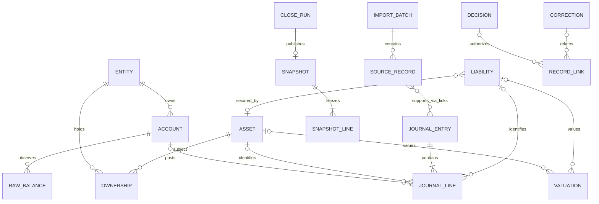

# Architecture proposal — Task A

> **Cập nhật nhập liệu liên tục:** đã bổ sung Tài khoản & biến động, Giao dịch cần xử lý, Công nợ theo người và Báo cáo theo ngày. Không bắt buộc làm theo tháng. Xem [hướng dẫn](runbooks/continuous-accounts.md) và [nghiệm thu](continuous-acceptance.md). Phần mô tả bản thử cũ bên dưới giữ làm lịch sử.


> **Cập nhật phạm vi 28/09/2026:** Thạch giao Codex tự quyết định và hoàn thành sản phẩm cơ bản dùng thử với dữ liệu giả lập. Đã triển khai ứng dụng local theo [quyết định bản thử](product-trial-decisions.md), [hướng dẫn sử dụng](runbooks/product-trial.md) và [nghiệm thu bản thử](product-trial-acceptance.md). Các ràng buộc Sheets-only/no-custom-UI và policy chưa chốt dưới đây thuộc baseline trước yêu cầu mới; chúng không chặn bản thử này. Những yêu cầu về dữ liệu thật/production chưa được coi là hoàn tất.


Cập nhật: 2026-09-26. Baseline tài liệu để chuẩn bị triển khai v0.1 theo yêu cầu của Thạch. Các policy O1–O9 chưa được chốt vẫn là PROPOSED.

Đọc [Product brief](product-brief.md) trước để hiểu core, input/output và trải nghiệm sử dụng; [Implementation readiness](implementation-readiness.md) quy định thứ tự triển khai và các gate dữ liệu thật. Người review sản phẩm không cần biết kế toán; đội triển khai phải giải thích lựa chọn bằng tình huống nghiệp vụ. Không suy ra Thạch là chủ sở hữu tài sản của Dũng hoặc người duyệt tài chính.

## A. Understanding of system

PCMS là sổ quản trị kinh tế toàn tài sản có khả năng truy nguyên từ báo cáo đến chứng từ, qua ledger và quyết định. Dashboard là đầu ra. Owner là người quyết định tài chính; RiDe/ChatGPT phân tích; Codex triển khai mô hình, kiểm soát và công cụ. Hệ thống không đặt lệnh hoặc tự quyết định phân bổ vốn.

v0.1 tập trung inventory, opening balance, balance sheet, dòng tiền và monthly close. Chưa xây frontend, APIs, risk engine, Monte Carlo hoặc tích hợp giao dịch. Kiến trúc phải chứa được bất động sản và phần sở hữu doanh nghiệp ngay từ inventory; analytics chuyên sâu của hai module để sau.

Snapshot crypto khoảng USD 974,535 là thông tin tham khảo chưa xác nhận ngày định giá, phạm vi tài khoản và margin. USDT thiếu cost basis và XRP không reconcile là data-quality issues. Không suy diễn giao dịch, giá vốn hoặc P&L từ snapshot này. Giá trị thị trường đáng tin có thể dùng cho net worth sau đối soát, nhưng không thay thế lịch sử giá vốn.

### Source of truth và dữ liệu có thẩm quyền

| Lớp | Nội dung và thẩm quyền |
|---|---|
| Evidence archive | Statements/CSV/chứng từ gốc; file ID, checksum, thời gian thu thập và quyền truy cập. Dùng chứng minh dữ kiện; không tự quyết định phân loại kinh tế. |
| Raw staging | Bản nhập nguyên trạng, append-only; duplicate/conflict được cách ly, không mặc nhiên vào báo cáo. |
| Accepted ledger | Record chuẩn hóa đã được chấp nhận, liên kết chứng từ và phê duyệt; nguồn tính báo cáo trong phạm vi đã reconcile. Sheets là nơi lưu provisional ở v0.1. |
| Derived metrics | Có thể rebuild từ ledger + policy version + valuation/FX selections; không sửa để ép reconcile. |
| Closed snapshots | Bản báo cáo đã duyệt tại một cutoff; giữ nguyên cả khi có restatement. |
| Analysis | Nhận report có snapshot ID và trạng thái chất lượng. Nhận xét AI không trở thành fact khi chưa qua review. |

Khi statement và tracker mâu thuẫn, mở reconciliation issue; ưu tiên statement đúng phạm vi/thời điểm hoặc on-chain evidence được kiểm chứng. Không chọn nguồn chỉ vì tổng khớp kỳ vọng. CoinMarketCap là monitoring/reference, không làm ledger.

## B. Proposed domain model

### Bounded contexts và aggregate roots

| Boundary | Aggregate root | Thành phần và invariant |
|---|---|---|
| Registry | Entity, Account, Asset, Liability | ID ổn định; thay đổi bằng revision; account có owner entity và capital pool rõ ràng. |
| Evidence / ingestion | ImportBatch | SourceRecords và evidence manifest; source event không được ghi sổ hai lần. |
| Ledger | JournalEntry | Nhiều JournalLines; publish nguyên entry sau validate; không có entry nửa vời. |
| Reconciliation | Reconciliation | So actual balance với ledger ở cùng cutoff; issues, evidence, reviewer. |
| Valuation | ValuationSet | Giá trị tài sản và FX được chọn theo ngày, nguồn, policy; không tự dùng dữ liệu tương lai. |
| Reporting / close | CloseRun | Scope, checks, snapshot header/lines, approval; bản closed bất biến. |
| Governance | Decision | Rationale, người duyệt, liên kết records và policy version; breach dẫn tới review. |

Liability, property và business là economic positions có định danh riêng; không biến một mortgage thành hai khoản nợ ở hai module. Journal dùng mô hình cân đối giản lược với các loại posting asset/liability/equity/income/expense. Đây là ledger quản trị; chưa thay thế sổ thuế hoặc kế toán pháp định.

### Phân biệt quan trọng

- Asset là công cụ/tài sản, Account là nơi giữ; Position là kết quả theo entity + account + asset + capital pool tại ngày báo cáo.
- Capital pool là INVESTMENT, TRADING, OPERATING hoặc RESERVE. Asset class không thay thế capital pool: USDT có thể nằm trong đầu tư hoặc trading.
- Chuyển vốn INVESTMENT → TRADING yêu cầu Decision đã duyệt; chuyển nội bộ không phải income/expense.
- Liabilities được ghi số dư riêng, không dùng negative cash để che borrowing. Margin collateral thuộc tài sản nhưng bị hạn chế thanh khoản; không cộng collateral hai lần. Derivatives cần hợp đồng và valuation phù hợp; v0.1 chưa hỗ trợ thì ghi coverage gap và chặn tuyên bố full reconciliation.
- Ownership có effective dates. Personal business equity không đồng nghĩa toàn bộ cash/revenue của business.
- Master revisions và financial facts đều append-only. Trạng thái hiện tại là projection từ event history, không phải cột bị cập nhật tùy tiện.

## C. Entity relationship overview



Sơ đồ rút gọn; một source record có thể hỗ trợ nhiều entries và một entry có thể dùng nhiều sources thông qua Record_Links. Quan hệ entity/account trên entry phải khớp từng line; transfer giữa entities được biểu diễn bằng entries riêng cùng transfer_group_id để giữ cân đối từng entity.

Mỗi journal entry cần ít nhất hai postings dù ký hiệu ER chỉ diễn đạt một hoặc nhiều. Asset/liability của valuation tuân theo XOR. Record_Links là liên kết tổng quát có kiểm tra loại record, không phải mọi link đều thuộc Decision/Correction. SOURCE_RECORD là khái niệm chung của raw records. Joint accounts và cross-collateral nhiều tài sản cần bảng nối/ownership rules trước khi hỗ trợ; không ép về một owner hoặc một collateral.

### Consolidation và chống double-count

Đề xuất v0.1 dùng **personal economic balance sheet**, lấy phần equity thuộc owner cho property/business. Không cộng xuyên xuống cash và assets của doanh nghiệp đã nằm trong business equity. Full look-through chỉ triển khai sau khi có elimination rules.

`TNW = cash + financial_investments + property_equity_owned + business_equity_owned + other_assets − separately_counted_liabilities`.

Property equity = owned gross market value − owned property debt, theo ownership/debt responsibility được xác nhận. Ownership percentage không tự suy ra trách nhiệm trả nợ. Business valuation phải khai báo gross enterprise value hay equity value; nếu dùng enterprise value, cần bridge cash/debt/other adjustments để ra equity trước khi nhân tỷ lệ sở hữu.

Mỗi liability có treatment đúng một trong: `DEDUCT_SEPARATELY`, `EMBEDDED_IN_PROPERTY_EQUITY`, `EMBEDDED_IN_BUSINESS_EQUITY`, `OUT_OF_SCOPE`. Embedded debt được hiển thị trong debt breakdown nhưng không trừ TNW lần hai. Nếu owner chịu thêm personal debt dùng mua cổ phần thì khoản đó vẫn trừ riêng. Bảo lãnh ghi contingent exposure, không mặc định coi là nợ hiện hữu.

Debt metrics phân biệt nghĩa vụ trực tiếp, cách xử lý embedded trong equity và guarantees. Direct debt và embedded debt có thể là cùng một liability: ví dụ mortgage cá nhân đã trừ trong property equity. Đây là các chiều phân loại, không phải các nhóm độc lập để cộng. Mỗi liability ID chỉ đóng góp một lần vào tổng tương ứng.

Liquid Net Worth: DEFERRED_POLICY, chưa chốt công thức. Phải duyệt liquidity horizon, eligible assets và phạm vi nghĩa vụ được trừ, độc lập với debt treatment trong TNW. Không loại mortgage khỏi LNW chỉ vì đã embedded trong property equity. Tách liquid assets, LNW và nghĩa vụ đến hạn thành các chỉ tiêu khác nhau. Trước khi O6 được duyệt, LNW hiển thị unavailable với lý do; không dùng công thức cũ trừ riêng separately-counted debt. Không mặc định stablecoin bằng bank cash hoặc USD 1.

## D. Google Sheets v0.1 schema

Chi tiết tại [data dictionary](data-dictionary.md). Workbook logic có Registry, Evidence/Raw, Accepted Ledger, Close/Governance và Derived Views. Các tab technical có thể ẩn khỏi operational UI; số tab không phải mục tiêu tối ưu chính.

Tab trong handoff được giữ vai trò: Accounts, Assets, Liabilities, Raw_Transactions, Raw_Balances, Valuations, Monthly_Snapshots, Decision_Log, Corrections, Config là dữ liệu; Cash_Flow, Investments, Dashboard là derived; Real_Estate/Business chứa thuộc tính quản trị liên kết asset, không tạo ledger tài sản thứ hai.

Các bổ sung bắt buộc: Entities, Ownership, Import_Batches, Journal_Entries, Journal_Lines, FX_Rates, Reconciliations, Close_Runs, Snapshot_Lines, Record_Events, Record_Links, Audit_Log. Không dùng row number làm ID, không dùng formulas làm raw facts.

Input vào vùng staging; raw/accepted/closed chỉ custodian được append sau review. Bảo vệ toàn tab, validation và hạn chế editors giúp giảm lỗi nhưng không tạo immutability tuyệt đối. Owner/admin vẫn có thể sửa hoặc xóa. v0.1 cần bản export độc lập, manifest checksum, backup có version và quy trình so sánh thay đổi. Không tuyên bố Sheets có transactional hoặc tamper-proof guarantees.

Multi-row publish dùng publication event cuối cùng: trước event, entry/close chưa xuất hiện trong accepted reports. Đây là quy ước kiểm soát, không phải database transaction. Nếu partial write hoặc concurrent writers xảy ra, quarantine và kiểm tra lại trước publish. v0.1 một designated writer tại một thời điểm.

## E. Future PostgreSQL schema direction

Một logical table tương ứng một technical tab; giữ IDs, FK, enum codes và effective/recorded timestamps. Monetary values dùng decimal, không binary float; raw JSON/text lưu nguyên trạng. Quy định chi tiết types/constraints tại data dictionary.

Sau migration: PostgreSQL là authoritative accepted ledger; evidence archive vẫn giữ độc lập. Sheets input gửi vào staging, không được chỉnh trực tiếp database facts. Runtime role append-only; corrections/restatements qua published events; transaction publish nguyên entry/close; unique constraints chống duplicate, FK và constraints bảo vệ integrity. Audit không chỉ dựa vào app logging. Admin/database owner vẫn là trust boundary cần phân quyền và backup độc lập.

Migration gate: freeze intake → export tất cả rows kể cả superseded/quarantined → verify manifest → import staging → validate IDs/FKs/enums/precision → rebuild projections → so counts, quantities, per-currency balances, close versions và checksum → owner sign-off → chuyển writer → Sheets read-only cho historical facts. Nếu lỗi trước cutover, tiếp tục Sheets; sau cutover mọi writes mới chỉ ở DB, rollback phải có replay log được reconcile. Không dual-write kéo dài.

## F. Audit / correction model

Giữ hai thời gian: `effective_at` là lúc sự kiện kinh tế có hiệu lực; `recorded_at` là lúc hệ thống biết. Report cần chỉ rõ effective cutoff và recorded cutoff để tái tạo cả “as originally reported” và “latest restated”.

1. Import: lưu file manifest và raw row, xác định event key; duplicate không bị xóa, chỉ có rejection event. Missing source ID dùng scoped fingerprint và manual review, không tự gộp hai giao dịch giống hệt nhau.
2. Normalize: entry/lines tham chiếu source; validation và reviewer quyết định publish/reject.
3. Correction: append Correction, reversal với lines đối dấu đầy đủ tham chiếu original, rồi replacement đúng. Một original chỉ có một active reversal; correction chain phải không có cycle.
4. Valuation/master sai: append revision/superseding record, giữ record cũ; báo cáo chọn revision theo cutoff, không cộng cả hai.
5. Closed period sai: append restatement request/approval và snapshot version mới. Snapshot cũ, checksum và publication event giữ nguyên.
6. Audit_Log ghi actor, action, target, recorded_at, reason, evidence và correlation ID. Actor không phải chỉ là tên model; cần người/cơ chế chịu trách nhiệm.

Ví dụ: expense 100 ghi nhầm thành 1,000 → reversal −1,000 và replacement +100 trong cùng correction group. Nếu tháng đã closed, journal sửa mang effective date gốc và recorded date hiện tại; chỉ restated close dùng correction mới. Closed snapshot gốc không đổi. Không vừa ghi adjustment tháng hiện tại vừa sửa kỳ gốc cho cùng sai sót.

Cash transfer 1,000 giữa hai account cá nhân → out/in cùng transfer ID, cash flow consolidated bằng 0. Fee 2 ghi expense riêng. Crypto purchase chuyển cash sang asset; không phải living expense. Loan drawdown tăng cash và debt; principal repayment giảm cả hai; interest là expense. Opening balance đối ứng opening equity, không phải income.

## G. Month-close model

State được suy ra từ events: DRAFT → RECONCILING → READY_FOR_REVIEW → CLOSED; rejected review quay lại bằng event mới. Restatement là close run mới có `restates_snapshot_id`, không reopen hoặc unlock bản closed.

Close theo calendar month trong reporting timezone do owner duyệt. Cutoff dùng đầu tháng sau (exclusive), convert UTC khi lưu. Freeze phạm vi entities/accounts, policy version, valuation/FX selections, source manifest và accepted-record manifest trong close run.

Close checklist:

1. Đủ statements/imports đến cutoff, source coverage rõ.
2. Mọi account/asset reconcile theo quantity và native currency; debt và margin nghĩa vụ được kiểm tra riêng.
3. Transfers matched; fees, FX, duplicate và pending settlements được giải thích.
4. Không còn material unresolved issues; threshold theo asset/native currency do owner duyệt. Không dùng tolerance để hợp thức hóa cost basis giả.
5. Valuations/FX đủ, đúng effective date, policy về độ cũ và confidence. Thiếu giá trị là unknown, không chuyển thành zero.
6. Consolidation không double-count, cash flow reconciliation và metric eligibility pass.
7. Owner review report cùng coverage/issues, approve close; material gaps chặn close. Immaterial exception cần decision có lý do và người duyệt.
8. Append snapshot header/lines cố định, manifest/checksum và CLOSED event cuối; xuất backup, kiểm tra khả năng restore.

M2 có thể chấp nhận opening quantity/value đã reconcile trong khi historical cost basis vẫn unknown; khi đó performance/capital gains tiếp tục bị khóa. Net worth toàn hệ chỉ có khi toàn bộ phạm vi tài sản/nợ đã reconcile. Dashboard trước đó chỉ hiển thị incomplete coverage.

Snapshot giữ số gốc, tỷ giá, base value, net-worth contribution, liquidity contribution, debt treatment, source IDs và formula/policy version. Rebuild từ frozen inputs phải khớp trong rounding policy; restatement hiển thị old/new/delta/reason/approval.

## H. Repo structure

Repo đã có local synthetic pilot trong src/pcms, tests và schema; chưa có workbook hoặc database production. Event files chỉ là harness kiểm chứng logic trước Sheets adapter, không đổi source-of-truth đích. Chi tiết phạm vi tại schema/README.md và runbook local-pilot. Production activation theo gates trong implementation-readiness. Cấu trúc đích:

```text
PCMS/
  README.md
  docs/
    architecture.md
    data-dictionary.md
    milestones.md
    adr-register.md
    runbooks/             # import, reconcile, close, restore
    adr/                  # mỗi ADR được duyệt thành file riêng
  schema/                 # schema machine-readable, enums, versions
  templates/              # workbook template rỗng
  src/
    ingestion/
    ledger/
    reconciliation/
    metrics/
    reporting/
  tests/fixtures/         # dữ liệu synthetic, không phải tài chính thực
  migrations/             # chỉ khi chuyển DB
```

Data/evidence/backups thật ở kho private ngoài repo. Không lưu secrets, account credentials, private keys hay seed phrases. AI chỉ nhận dữ liệu cần thiết cho review, ưu tiên account aliases.

## I. M0–M3 implementation plan

Xem [milestones](milestones.md) cho task IDs và acceptance gates. Tuần 1–3 là định hướng, phụ thuộc completeness của chứng từ và thời gian owner review; không cam kết tự reconcile khi thiếu evidence.

## J. Open decisions requiring owner approval

Cập nhật 28/09/2026: Dũng là người duyệt số liệu theo xác nhận trong trao đổi. Việc chỉ định người duyệt không đồng nghĩa các số dư, phân loại hoặc close đã được Dũng duyệt.

| ID | Đề xuất để duyệt | Vì sao cần owner |
|---|---|---|
| O1 | Đã chốt giữ đơn vị gốc từng tài khoản (VND/USDT); tổng hợp USDT là hướng tương lai. Timezone và nguồn/ngày FX chưa chốt. | Không tự quy đổi hoặc giả định USDT bằng USD. |
| O2 | Chọn ngày opening và calendar month close | Không suy ra ngày opening từ ngày handoff. |
| O3 | Personal perimeter; business equity thay vì full consolidation; xác nhận co-ownership | Quyết định tài sản/nợ nào thuộc scope và nghĩa vụ thực tế. |
| O4 | Sheet provisional, evidence archive và backup ở nơi owner kiểm soát; chỉ định custodian/reviewer | Phân quyền, privacy, writer discipline. |
| O5 | Cash-flow basis cho income/spending v0.1; capital flows riêng | Cần thống nhất cách xử lý credit cards, owner contribution/distribution và tax. |
| O6 | Duyệt liquidity eligibility/horizon, stablecoin treatment, debt denominator | Quyết định ý nghĩa LNW, runway, leverage. |
| O7 | Nguồn giá/FX, valuation frequency, staleness và tolerance | Không dùng mặc định ngầm khi định giá tài sản khó thanh khoản. |
| O8 | Approve close/restatement bằng Decision; material unresolved issues chặn close | Quyền ký, materiality và late-arrival policy. |
| O9 | Phân tách INVESTMENT/TRADING; chuyển vốn có decision | Chưa có allocation bands hoặc hard limits được phê duyệt. |

### Assumptions và risks

- Một owner vận hành và khối lượng dữ liệu phù hợp manual import trong v0.1; cần xác nhận số accounts, transactions/tháng và collaborators.
- Không có approved tax-lot method, risk limit hoặc benchmark; chưa tính tax/performance analytics.
- Thiếu lịch sử có thể không khôi phục cost basis được: giữ unknown, không backfill bằng current price.
- Sheets có edit/concurrency/precision risks: text decimals, publication manifests, single writer, independent backups; đây là residual risk owner cần biết khi chọn provisional ledger.
- Private assets có valuation uncertainty; report kèm age/method/coverage, không biểu diễn ước tính như giá giao dịch chắc chắn.
- Margin/cross-collateral và business ownership có thể gây gross/net nhầm lẫn; M1 cần contracts/statements trước khi M2 đạt gate.
- Historical policy changes cần versioning để không tái viết cash flow hoặc allocation history.
- Đây là thiết kế hệ thống quản trị theo handoff, không xác nhận số dư, định giá thị trường hoặc quy tắc thuế/pháp lý hiện hành.

## K. AI analysis boundary

[AI analysis contract](ai-analysis-contract.md) tách calculation engine, approved policy checks và AI reasoning. AI đọc report có provenance và quality flags, không tự ghi ledger, thay công thức, duyệt policy hoặc giao dịch. Mọi con số kiểm chứng bằng deterministic engine; nhận định phải phân biệt fact, policy breach, scenario và suggestion. AI không phải dependency để v0.1 xuất báo cáo và đóng kỳ.
