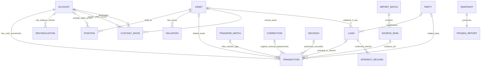

# PCMS — Domain model

Cập nhật: **29/09/2026**. Phạm vi: ứng dụng dùng thử đang triển khai trong `src/pcms/product.py` và `src/pcms/continuous.py`.

Tài liệu này giải thích các đối tượng nghiệp vụ, quan hệ, cách dữ liệu thay đổi và khác biệt giữa mô hình hiện tại với hướng hoàn thiện. Đây không phải thiết kế database đã triển khai, cũng không xác nhận số liệu tài chính thật.

Tài liệu đi kèm: [Use cases](use-cases.md) mô tả các thao tác, ngoại lệ và cách nghiệm thu.

## 1. Sản phẩm quản lý điều gì?

**PCMS quản lý tiền, tài sản và công nợ thông qua lịch sử giao dịch của từng tài khoản.** Người dùng nhập và phân loại bất cứ lúc nào; hệ thống kiểm tra, tính số dư, giữ dấu vết và tổng hợp báo cáo theo ngày tùy chọn.

Sáu câu hỏi chính:

| Câu hỏi | Khái niệm nghiệp vụ |
|---|---|
| Của ai? | Chủ sở hữu — Entity |
| Nằm ở đâu? | Tài khoản — Account |
| Đang giữ gì và bao nhiêu? | Tài sản — Asset; vị thế tại tài khoản — Position |
| Vì sao số dư thay đổi? | Giao dịch — Transaction |
| Giao dịch hoặc vay nợ với ai? | Bên liên quan — Party |
| Còn nợ / được nợ theo món nào? | Khoản vay — Loan |

Ví dụ minh họa: Thạch là chủ sở hữu; hai ngân hàng và hai sàn là bốn tài khoản. BTC là tài sản. BTC ở Sàn 1 và BTC ở Sàn 2 là hai vị thế của cùng tài sản. Người A là bên liên quan; A01 và A02 là hai khoản vay với A.

**Không đồng nhất:** tài khoản với tài sản; người gửi tiền với người chịu nợ; tiền vào với thu nhập; tiền ra với chi phí; tăng giá với tăng số lượng tài sản.

## 2. Ba lớp cần phân biệt

| Lớp | Ý nghĩa | Trạng thái |
|---|---|---|
| Mô hình nghiệp vụ | Các khái niệm người dùng cần: chủ sở hữu, tài khoản, giao dịch, công nợ… | Được mô tả trong tài liệu này |
| Mô hình bản thử hiện tại | Danh sách đối tượng trong trạng thái ứng dụng, cùng các phép tính báo cáo | Đã có trong `product.py`, `continuous.py` |
| Thiết kế ledger dài hạn | Entity, Ownership, Journal Entry/Line, versioned FX, Close Run… | Baseline thiết kế; một phần có trong pilot riêng, chưa là lõi đầy đủ của giao diện hiện tại |

[Data dictionary](data-dictionary.md) và [architecture](architecture.md) có phạm vi rộng hơn bản thử. Không được suy từ tên bảng trong các tài liệu đó rằng chức năng tương ứng đã triển khai trong ứng dụng.

## 3. Sơ đồ các đối tượng hiện tại

Sơ đồ dưới đây dùng tên nghiệp vụ dễ đọc. `LOAN` được lưu trong danh sách `liabilities`; `POSITION` là kết quả tính, không phải bảng lưu riêng. Các liên kết tùy chọn cho phép giữ dữ liệu mẫu/cũ chưa gắn đầy đủ.

Một Transaction chuyển trực tiếp có tài khoản nguồn và tài khoản nhận. Sơ đồ rút gọn thành quan hệ Account–Transaction; không có nghĩa mỗi giao dịch chỉ ảnh hưởng một tài khoản. Một nhóm ghép chuyển liên kết hai đầu nguồn và các bản thay thế tương ứng.

Chủ sở hữu hiện được ghi bằng chữ trên Account; chưa vẽ Entity như một đối tượng có ID đã triển khai.

## 4. Các đối tượng cốt lõi

### 4.1. Entity — Chủ sở hữu

**Ý nghĩa:** cá nhân hoặc pháp nhân sở hữu tài khoản và tài sản. Ví dụ: Thạch; Công ty X. Chủ sở hữu công ty và chính công ty là hai chủ thể khác nhau.

**Hiện tại:** tài khoản mới có `owner` là chuỗi tên. Chưa có danh mục `entities`, `entity_id`, quan hệ sở hữu nhiều chủ thể hoặc kiểm soát chuyển tiền giữa pháp nhân.

**Hướng hoàn thiện:** Entity có ID, tên và loại cá nhân/pháp nhân; Account tham chiếu `owner_entity_id`; quyền sở hữu tài sản được quản lý theo từng chủ thể và thời gian. Đây là hướng thiết kế, chưa phải chức năng đã có.

### 4.2. Account — Tài khoản

**Ý nghĩa:** nơi giữ tiền hoặc tài sản, chẳng hạn Tech-54, ngân hàng thứ hai, tài khoản Sàn 1, Sàn 2.

| Thuộc tính hiện tại | Ý nghĩa |
|---|---|
| `id`, `name` | Mã ổn định và tên gợi nhớ |
| `owner` | Tên chủ sở hữu; dữ liệu mẫu cũ có thể chưa có |
| `type` | BANK hoặc EXCHANGE; dữ liệu mẫu cũ có thể suy ra khi hiển thị |
| `currency` | Đồng tiền thanh toán chính: VND, USD hoặc USDT |
| `opening`, `effective_date` | Số dư tại đầu ngày bắt đầu theo dõi |
| `opening_source` | Nguồn xác nhận số dư đầu |
| `pool` | Nhóm vốn/mục đích tài khoản, giải thích riêng ở mục 7 |

Một tài khoản hiện có một số dư tiền thanh toán chính và có thể giữ nhiều vị thế tài sản. Chưa có mô hình nhiều ví tiền tệ con trong cùng một tài khoản sàn.

Số dư hiện tại là kết quả tính từ số dư đầu và các giao dịch, không phải một ô số dư được sửa tùy ý. Số dư đầu là mốc mở phạm vi theo dõi, không phải thu nhập mới.

### 4.3. Asset và Position — Tài sản và nơi giữ

**Asset** mô tả tài sản: BĐS, phần vốn doanh nghiệp, cổ phiếu hoặc crypto. Trường chính: `id`, `name`, `class`, `currency`, `quantity`, `price`, `ownership`, `liquid`, `detail`; tài sản thêm mới có ngày hiệu lực.

**Position** trả lời: tài khoản nào giữ bao nhiêu đơn vị của tài sản nào. Hiện tính thành `report.holdings` với `account`, `asset`, `quantity`, từ số lượng đầu, mua/bán và chuyển nơi giữ.

- Cùng BTC tại hai sàn: hai vị thế, một tài sản để tổng hợp.
- Tài sản chưa xác nhận nơi giữ nằm ở `UNASSIGNED`; hệ thống không tự đoán sàn.
- `CustodyMove` ghi chuyển số lượng từ nơi giữ cũ sang nơi giữ mới, có ngày và căn cứ; không tạo giao dịch mua/bán hay tăng tổng số lượng.
- BĐS/doanh nghiệp có thể thuộc sở hữu trực tiếp, không bắt buộc nằm trong tài khoản sàn.
- `ownership` hiện là một tỷ lệ trên Asset, chưa phải danh sách nhiều người đồng sở hữu có ngày hiệu lực.

**Valuation** lưu giá tại một ngày và nguồn định giá. Tăng giá làm tăng giá trị quy đổi, không làm tăng số lượng đang giữ. Doanh nghiệp mẫu dùng giá trị vốn chủ sở hữu; tiền/nợ bên trong không cộng/trừ lần nữa vào tài sản cá nhân.

### 4.4. Transaction — Giao dịch hoặc phần nghiệp vụ

**Ý nghĩa:** một biến động tiền/tài sản có ngày, tài khoản, số tiền và bản chất nghiệp vụ. Một dòng bank có thể được phân loại thành nhiều Transaction, ví dụ phần gốc và phần lãi.

Trường chính:

- `id`, `date`, `account`, `amount`, `currency`, `fee`, `description`, `kind`.
- Tùy nghiệp vụ: `to_account`, `received_amount`, `asset`, `quantity`, `custody_account`, `liability`, `party`, `component`, `group`, `decision`.
- Truy nguồn: `source`, `source_batch`, `source_row_id`, `source_reference` khi có.
- Sửa/phân loại: `direction`, `correction_of`, thứ tự ghi và thứ tự nghiệp vụ khi có.

| Nhóm nghiệp vụ | Mã hiện tại | Tác động chính |
|---|---|---|
| Thu / chi | `income`, `expense` | Tiền và thu/chi thay đổi |
| Chưa rõ | `unclassified_in`, `unclassified_out` | Tiền thay đổi; chưa tính là thu nhập/chi phí |
| Chuyển trực tiếp | `transfer` | Chuyển giữa hai tài khoản; có số thực nhận nếu khác tiền tệ |
| Hai đầu chuyển đã ghép | `transfer_out`, `transfer_in` | Giữ ngày và số tiền của từng đầu nguồn |
| Mua / bán | `buy`, `sell` | Tiền và số lượng tài sản thay đổi ngược chiều |
| Mình đi vay / trả gốc | `borrow`, `repay` | Tiền và dư nợ vay thay đổi |
| Mình cho vay / thu gốc | `lend`, `collect` | Tiền và khoản phải thu thay đổi |

Lãi đã thu/trả dùng `income`/`expense`, gắn khoản vay và `component=interest`. Phí có thể gắn giao dịch nhập tay; khi phí là dòng riêng trên nguồn phải tránh ghi thêm lần nữa.

Chưa có một danh mục category/subcategory đầy đủ cho sinh hoạt, học phí, du lịch… `kind` hiện là phân loại nghiệp vụ chính, còn nội dung chi tiết nằm trong mô tả và các liên kết.

### 4.5. Party — Bên liên quan

**Ý nghĩa:** người hoặc tổ chức liên quan đến giao dịch hay công nợ, có `id`, `name`, `note`.

Một Party có thể là đối tác trong nhiều giao dịch và nhiều khoản vay. Party là vai trò đối tác; không mặc định là chủ sở hữu tài khoản của mình.

Tên người chuyển trong sao kê chỉ là thông tin nguồn. Người chịu khoản nợ được xác nhận riêng vì có thể chuyển hộ. Hiện chưa có hồ sơ người chuyển hộ hay quan hệ đại diện riêng biệt.

### 4.6. Loan — Khoản vay / khoản phải thu

**Ý nghĩa:** một món hoặc thỏa thuận vay, có thể giải ngân và thanh toán nhiều lần qua nhiều tài khoản.

Hiện lưu chung trong `state.liabilities`, phân biệt bằng:

- `loan_direction=BORROWED`: mình đi vay, là nợ phải trả.
- `loan_direction=LENT`: mình cho vay, là tài sản phải thu.

Thuộc tính chính: `id`, `name`, `party`, `currency`, `opening`, `effective_date`, `due`, `annual_rate`, `terms`, `opening_source`; khoản nợ bảo đảm có thể có `asset_id`. Khoản nợ cũ chưa có chiều vay được hiểu là BORROWED, chưa gắn Party thì hiển thị chờ xác định.

Mỗi giao dịch có thể gắn một khoản vay; một lần chuyển trả nhiều khoản phải được chia thành các phần nghiệp vụ. Tài khoản nhận/trả tiền không quyết định ai là chủ nợ.

**InterestRecord** là số lãi phát sinh đã xác nhận, có khoản vay, ngày, tiền và căn cứ. Không tạo tiền vào/ra. Lãi còn phải trả/thu được đối chiếu với các giao dịch đã thanh toán lãi. Chưa có công cụ tự tính lãi theo ngày, lãi phạt, lãi kép hoặc lịch trả góp đầy đủ.

## 5. Các đối tượng nguồn, kiểm tra và lịch sử

| Đối tượng | Vai trò | Nơi lưu hiện tại |
|---|---|---|
| ImportBatch | File nhập, nội dung gốc, hash, lỗi và mapping tài khoản | `imports[]`, gồm `raw_base64`, `sha256`, `issues` |
| SourceRow | Dòng trích từ nguồn, ngày, chiều tiền, số tiền, tham chiếu, số dư nguồn nếu có | `imports[].rows[]`; có payload nguồn ở luồng nhập mới |
| TransferMatch | Liên kết hai đầu chuyển, nguyên tệ, số tiền, ngày và căn cứ | `transfer_matches[]` |
| Reconciliation | Số dư nguồn tại ngày đối chiếu, tài khoản và dấu nhận biết bộ giao dịch | `reconciliations[]`; chênh lệch được tính khi xem |
| Correction | Gốc, bản đảo, bản thay thế hoặc nhóm phân loại, lý do | `corrections[]` và các Transaction liên quan |
| Decision | Đề xuất REVIEW/CAPITAL, lý do, trạng thái duyệt, dấu thực thi | `decisions[]` |
| Policy và rates | Ngưỡng review và tỷ giá mẫu dùng cho báo cáo | `policy`, `rates`, `rate_note` trong trạng thái |
| Snapshot | Báo cáo đóng băng, phiên bản, bản được điều chỉnh, ghi chú; close mới giữ policy/rates | `snapshots[]` |
| Audit | Ai trong vai trò mô phỏng thao tác gì và khi nào | `audit[]` |
| State event | Một lần lưu toàn bộ trạng thái, nối checksum với lần trước | Các file phiên bản JSON trong thư mục dữ liệu |

Một source row không nhất thiết sinh giao dịch: có thể đang chờ, bị bỏ qua có lý do hoặc được liên kết với giao dịch đã có. Một giao dịch có thể có nhiều chứng từ trùng được liên kết qua các source row. Phân loại tách khoản tạo nhiều phần nghiệp vụ cùng truy về nguồn ban đầu.

**Phạm vi vai trò:** người duyệt Dũng hiện là vai trò mô phỏng; chưa có đăng nhập/phân quyền để chứng minh người thao tác thực sự là Dũng.

## 6. Quy tắc nghiệp vụ đang áp dụng

1. **Nhập liên tục:** không cần chọn tháng hoặc đóng kỳ trước khi ghi nhận giao dịch. Ngày giao dịch không được trước mốc số dư đầu của tài khoản liên quan.
2. **Giữ nguyên nguồn:** sửa nghiệp vụ không sửa file sao kê gốc.
3. **Không ghi trùng:** file y hệt bị chặn; dòng tương tự giữa các file cần người dùng xác nhận trùng hay khác. Không tự bỏ chỉ vì cùng ngày/số tiền.
4. **Ghi tiền và phân loại là hai việc:** chưa rõ nghiệp vụ vẫn theo dõi được số dư; báo cáo có giao dịch chưa rõ là tạm tính.
5. **Tách khoản phải khớp:** tổng các phần bằng số tiền nguồn. Trả gốc giảm nợ, trả lãi là chi phí; thu hồi gốc giảm phải thu, thu lãi là thu nhập.
6. **Chuyển nội bộ không là thu nhập:** ghép giữ nguyên hai đầu. Khác tiền tệ dùng số thực nhận. Khoảng giữa ngày gửi/nhận của chuyển đã ghép được theo dõi là tiền đang chuyển.
7. **Tiền và tài sản theo nơi giữ:** không bán/chuyển vượt số lượng tại tài khoản trong luồng liên tục. Tài sản chưa rõ nơi giữ cần xác nhận trước khi sử dụng vị thế tại sàn.
8. **Không trả vượt gốc:** gốc phải trả/phải thu không âm; các mốc ngày bị ảnh hưởng được kiểm tra, kể cả giao dịch nhập lùi ngày. Bản thử không hỗ trợ thấu chi.
9. **Giữ lịch sử sửa:** bản gốc vẫn lưu, thêm đảo/thay thế. Lịch sử tài khoản mặc định dùng các dòng có hiệu lực để không làm phình tổng vào/ra; truy vết cho xem bản cũ.
10. **Nợ vay và phải thu tách riêng:** tổng theo người và nguyên tệ; không bù trừ ngầm hai chiều.
11. **Định giá không tạo giao dịch:** số lượng, giá trị thị trường và giá vốn là các khái niệm riêng. Bản thử chưa có đầy đủ giá vốn/lợi suất.
12. **Close tùy chọn:** xem báo cáo không cần close. Lưu báo cáo đóng băng cần đạt kiểm tra đối soát, nguồn và phân loại; sửa sau đó tạo bản điều chỉnh thay vì ghi đè.

Các quy tắc là kiểm soát trong mã ứng dụng; không phải toàn bộ ràng buộc database và không thay thế kiểm chứng nguồn ngoài hệ thống.

## 7. “Mục đích” nằm ở đâu trong domain model?

**Quyết định mới đã chốt ngày 29/09/2026:** bỏ lựa chọn Mục đích khỏi UC-01, không thay bằng dropdown bắt chọn “Dùng chung”. Import và xử lý trùng gộp tại hồ sơ tài khoản; lịch sử mặc định từ ngày tracking đến hiện tại. Xem [Use cases v1.1](use-cases.md). Phần sau mô tả mã hiện tại và khoảng cách cần cập nhật, không phải yêu cầu giữ trường này.

**Hiện tại:** là `Account.pool`, gồm OPERATING/RESERVE/INVESTMENT/TRADING, hiển thị Chi tiêu/Dự phòng/Đầu tư/Trading.

Nó không phải:

- Loại tài khoản: ngân hàng hay sàn.
- Loại nghiệp vụ của từng giao dịch: thu, chi, vay, chuyển…
- Người liên quan hoặc khoản vay.

Nó đang có tác dụng: cộng số dư RESERVE vào quỹ dự phòng và kiểm soát luồng chuyển tiền INVESTMENT → TRADING bằng quyết định được duyệt. Vì vậy chưa thể coi đây chỉ là một nhãn trang trí.

**Điểm không khớp nhu cầu vừa trao đổi:** một bank như Tech-54 có thể đồng thời nhận lương, nhận tiền vay, trả nợ và đầu tư. Bắt tài khoản chỉ thuộc một mục đích dễ gây hiểu nhầm giữa nơi giữ tiền và cách phân bổ vốn.

**Hướng cập nhật theo yêu cầu mới, chưa triển khai vào mã trong lần sửa tài liệu:**

- Bỏ trường Mục đích trong khai báo tài khoản. Không yêu cầu người dùng chọn “Dùng chung” hoặc tự suy ra phân loại giao dịch từ tài khoản.
- Nếu cần quản lý ngân sách/quỹ thực sự, tạo khái niệm CapitalPool riêng và quan hệ phân bổ số tiền/tài sản từ tài khoản vào quỹ.
- Một tài khoản có thể góp vào nhiều quỹ; một quỹ có thể ở nhiều tài khoản. Phân bổ phải theo ngày, không cộng trùng tổng tiền.
- Chỉ phần vốn thực sự thuộc quỹ mới được tính là dự phòng/Trading. Cần điều chỉnh đồng thời công thức dự phòng và quy tắc duyệt, không chỉ thêm lựa chọn vào giao diện.

## 8. Ví dụ đi xuyên mô hình

### Nhận vay qua người chuyển hộ

Thạch nhận 100 triệu tại Bank 1 từ B, nhưng xác nhận đây là A cho vay theo A01:

1. ImportBatch và SourceRow giữ nguyên tên B, mã chuyển và số tiền.
2. Transaction cập nhật Bank 1 tăng 100 triệu, ban đầu có thể là chưa phân loại.
3. Khi xác nhận, giao dịch được phân loại `borrow`, gắn Loan A01; Loan A01 có Party A.
4. Báo cáo: tiền tăng 100 triệu và nợ A01 tăng 100 triệu; không ghi thu nhập. Không đổi tên B trên nguồn thành A.

### Trả 55 triệu gồm gốc và lãi

Một SourceRow tiền ra 55 triệu từ Bank 2 được chia thành:

- Transaction `repay`: 50 triệu, Loan A01.
- Transaction `expense`: 5 triệu, Loan A01, `component=interest`.

Bank 2 giảm tổng 55 triệu, nợ A01 giảm 50 triệu, chi phí lãi tăng 5 triệu. Không nhập thêm một lần thanh toán ngoài các phần đã phân loại.

### Chuyển USDT giữa hai sàn

Đầu ra ở Sàn 1 và đầu nhận ở Sàn 2 được giữ theo ngày thực tế, rồi gắn TransferMatch. Không tạo thu nhập từ đầu nhận. Nếu chuyển BTC/ETH đang giữ, dùng CustodyMove theo số lượng tài sản; khác với chuyển tiền thanh toán USDT. Phí trừ bằng coin và giao dịch swap phức tạp chưa là luồng hoàn chỉnh.

## 9. Báo cáo nào là kết quả tính?

Không nhập riêng các con số sau để làm chúng “khớp”:

- Số dư tài khoản và lịch sử sau từng giao dịch.
- Số lượng tài sản tại từng nơi giữ.
- Dư gốc từng khoản, tổng theo người và tổng nguyên tệ.
- Thu, chi trong khoảng ngày; tiền đang chuyển.
- Giá trị tài sản, tài sản ròng, cảnh báo theo policy.

Chúng được tính từ dữ liệu nguồn đã ghi nhận, số dư đầu, giao dịch có hiệu lực, định giá và các tham số. Riêng Snapshot là bản kết quả đã đóng băng. Tỷ giá bản thử vẫn là tỷ giá giả lập cố định, không phải giá thị trường hay FX theo ngày.

## 10. Cách lưu thực tế và đường dẫn trong dự án

Ứng dụng hiện **chưa dùng PostgreSQL hay một bộ bảng Google Sheets làm database chính**. Mỗi thao tác hợp lệ lưu một file JSON chứa toàn bộ trạng thái mới, nối với phiên bản trước bằng checksum. Đối tượng trong trạng thái mới có thể mang trạng thái cập nhật; bản trạng thái cũ vẫn tồn tại. Đây không phải cơ chế chỉ lưu từng domain event nhỏ hay master revision đầy đủ như thiết kế dài hạn.

| Nguồn trong dự án | Vai trò |
|---|---|
| [product.py](../src/pcms/product.py) | Giao dịch, tính tài sản/dòng tiền, quyết định, close, lưu phiên bản và restore |
| [continuous.py](../src/pcms/continuous.py) | Tài khoản, công nợ, nguồn nhập, phân loại, ghép chuyển, lịch sử số dư |
| [product_seed.py](../src/pcms/product_seed.py) | Bộ dữ liệu mẫu; không phải dữ liệu thật của người dùng |
| [core.py](../src/pcms/core.py) | Ledger pilot riêng; không đồng nghĩa giao diện hiện tại đã dùng đầy đủ Journal Entry/Line |
| `private-data/product-demo/` | Trạng thái và lịch sử bản đang dùng; bị loại khỏi Git |
| `private-data/backups/` | Các bản sao lưu được tạo trong quá trình cập nhật |
| [product-trial-decisions.md](product-trial-decisions.md) | Quyết định thiết kế và thay đổi phạm vi bản thử |
| [revision-history.md](revision-history.md) | Lịch sử thay đổi dự án |
| [continuous-acceptance.md](continuous-acceptance.md) | Mốc nghiệm thu luồng liên tục |

Checksum giúp phát hiện dữ liệu bị thay đổi ngoài ý muốn; không phải chữ ký xác thực người dùng hoặc biện pháp chống người có quyền sửa toàn bộ file và tính lại checksum.

## 11. Khoảng cách giữa hiện tại và mô hình hoàn chỉnh

| Khái niệm | Hiện tại | Hướng hoàn thiện |
|---|---|---|
| Entity | Tên owner trên Account | Danh mục chủ thể có ID, phạm vi và quyền sở hữu |
| Ownership | Một tỷ lệ trên Asset | Quan hệ Entity–Asset theo thời gian, có bằng chứng |
| CapitalPool | Một giá trị bắt buộc trên Account mới | Dùng chung/tùy chọn; phân bổ vốn riêng nếu cần |
| Position / Balance | Tiền thanh toán chính + vị thế tài sản tính ra | Nhiều ví/đơn vị trong tài khoản và quan sát số dư từng tài sản |
| Transaction | Dòng nghiệp vụ và liên kết nhóm | Entry/Line đa chân, tách nguồn tiền với phân bổ nghiệp vụ rõ hơn |
| Category | `kind`, mô tả và các liên kết | Danh mục chi tiết, quy tắc gợi ý và phiên bản phân loại |
| Loan | Đi vay/cho vay chung trong `liabilities` | Tên miền rõ hơn, lịch trả, điều khoản có phiên bản, công cụ tính lãi |
| Reconciliation | Chủ yếu số dư tiền theo tài khoản | Kiểm tra đầy đủ số lượng, phí, dư nợ, khoảng thiếu dữ liệu và xử lý vấn đề |
| FX và Policy | Tham số trong trạng thái; close mới giữ bản sao | Nguồn/tỷ giá theo ngày, policy có hiệu lực và duyệt rõ ràng |
| Approval / Audit | Một người dùng, vai trò mô phỏng | Danh tính, phân quyền và phê duyệt thực |

Các mục “hướng hoàn thiện” là backlog đề xuất, không phải công việc tự động hoàn thành bởi tài liệu này. Tài liệu này không thay đổi dữ liệu hay hành vi ứng dụng.

## 12. Bổ sung mô hình cho tracking và sao kê hợp nhất — yêu cầu mới

- **Tracking baseline:** mốc ngày và số dư đầu được xác nhận của từng tài khoản. Lịch sử đã có là nền cho mọi lần nhập tiếp theo, không đặt lại từ file mới nhất. `effective_date`, `opening`, `opening_source` đang là các trường gần tương ứng.
- **Import trong phạm vi tài khoản:** chọn Account trước, đối chiếu cả lịch sử cũ, nguồn nhập và giao dịch nhập tay. Xử lý trùng/xung đột là một phần của import, không là một nghiệp vụ tách màn hình.
- **Giao dịch sao kê hợp nhất:** một phát sinh nguồn đã xác nhận có thể được chứng minh bởi nhiều SourceRow từ các file chồng kỳ. Một phát sinh đó có thể được chia nhiều phần nghiệp vụ mà lịch sử sao kê vẫn chỉ hiện một dòng kinh tế. Đây là phân biệt cần làm rõ trong cách hiển thị/liên kết, không tuyên bố đã có bảng riêng.
- **Độ bao phủ nguồn:** cần thể hiện khoảng ngày có chứng từ/đã đối chiếu, ngày nguồn gần nhất, phần còn thiếu hoặc chưa xác nhận. Một ngày không có giao dịch hoặc ngày giao dịch cuối không chứng minh nguồn đã bao phủ hết khoảng đó.
- **Hai lớp thời gian:** ngày hiện tại dùng cho phạm vi mặc định “tracking → hôm nay”; ngày xem báo cáo là lựa chọn khác. Không dùng ngày giả lập cố định của dashboard thay ngày hiện tại cho lịch sử sao kê.

Những mục này bổ sung yêu cầu sau phiên bản mô hình ban đầu; cần triển khai và kiểm tra theo mục 8 của tài liệu use case.
