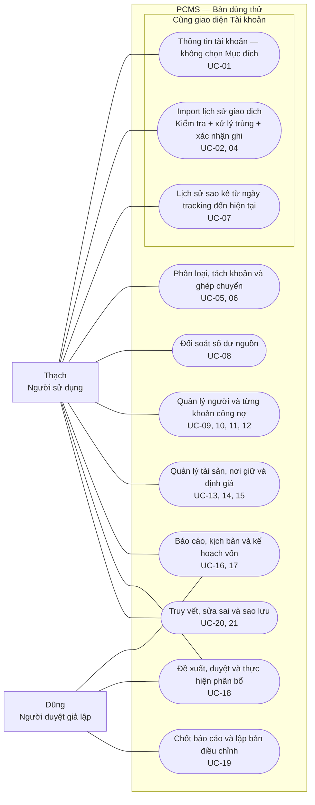

# PCMS — Tài liệu use case

**Phiên bản:** 1.1 · **Ngày:** 29/09/2026 · **Phạm vi:** bản dùng thử và yêu cầu cập nhật đã chốt.

Tài liệu dành cho Thạch hiểu sản phẩm và nghiệm thu bằng thao tác thực tế. Đối chiếu với [domain model](domain-model.md), [hướng dẫn sử dụng liên tục](runbooks/continuous-accounts.md) và mã nguồn hiện tại. Các ví dụ đều là giả lập.

## 1. Mục tiêu và ranh giới

Người dùng quản lý tài khoản, tài sản và công nợ bằng lịch sử giao dịch có nguồn. Có thể nhập và phân loại bất cứ lúc nào; xem báo cáo theo khoảng ngày tùy chọn. **Không bắt buộc chọn tháng hoặc chốt kỳ trước khi làm việc.**

**Thay đổi đã chốt:** UC-01 bỏ trường Mục đích; UC-03 được gộp vào UC-02; khai báo tài khoản, import/xử lý trùng và xem lịch sử sao kê nằm trong cùng giao diện tài khoản. UC-07 bổ sung toàn bộ lịch sử sao kê từ ngày tracking đến hiện tại.

**Trạng thái triển khai:** UC-01, UC-02 và UC-07 bên dưới là đặc tả mới cần cập nhật ứng dụng, chưa được coi là đã chạy đầy đủ. Các use case khác giữ mô tả bản thử, trừ những liên kết giao diện được nêu rõ. Lần cập nhật này thay tài liệu, không thay mã chạy hay dữ liệu.

Có **20 use case hoạt động**. Mã UC-03 được giữ trong lịch sử là “đã gộp vào UC-02”; không đánh lại các mã còn lại để tránh mất tham chiếu. Không coi tài liệu này là xác nhận phần mềm đã dùng được cho tài chính thật hoặc thay cho nghiệm thu của người dùng.

### Tác nhân

| Tác nhân | Vai trò |
|---|---|
| Người sử dụng — Thạch | Khai báo, nhập nguồn, xác nhận nghiệp vụ, quản lý tài khoản/công nợ, xem báo cáo |
| Người duyệt — Dũng, vai trò giả lập | Duyệt quyết định phân bổ và chốt báo cáo trong bản thử |

Hiện một người tại máy có thể đóng cả hai vai; chưa có đăng nhập, phân quyền hay chữ ký xác thực Dũng. Ngân hàng/sàn **không phải tác nhân kết nối trực tiếp** trong bản này: người dùng tải file bên ngoài rồi đưa vào PCMS. Người cho vay/người vay là dữ liệu bên liên quan, chưa đăng nhập vào hệ thống.

### Cách đọc

- **Điều kiện:** thông tin cần có trước khi bắt đầu.
- **Luồng chính:** việc người dùng và hệ thống thực hiện.
- **Ngoại lệ:** dữ liệu thiếu/sai hoặc trường hợp chưa hỗ trợ.
- **Kết quả:** thay đổi được lưu hoặc báo cáo được hiển thị.
- **Nghiệm thu:** một cách kiểm chứng cụ thể; là tiêu chí để thử, không phải khẳng định mọi tình huống đã chạy tự động.

## 2. Sơ đồ use case tổng quan

Đường nối cho biết tác nhân sử dụng nhóm chức năng nào, **không biểu diễn thứ tự xử lý**. Mỗi hình bầu dục gom một nhóm use case để dễ đọc; danh sách chi tiết ở mục 3.



## 3. Danh mục use case

| Mã | Mục tiêu người dùng | Màn hình chính |
|---|---|---|
| UC-01 | Khai báo tài khoản, ngày tracking và số dư đầu; không có Mục đích | Tài khoản → Thông tin tài khoản |
| UC-02 | Import lịch sử, kiểm tra và xử lý trùng ngay khi nhập — đã gộp UC-03 | Tài khoản → Import lịch sử giao dịch |
| UC-04 | Ghi nhận tiền trước, hoặc nhập giao dịch đã rõ | Tài khoản → Import lịch sử giao dịch / + Giao dịch |
| UC-05 | Phân loại, tách khoản, phân loại lại | Giao dịch cần xử lý / Truy vết |
| UC-06 | Ghép hai đầu chuyển nội bộ | Giao dịch cần xử lý |
| UC-07 | Xem toàn bộ sao kê từ ngày tracking đến hiện tại và lịch sử số dư | Tài khoản → Lịch sử sao kê |
| UC-08 | Đối soát với số dư nguồn | Tài khoản & biến động |
| UC-09 | Khai báo người và từng khoản vay/cho vay | Công nợ theo người |
| UC-10 | Ghi nhận giải ngân hoặc nhận tiền vay | + Giao dịch / Phân loại |
| UC-11 | Thanh toán gốc và lãi | Công nợ / Phân loại |
| UC-12 | Ghi lãi đã xác nhận và theo dõi công nợ | Công nợ theo người |
| UC-13 | Bổ sung tài sản, ghi mua/bán | Tài sản & khoản nợ / + Giao dịch |
| UC-14 | Xác nhận hoặc chuyển nơi giữ tài sản | Tài khoản & biến động |
| UC-15 | Cập nhật định giá tài sản | Tài sản & khoản nợ |
| UC-16 | Xem báo cáo theo ngày và xuất báo cáo | Báo cáo theo ngày / Thiết lập |
| UC-17 | Review rủi ro, thử kịch bản và kế hoạch vốn | Rủi ro / Kế hoạch 1/3/5 năm |
| UC-18 | Đề xuất, duyệt và thực hiện phân bổ | Phân bổ & quyết định |
| UC-19 | Lưu báo cáo đã chốt và bản điều chỉnh | Đối soát & lưu báo cáo |
| UC-20 | Truy nguồn, xem lịch sử và sửa sai | Truy vết / Sổ giao dịch / Lịch sử |
| UC-21 | Sao lưu và khôi phục | Thiết lập & sao lưu |

## 4. Đặc tả use case

### UC-01 — Khai báo tài khoản, mốc tracking và số dư đầu

- **Trạng thái:** yêu cầu cập nhật đã chốt; chưa áp dụng vào mã chạy trong lần sửa tài liệu này.
- **Tác nhân/kích hoạt:** người dùng bắt đầu theo dõi một ngân hàng hoặc tài khoản sàn.
- **Điều kiện:** biết tên gợi nhớ, chủ sở hữu, loại tài khoản, nguyên tệ, mốc tracking và căn cứ số dư đầu.
- **Luồng chính:** mở Tài khoản → Khai báo tài khoản → nhập thông tin và ngày bắt đầu tracking → xác nhận số dư đầu ngày đó cùng nguồn → lưu. Sau khi tạo, ở ngay hồ sơ tài khoản để import lịch sử và xem sao kê.
- **Bỏ trường Mục đích:** không hiển thị và không yêu cầu chọn Chi tiêu/Dự phòng/Đầu tư/Trading; không thay bằng một dropdown “Dùng chung” khác. Không tự suy mục đích từ tên bank/sàn hoặc loại tài khoản. Việc quản lý quỹ vốn là phạm vi riêng, không là điều kiện khai báo tài khoản.
- **Tracking gốc:** nếu tài khoản đã có lịch sử, dùng mốc số dư đầu và lịch sử nguồn đã được ghi nhận của chính tài khoản đó làm nền. Import mới không đặt lại ngày tracking hoặc số dư đầu. Với tài khoản mới, có thể lấy số dư đầu từ sao kê lịch sử khi có đủ bằng chứng và người dùng xác nhận; không mặc định 0 khi chưa biết.
- **Ngoại lệ:** số dư âm hoặc thiếu căn cứ bắt buộc thì chưa hoàn tất khai báo để ghi sổ. Không tự nhận diện hai tài khoản là một chỉ vì trùng tên. Không đổi các tài khoản mẫu cũ thành tài khoản thật.
- **Kết quả:** có một hồ sơ tài khoản gắn mốc tracking và số dư đầu; số dư đầu không phải thu nhập.
- **Nghiệm thu:** tạo hai bank và hai sàn mà không cần trường Mục đích. Nhập đợt tiếp theo không làm thay số dư đầu/mốc tracking đã xác nhận. Mỗi tài khoản giữ số dư và lịch sử riêng.
- **Lưu ý chuyển đổi:** mã cũ còn dùng `pool` cho công thức dự phòng/duyệt Trading. Khi triển khai phải xử lý tương thích dữ liệu cũ và policy, không chỉ ẩn dropdown rồi âm thầm gán tài khoản mới vào “Chi tiêu”.

### UC-02 — Import lịch sử giao dịch, kiểm tra và xử lý trùng

**Đã gộp toàn bộ UC-03.** Không còn một use case hoặc màn hình riêng để xử lý trùng sau khi import xong.

- **Trạng thái:** yêu cầu cập nhật đã chốt; các bước kiểm tra/trùng đã có một phần, nhưng giao diện chung và tracking theo lịch sử gốc cần cập nhật.
- **Tác nhân/kích hoạt:** người dùng có file lịch sử mới, nhập bất cứ lúc nào, có thể chồng kỳ hoặc đến không theo thứ tự thời gian.
- **Điều kiện:** chọn tài khoản trong cùng hồ sơ UC-01; có mốc tracking/số dư đầu đã xác nhận. File thuộc định dạng được hỗ trợ. Giới hạn hiện tại 3 MB/file và 1.000 dòng/CSV không phải giới hạn tổng lịch sử tài khoản.

**Luồng chính ngay trong mục “Import lịch sử giao dịch”:**

1. Người dùng chọn file trong tài khoản đang mở; không phải chuyển sang màn hình Nhập dữ liệu độc lập.
2. Hệ thống giữ file gốc, đọc thông tin tài khoản, khoảng ngày, các dòng và số dư nguồn. Tài khoản đang chọn là ngữ cảnh import; nếu nguồn có mã tài khoản thì đối chiếu, không gắn mù quáng vào tài khoản đó.
3. Hệ thống so với **toàn bộ lịch sử đã có của chính tài khoản**, gồm các lần import trước, giao dịch nhập tay và liên kết nguồn/bản sửa. Không chỉ so với file nhập gần nhất hoặc các ngày sau ngày giao dịch cuối.
4. Ngay trong bản xem trước, chia thành: **dòng mới hợp lệ / đã có / nghi trùng hoặc xung đột / dòng lỗi**. Kiểm tra cả dòng lặp trong cùng đợt import.
5. Bản chắc chắn đã có được nhận diện ngay, không ghi tăng/giảm lần nữa. Dòng tương tự nhưng chưa chắc trùng cần người dùng xác nhận “cùng giao dịch” hoặc “giao dịch khác” kèm căn cứ, ngay tại đây. Cùng ngày/số tiền hoặc cùng mã tham chiếu đơn lẻ không đủ để tự loại.
6. Kiểm tra số dư nguồn và tính nối tiếp với lịch sử đã có. Nếu chỉ có số dư ở một số mốc thì nêu rõ phạm vi kiểm chứng; không tự dựng giao dịch để lấp chênh lệch.
7. Người dùng xác nhận phần dữ liệu đủ điều kiện ghi theo UC-04. Trong phạm vi đợt nhập còn lỗi hoặc nghi trùng chưa giải quyết thì chưa xác nhận hoàn tất; có thể giữ đợt ở trạng thái chờ hoặc loại trừ dòng có lý do, phần loại trừ phải còn truy được.
8. Hệ thống nối dòng mới vào lịch sử gốc, giữ liên kết chứng từ trùng; tính lại số dư từ ngày sớm nhất bị ảnh hưởng. Không bắt phân loại nghiệp vụ trước khi đưa số tiền đã xác nhận vào lịch sử tài khoản.
9. Hiển thị kết quả: số dòng thêm mới, số dòng đã có được liên kết/bỏ qua, dòng chờ/lỗi/loại trừ, phạm vi ngày có nguồn và các điểm chênh lệch. Người dùng mở Lịch sử sao kê ngay trong hồ sơ này.

**Ngoại lệ và quy tắc:**

- File y hệt đã nhập: báo “đã nhập”, cho xem lần nhập liên quan; không tạo tiền lần hai.
- File chồng kỳ: giữ dòng mới, không tạo bản sao cho dòng đã có. Nguồn khác nhau cho cùng giao dịch được giữ làm bằng chứng liên kết.
- Hai khoản hợp lệ giống nhau: không tự gộp chỉ vì giống ngày/số tiền/nội dung; cho xác nhận khác nhau.
- Cùng nhận dạng nhưng số tiền/ngày/số dư mâu thuẫn: báo xung đột; không ghi đè nguồn cũ hoặc tự chọn nguồn mới là đúng.
- Giao dịch trong khoảng tracking nhưng nhập muộn: bổ sung và tính lại phần lịch sử bị ảnh hưởng; snapshot đã chốt giữ nguyên.
- File có dữ liệu trước ngày tracking: đánh dấu phần ngoài phạm vi, không cộng vào số dư hiện tại lần nữa. Muốn mở rộng tracking về trước phải xác nhận lại mốc đầu và nguồn số dư theo một thao tác rõ ràng; không tự thay mốc trong import. Luồng mở rộng mốc là phần cần thiết kế bổ sung, chưa coi là đã triển khai.
- Tài khoản nguồn không khớp: chặn xác nhận và yêu cầu chọn lại/xác minh mapping.
- Không có nguồn đủ kiểm chứng khoảng ngày: hiển thị “chưa xác nhận đủ lịch sử”, không coi ngày không có dòng là ngày chắc chắn không phát sinh.

**Kết quả:** lịch sử tài khoản được nối liên tục từ nền đã có; không ghi trùng, không đặt lại tracking, giữ nguyên chứng từ và quyết định xử lý trùng.

**Nghiệm thu:** file A có ngày 01–15, file B có ngày 10–20. Sau nhập B, các giao dịch 10–15 đã có không bị nhân đôi, giao dịch mới được bổ sung kể cả nằm trong phần chồng kỳ. Khoản nhập tay trước đó nếu xuất hiện trên sao kê phải được đối chiếu thay vì ghi thêm lần nữa.

### UC-04 — Ghi nhận tiền hoặc nhập giao dịch đã rõ

- **Tác nhân/kích hoạt:** người dùng xác nhận một dòng nguồn hoặc cần nhập tay một phát sinh chưa có trong sổ.
- **Điều kiện:** tài khoản tồn tại; ngày không trước số dư đầu; số tiền dương và có nội dung.
- **Liên kết giao diện mới:** bước xác nhận này nằm trong Tài khoản → Import lịch sử giao dịch của UC-02; không mở thêm quy trình import độc lập. Nhập tay vẫn dùng + Giao dịch.
- **Luồng chính từ nguồn:** chọn Ghi số tiền → chọn Tiền vào/ra, phân loại sau → lưu. Hệ thống cập nhật tiền, chưa ghi là thu nhập/chi phí, đưa dòng vào hàng đợi phân loại.
- **Luồng khác:** nếu chắc chắn là thu nhập/chi phí thì chọn đúng loại. Nhập tay dùng + Giao dịch; loại mua/bán, vay/trả hoặc chuyển tiền yêu cầu thêm tài sản, khoản vay hay tài khoản nhận tương ứng.
- **Ngoại lệ:** dòng đã xử lý không ghi lại; giao dịch làm số dư tiền âm ở mốc kiểm tra bị chặn. Không nhập tay một lần nữa nếu khoản tiền đã được ghi từ sao kê.
- **Kết quả:** tiền được ghi nhận và có lịch sử. Giao dịch chưa rõ khiến báo cáo liên quan hiển thị tạm tính.
- **Nghiệm thu:** nhận 50 triệu chưa phân loại làm tiền tăng 50 triệu nhưng không làm thu nhập tăng 50 triệu.

### UC-05 — Phân loại, tách khoản và phân loại lại

- **Tác nhân/kích hoạt:** người dùng đã xác định bản chất của một giao dịch.
- **Điều kiện:** giao dịch còn hiệu lực và thuộc luồng được phép phân loại; có căn cứ. Luồng chuyển nội bộ/thi hành quyết định xử lý riêng.
- **Luồng chính:** mở Phân loại/tách khoản → chọn loại nghiệp vụ, người liên quan, tài sản hoặc khoản vay → nhập các phần → ghi căn cứ → lưu. Giao diện hỗ trợ tối đa ba phần; phần không dùng để 0.
- **Luồng phân loại lại:** từ Sổ giao dịch → Nguồn/phân loại → Phân loại lại. Bản gốc vẫn giữ; hệ thống thêm đảo và các phần thay thế.
- **Ngoại lệ:** tổng các phần khác số tiền nguồn, ngược chiều tiền, sai chiều vay, thiếu tài sản/số lượng hoặc làm vượt dư nợ/số lượng thì không lưu. Phí gắn trực tiếp không được tùy tiện thêm/bớt khi phân loại.
- **Kết quả:** số tiền tài khoản giữ nguyên; thu/chi, vị thế tài sản hoặc dư nợ cập nhật theo bản chất đã xác nhận.
- **Nghiệm thu:** tiền ra 55 triệu tách 50 triệu trả gốc + 5 triệu trả lãi: tiền vẫn giảm tổng 55 triệu, nợ gốc chỉ giảm 50 triệu, chi phí lãi tăng 5 triệu.

### UC-06 — Ghép hai đầu chuyển nội bộ

- **Tác nhân/kích hoạt:** người dùng thấy tiền đi và tiền nhận giữa hai tài khoản của mình.
- **Điều kiện:** hai dòng chưa phân loại, khác tài khoản; ngày nhận không trước ngày gửi; có căn cứ ghép.
- **Luồng chính:** chọn dòng đi và dòng nhận → kiểm tra ngày, đơn vị và số tiền thực tế → chọn quyết định nếu cần → ghi căn cứ → lưu. Hệ thống liên kết hai đầu, giữ nguyên ngày/số tiền nguồn.
- **Ngoại lệ:** một đầu đã xử lý thì không ghép lại. Cùng đơn vị phải khớp số tiền; phí cần tách riêng. Khác đơn vị không dùng FX báo cáo để suy ra số nhận. Chuyển Đầu tư sang Trading phải có quyết định phù hợp đã duyệt.
- **Kết quả:** không tạo thu nhập/chi phí từ tiền chuyển; giữa ngày gửi và ngày nhận đã liên kết, báo cáo có tiền đang chuyển.
- **Nghiệm thu:** Bank 1 gửi 10 triệu ngày 10, Bank 2 nhận ngày 11: lịch sử giữ hai ngày, báo cáo ngày 10 có khoản đang chuyển; khi nhận, khoản này hết.
- **Luồng khác:** nếu chưa nhập nguồn nào, có thể ghi một giao dịch chuyển trực tiếp qua + Giao dịch. Không đồng thời ghi trực tiếp và ghép nguồn cho cùng khoản tiền mà không xử lý trùng.

### UC-07 — Xem toàn bộ lịch sử sao kê từ ngày tracking đến hiện tại

- **Trạng thái:** yêu cầu mở rộng đã chốt. Bản đang chạy đã có lịch sử nghiệp vụ/số dư theo khoảng ngày; chưa đồng nghĩa có đầy đủ chế độ sao kê gốc và kiểm chứng độ bao phủ dưới đây.
- **Tác nhân/kích hoạt:** người dùng mở tài khoản để xem toàn bộ quá trình phát sinh và số dư.
- **Điều kiện:** tài khoản có ngày tracking và dữ liệu nguồn/nhập tay đã ghi nhận.

**Luồng chính:**

1. Mở Tài khoản → chọn tài khoản → Lịch sử sao kê, trong cùng hồ sơ với thông tin tài khoản và Import lịch sử giao dịch.
2. Mặc định xem **từ ngày tracking đến ngày hiện tại theo múi giờ sử dụng**, không phải tháng đang chọn, ngày report mẫu hay chỉ kỳ của file mới nhất.
3. Hiển thị ngày tracking, số dư đầu, nguồn được cập nhật đến ngày nào và khoảng lịch sử đã/chưa được xác nhận đủ. “Xem đến hôm nay” không có nghĩa hệ thống đã có sao kê đến hôm nay.
4. Hiển thị mọi giao dịch sao kê đã xác nhận trong phạm vi theo trình tự thời gian: ngày/giờ nếu nguồn có, nội dung gốc, tham chiếu, tiền ra, tiền vào, số dư nguồn nếu có, số dư hệ thống tính, trạng thái phân loại/đối soát và nguồn file.
5. Mỗi giao dịch kinh tế từ sao kê xuất hiện một lần trong lịch sử chính; file trùng được liên kết làm nguồn bổ sung. Có thể mở từng lần import để xem nguyên văn toàn bộ dòng, kể cả dòng trùng/lỗi/bị loại. Không xóa dấu vết nguồn để đạt hiển thị một lần.
6. Dòng sao kê chưa phân loại vẫn hiện. Một lần trả 55 triệu được tách 50 triệu gốc + 5 triệu lãi vẫn là **một dòng sao kê 55 triệu**; mở chi tiết mới thấy hai phần nghiệp vụ. Các bản đảo/sửa không trở thành tiền vào/ra mới trong chế độ sao kê.
7. Giao dịch nhập tay chưa có chứng từ sao kê được hiển thị với nhãn riêng, không giả làm dòng nguồn bank/sàn. Khi có sao kê khớp, liên kết nguồn vào giao dịch đã ghi.
8. Người dùng có thể lọc ngày, nội dung, trạng thái hoặc mở truy vết; có nút trở về “Toàn bộ từ ngày tracking”. Nếu phân trang, người dùng vẫn truy cập được toàn bộ lịch sử; tổng số dư/tăng giảm tính cho cả phạm vi, không chỉ trang đang thấy.

**Phân biệt hai cách xem:**

| Cách xem | Đơn vị một dòng | Mục đích |
|---|---|---|
| Lịch sử sao kê — mặc định | Một giao dịch nguồn đã xác nhận và hợp nhất liên kết trùng | So với bank/sàn, xem dòng tiền gốc |
| Chi tiết nghiệp vụ / truy vết | Các phần phân loại, bản sửa, tài sản/khoản vay liên quan | Giải thích tiền thuộc việc gì, ai và khoản nào |

**Ngoại lệ:** thiếu nguồn/số dư đầu thì không bịa số dư liên tục; hiển thị rõ phần chưa đủ căn cứ. Cùng ngày thiếu giờ nguồn thì giữ thứ tự nguồn khi có, không khẳng định thời điểm trong ngày. Import cũ hơn ngày tracking không được tự cộng lại khoản đã nằm trong số dư đầu.

**Kết quả:** một lịch sử tài khoản hợp nhất từ ngày tracking, truy được mọi nguồn và phần phân loại; phân biệt số dư tính toán với số dư bank/sàn quan sát được.

**Nghiệm thu:** tracking từ 01/01, có nhiều lần import đến 20/09, mở ngày 29/09 → mặc định phạm vi 01/01–29/09, thấy tất cả dữ liệu đã có và nhãn nguồn mới nhất đến 20/09; phần 21–29/09 chưa được xác nhận đủ. Phân loại lại một dòng hoặc nhập file chồng kỳ không làm nhân đôi dòng sao kê, tiền vào/ra hoặc tổng số dư.

### UC-08 — Đối soát số dư nguồn

- **Tác nhân/kích hoạt:** người dùng có số dư bank/sàn tại một ngày để kiểm tra sổ.
- **Điều kiện:** biết tài khoản, ngày, số dư và nguồn xác nhận.
- **Luồng chính:** mở Đối soát số dư nguồn → nhập ngày, số dư nguồn, căn cứ → lưu → xem chênh lệch so với sổ tại ngày đó.
- **Ngoại lệ:** số dư không khớp thì giữ chênh lệch; người dùng kiểm tra thiếu/trùng/sai giao dịch, không sửa tự động để ép khớp. Giao dịch bổ sung có thể làm mốc đối soát cần kiểm tra lại.
- **Kết quả:** có mốc nguồn để đối chiếu; đối soát không tự tạo thu/chi hoặc thay số dư sổ.
- **Nghiệm thu:** sổ 128 triệu, nguồn 127 triệu → chênh lệch +1 triệu được hiển thị, số dư sổ vẫn 128 triệu.
- **Giới hạn:** màn hình hiện chủ yếu đối soát tiền thanh toán; chưa có quy trình đối soát độc lập đầy đủ cho mọi đồng coin/vị thế. Số điền sẵn từ sổ và nút nguồn giả lập không phải bằng chứng bên ngoài.

### UC-09 — Khai báo người và từng khoản vay/cho vay

- **Tác nhân/kích hoạt:** người dùng bắt đầu quản lý công nợ với một người/tổ chức.
- **Điều kiện:** xác định người chịu công nợ, chiều vay, nguyên tệ, ngày bắt đầu, gốc đầu, hạn trả và căn cứ.
- **Luồng chính:** thêm Người/tổ chức → tạo Khoản vay/cho vay → chọn người và chiều Mình đi vay/Mình cho vay → điền điều khoản, số dư đầu → lưu. Có thể tạo nhiều khoản với cùng người.
- **Ngoại lệ:** hạn trả trước ngày bắt đầu, gốc âm hoặc thiếu thông tin thì không lưu. Nếu sẽ ghi giải ngân bằng giao dịch, để gốc đầu bằng 0; không ghi trùng khoản đã nằm trong gốc đầu.
- **Kết quả:** hồ sơ khoản vay tách biệt với tài khoản nhận/trả tiền. Khoản cũ chưa gắn người có thể bổ sung người chịu nợ cùng căn cứ.
- **Nghiệm thu:** A có A01 và A02, B/C/D có khoản riêng; xem được tổng từng người và từng món, không bù trừ vay với cho vay.

### UC-10 — Ghi nhận nhận vay hoặc giải ngân cho vay

- **Tác nhân/kích hoạt:** tiền vay được nhận hoặc tiền cho vay được chuyển đi.
- **Điều kiện:** tài khoản và khoản vay tồn tại, cùng đơn vị, ngày không trước mốc theo dõi.
- **Luồng chính:** nếu đã có dòng nguồn, dùng UC-05 để gắn borrow/lend và mã khoản vay. Nếu chưa có trong sổ, nhập + Giao dịch với loại Vay thêm/Cho vay, chọn khoản và tài khoản.
- **Ngoại lệ:** chọn loại trái chiều khoản vay bị chặn. Người chuyển trên sao kê có thể chuyển hộ; không tự lấy tên đó làm người chịu nợ.
- **Kết quả:** nhận vay tăng tiền và nợ gốc; cho vay giảm tiền và tăng phải thu. Không ghi nhận thành thu nhập hay chi phí.
- **Nghiệm thu:** nhận vay A01 100 triệu vào Bank 1 làm tiền và gốc A01 cùng tăng 100 triệu; tổng thu nhập không đổi.

### UC-11 — Thanh toán gốc và lãi

- **Tác nhân/kích hoạt:** người dùng trả nợ hoặc nhận lại tiền đã cho vay.
- **Điều kiện:** biết khoản vay, phần gốc/lãi/phí và tài khoản thanh toán.
- **Luồng chính:** với khoản đã có trên sao kê, tách/gắn qua UC-05. Với thanh toán chưa ghi ở đâu, mở hồ sơ khoản vay → Nhận/trả gốc và lãi → nhập tổng gốc + lãi, từng phần và phí riêng → lưu.
- **Ngoại lệ:** tổng không bằng gốc + lãi, số âm, trả/thu gốc vượt số còn lại hoặc thiếu tiền thì chặn. Một lần trả nhiều món phải phân bổ vào từng món, không giảm một tổng nợ chung vô danh.
- **Kết quả:** tiền cập nhật một lần về tổng kinh tế; gốc giảm đúng khoản, lãi thu/chi riêng. Phí ngân hàng được xử lý ngoài tổng gốc + lãi đã khai báo.
- **Nghiệm thu:** A01 còn 100 triệu, A02 còn 50 triệu; trả 20 triệu gốc A01 và 2 triệu lãi → A01 còn 80 triệu, A02 vẫn 50 triệu, tổng nợ A còn 130 triệu.

### UC-12 — Ghi lãi đã xác nhận và xem công nợ

- **Tác nhân/kích hoạt:** người dùng có xác nhận số lãi hoặc cần xem tổng nghĩa vụ.
- **Điều kiện:** khoản vay tồn tại; số lãi phát sinh dương, ngày và căn cứ hợp lệ.
- **Luồng chính:** mở khoản vay → Ghi lãi đã xác nhận → lưu số lãi/căn cứ. Màn hình công nợ tổng hợp theo nguyên tệ, theo người và từng khoản; hồ sơ hiển thị gốc, lãi xác nhận/đã trả/còn lại, hạn và lịch sử.
- **Ngoại lệ:** lãi thanh toán nhiều hơn lãi đã xác nhận được nêu để kiểm tra/bổ sung căn cứ. Chưa có căn cứ thì không suy từ lãi suất lưu trong hồ sơ ra số lãi chắc chắn phải trả.
- **Kết quả:** có sổ lãi được xác nhận, không tạo dòng tiền khi chỉ ghi lãi phát sinh. Lãi chưa thu/chi trình bày riêng, chưa cộng vào tài sản ròng theo tiền thực tế.
- **Nghiệm thu:** ghi nhận lãi 5 triệu, thanh toán lãi 2 triệu → còn 3 triệu; gốc không giảm vì thanh toán lãi.
- **Giới hạn:** chưa tự tính lãi ngày, lãi kép, lãi phạt hoặc lịch trả góp đầy đủ.

### UC-13 — Bổ sung tài sản và ghi mua/bán

- **Tác nhân/kích hoạt:** người dùng thêm BĐS/doanh nghiệp/cổ phiếu/crypto hoặc có giao dịch mua/bán.
- **Điều kiện:** biết nhóm, đơn vị, số lượng, giá, phần sở hữu và lý do bổ sung; mua/bán cần tài khoản thanh toán và vị thế phù hợp.
- **Luồng chính:** thêm tài sản đã có vào phạm vi → nhập thông tin và lý do → lưu. Với cổ phiếu/crypto mua mới, có thể tạo số lượng đầu 0 rồi ghi giao dịch mua; bán giảm số lượng và tăng tiền.
- **Ngoại lệ:** giá không dương, tỷ lệ sở hữu ngoài (0,1], thiếu tiền hoặc bán vượt số lượng bị chặn. Tài sản và tiền thanh toán mua/bán phải cùng đơn vị định giá được hỗ trợ.
- **Kết quả:** tồn tại tài sản, phần sở hữu và lịch sử giao dịch. Thêm phạm vi tài sản không tự tạo thu nhập.
- **Nghiệm thu:** đất trị giá 3,2 tỷ sở hữu 50% đóng góp giá trị 1,6 tỷ trước nợ liên quan; mua BTC làm USDT giảm và BTC tăng.
- **Giới hạn:** chưa có toàn bộ luồng mua/bán BĐS/doanh nghiệp, thuế hoặc lợi nhuận dựa trên giá vốn.

### UC-14 — Xác nhận hoặc chuyển nơi giữ tài sản

- **Tác nhân/kích hoạt:** người dùng biết tài sản cũ nằm ở sàn nào hoặc chuyển tài sản giữa nơi giữ.
- **Điều kiện:** có cổ phiếu/crypto, nơi nhận là tài khoản sàn, số lượng dương và căn cứ; nguồn có đủ số lượng tại ngày chuyển.
- **Luồng chính:** Phân bổ/chuyển tài sản → chọn tài sản, ngày, nơi đi, nơi nhận, số lượng và nguồn → lưu. Tài sản cũ chưa rõ nơi giữ chọn nguồn Chưa gắn nơi giữ.
- **Ngoại lệ:** thiếu số lượng hoặc chọn cùng nơi đi/đến thì chặn. Không tự đoán nơi giữ từ tên tài sản.
- **Kết quả:** số lượng theo tài khoản thay đổi, tổng số lượng không đổi; không tạo mua/bán.
- **Nghiệm thu:** chuyển 0,2 BTC từ Sàn 1 đang giữ 1 BTC sang Sàn 2 → còn 0,8 và 0,2 BTC, tổng vẫn 1 BTC.
- **Giới hạn:** phí rút bằng coin chưa nằm trong thao tác này; không khẳng định mọi luồng dịch chuyển tài sản đã áp dụng cùng kiểm soát như luồng chuyển tiền Trading.

### UC-15 — Cập nhật định giá

- **Tác nhân/kích hoạt:** người dùng có giá hoặc đánh giá tài sản tại một ngày.
- **Điều kiện:** tài sản tồn tại; giá dương, ngày và nguồn định giá rõ.
- **Luồng chính:** mở chi tiết tài sản → Cập nhật định giá → nhập giá mỗi đơn vị/toàn tài sản theo hướng dẫn, ngày, căn cứ → lưu. Báo cáo chọn định giá phù hợp với ngày xem.
- **Ngoại lệ:** không nhập giá phần sở hữu rồi để hệ thống nhân tỷ lệ lần nữa. Doanh nghiệp mẫu sử dụng giá vốn chủ sở hữu toàn doanh nghiệp, không cộng thêm tiền/nợ nội bộ vào tài sản cá nhân.
- **Kết quả:** thay giá trị báo cáo, không thay số lượng, không tạo thu nhập tiền mặt và không ghi đè báo cáo đã chốt.
- **Nghiệm thu:** tăng giá BTC nhưng số lượng BTC và số dư USDT không đổi; snapshot cũ giữ nguyên.

### UC-16 — Xem báo cáo theo ngày và xuất báo cáo

- **Tác nhân/kích hoạt:** người dùng muốn xem thu/chi một khoảng hoặc tài sản tại ngày cụ thể.
- **Điều kiện:** chọn khoảng ngày hợp lệ; đã có dữ liệu trong phạm vi cần xem.
- **Luồng chính:** Báo cáo theo ngày → chọn từ/đến → xem thu/chi trong khoảng và số dư/tài sản tại ngày cuối. Tổng quan dùng ngày xem mặc định; có thể thay ngày này trong Thiết lập.
- **Ngoại lệ:** giao dịch chưa phân loại làm báo cáo tạm tính; dữ liệu thiếu không được coi là lịch sử đầy đủ. Thay đổi tài sản ròng không được gọi là lợi nhuận đầu tư.
- **Kết quả:** xem báo cáo mà không cần close. Báo cáo tài khoản giữ nguyên tệ; tổng hợp dùng FX giả lập đã nêu.
- **Nghiệm thu:** đổi khoảng ngày làm thu/chi thay đổi theo giao dịch thuộc khoảng; tài sản tại cuối ngày tính đúng số dư và định giá đến ngày đó.
- **Xuất file:** Thiết lập có báo cáo CSV mở bằng Excel cho **ngày xem mặc định hiện tại**, không mặc định xuất đúng khoảng vừa chọn ở màn hình Báo cáo theo ngày. Không khẳng định chức năng xuất khoảng ngày tùy ý đã có.

### UC-17 — Review rủi ro, kịch bản và kế hoạch vốn

- **Tác nhân/kích hoạt:** người dùng muốn biết danh mục có vượt ngưỡng hoặc thử giả định tương lai.
- **Điều kiện:** báo cáo có dữ liệu; hiểu các ngưỡng và giá đều thuộc bản thử.
- **Luồng chính:** xem cảnh báo tập trung/crypto/dự phòng → thử mức thay đổi giá từng nhóm → xem ảnh hưởng lên tài sản ròng. Có thể điều chỉnh policy. Ở Kế hoạch 1/3/5 năm, thay vốn đầu, góp hàng tháng, tăng trưởng và mục tiêu; lưu giả định thành quyết định review nếu muốn.
- **Ngoại lệ:** giả định không hợp lệ bị báo lỗi; dữ liệu tài chính chưa phân loại vẫn cần xử lý trước khi dùng kết quả để quyết định.
- **Kết quả:** kịch bản và kế hoạch không tạo giao dịch hay tự mua/bán. Quyết định review chỉ lưu nội dung, không thi hành chuyển vốn.
- **Nghiệm thu:** sốc giá crypto làm giá trị kịch bản đổi nhưng số dư sổ không đổi; vốn 1.000, góp 100/tháng, tăng trưởng 0% → sau một năm 2.200 theo mô hình.
- **Giới hạn:** bộ quy tắc chưa là AI ngôn ngữ. Kế hoạch chưa tính thuế/phí/lạm phát/lịch trả nợ tương lai; không phải dự báo xác suất.

### UC-18 — Đề xuất, duyệt và thực hiện phân bổ

- **Tác nhân:** người dùng đề xuất/thực hiện; Dũng đóng vai duyệt giả lập.
- **Điều kiện:** hai tài khoản khác nhau, số tiền dương, nội dung và lý do; tài khoản nguồn có đủ tiền khi thực hiện.
- **Luồng chính:** tạo đề xuất vốn → lưu trạng thái chờ → duyệt thử → thực hiện. Hệ thống tạo giao dịch chuyển, gắn quyết định và đánh dấu đã thực hiện.
- **Ngoại lệ:** chưa duyệt, đã thực hiện, sai tài khoản/số tiền hoặc thiếu tiền thì không thực hiện. Chuyển tiền Đầu tư → Trading yêu cầu quyết định phù hợp. Luồng phân bổ hiện phù hợp nhất với hai tài khoản cùng đơn vị; khác đơn vị cần số thực nhận, chưa có đầy đủ trường này trong form đề xuất phân bổ.
- **Kết quả:** đề xuất/duyệt riêng chưa làm tiền dịch chuyển; chỉ bước thực hiện mới ghi tiền.
- **Nghiệm thu:** đề xuất 1.000 USDT Đầu tư → Trading, duyệt rồi thực hiện một lần; tổng tiền không đổi; lần thực hiện thứ hai bị chặn.

### UC-19 — Lưu báo cáo đã chốt và bản điều chỉnh

- **Tác nhân/kích hoạt:** Dũng trong vai duyệt giả lập muốn giữ một bản báo cáo sau kiểm tra.
- **Điều kiện:** tại ngày xem cần chốt, tài khoản được đối soát hợp lệ; không còn giao dịch chưa phân loại, dòng nhập đang chờ hoặc file lỗi còn mở.
- **Luồng chính:** mở Đối soát & lưu báo cáo → kiểm tra trạng thái → nhập ghi chú → chốt. Hệ thống giữ báo cáo, phiên bản và dấu kiểm tra; close mới giữ policy/tỷ giá tương ứng.
- **Luồng điều chỉnh:** sau sửa/bổ sung dữ liệu, kiểm tra lại → chốt cùng ngày → tạo phiên bản tiếp theo tham chiếu bản cũ.
- **Ngoại lệ:** điều kiện chưa đạt thì chặn chốt; thao tác này không ép ngừng nhập liệu. Nguồn đối soát giả lập chỉ chứng minh luồng demo.
- **Kết quả:** snapshot cũ bất biến; báo cáo hiện tại có thể khác snapshot cũ vì dữ liệu mới.
- **Nghiệm thu:** chốt v1, sửa một giao dịch, đối soát và chốt v2; mở lại v1 thấy số liệu ban đầu.

### UC-20 — Truy vết, xem lịch sử và sửa sai

- **Tác nhân/kích hoạt:** người dùng muốn giải thích một số tiền hoặc sửa thông tin sai.
- **Điều kiện:** có giao dịch đã ghi hoặc thao tác đã lưu.
- **Luồng chính:** từ tài khoản/Sổ giao dịch chọn Truy vết hoặc Nguồn/phân loại → xem nguồn, tham chiếu, bản gốc, đảo/thay thế và căn cứ. Màn hình Lịch sử cho xem các thao tác đã ghi.
- **Luồng sửa tiền nhập tay:** chọn Sửa ở giao dịch gốc thông thường đủ điều kiện → nhập số tiền/nội dung đúng và lý do → lưu. Hệ thống kiểm tra rồi tạo đảo/thay thế; giữ ngày, loại và tài khoản gốc.
- **Ngoại lệ:** dòng nguồn nhập, dòng thuộc nhóm hoặc thi hành quyết định không dùng nút sửa tiền thông thường. Phân loại lại dùng UC-05, không sửa tiền nguồn. Chưa có quy trình tùy ý đổi/xóa mọi giao dịch hoặc mọi trường của hồ sơ.
- **Kết quả:** có dấu vết trước/sau; không ghi đè snapshot đã chốt.
- **Nghiệm thu:** sửa chi nhập tay từ 1 triệu thành 2 triệu: số dư thay đổi thêm đúng 1 triệu, bản gốc và lý do vẫn truy được.

### UC-21 — Sao lưu và khôi phục

- **Tác nhân/kích hoạt:** người dùng muốn giữ bản dự phòng hoặc trở lại dữ liệu đã sao lưu.
- **Điều kiện:** ứng dụng đang chạy; khôi phục cần file backup đúng định dạng bản thử.
- **Luồng chính:** Thiết lập & sao lưu → tải backup. Khi khôi phục, chọn file → nhập xác nhận KHOI PHUC → hệ thống kiểm tra checksum, chuỗi phiên bản, snapshots và số dư → tạo phiên bản khôi phục mới.
- **Ngoại lệ:** file sai, chuỗi không khớp hoặc dữ liệu không hợp lệ thì không áp dụng. Không coi checksum là chữ ký chống người có thể sửa cả file và checksum.
- **Kết quả:** trạng thái đang xem chuyển về bản sao lưu; các file lịch sử lưu trữ trước đó không bị xóa. Lịch sử hiển thị theo trạng thái khôi phục có thể khác lịch sử của nhánh thao tác vừa rời khỏi.
- **Nghiệm thu:** lưu backup A, thêm giao dịch B, khôi phục A; số dư trở về A, snapshot giữ đúng và các phiên bản trước vẫn còn trong lưu trữ.

## 5. Một kịch bản nghiệm thu xuyên suốt

Dùng dữ liệu giả lập, thực hiện trên tài khoản thử riêng để không làm lẫn dữ liệu đang review:

1. **UC-01:** Bank thử có số dư đầu 100 triệu; tạo thêm Bank thử 2 số dư 0.
2. **UC-09:** thêm người A, tạo A01 với gốc đầu 0.
3. **UC-02, 04:** nhập nguồn nhận 50 triệu vào Bank thử, ghi chưa phân loại. Tiền 150 triệu; chưa ghi thu nhập 50 triệu.
4. **UC-05, 10:** xác nhận là vay A01. Tiền vẫn 150 triệu, nợ A01 là 50 triệu.
5. **UC-04, 05, 11:** nhập tiền ra 22 triệu, tách 20 triệu gốc + 2 triệu lãi. Tiền còn 128 triệu; gốc A01 còn 30 triệu.
6. **UC-12:** xác nhận lãi phát sinh 2 triệu có căn cứ. Lãi đã trả 2 triệu, còn 0; không thêm biến động tiền.
7. **UC-06:** nhập và ghép chuyển 10 triệu sang Bank thử 2. Bank thử còn 118 triệu, Bank thử 2 có 10 triệu; tổng hai bank vẫn 128 triệu.
8. **UC-02 (đã gồm xử lý trùng):** nhập file khác có lại cùng dòng chuyển, liên kết bản trùng; số dư không đổi.
9. **UC-07, 08, 16:** đối chiếu nguồn, xem lịch sử và báo cáo khoảng ngày. Tiền vay/chuyển nội bộ không thành thu nhập; chi phí lãi là 2 triệu.
10. **UC-20, 21:** truy nguồn một dòng, tải sao lưu. Nếu muốn giữ báo cáo đã duyệt và đủ điều kiện toàn phạm vi, thực hiện UC-19; không bắt buộc để kết thúc lượt nhập liệu.

## 6. Liên kết với milestone nghiệm thu hiện tại

| Mốc | Use case liên quan | Điều người dùng cần thấy |
|---|---|---|
| C1 — Tài khoản | UC-01, 07, 14 | Tài khoản riêng, số dư và nơi giữ tài sản rõ |
| C2 — Nhập liên tục | UC-02, 04 | Import và xử lý trùng ngay trong hồ sơ tài khoản; nối lịch sử gốc, không ép tháng |
| C3 — Phân loại | UC-05, 06, 20 | Giải thích bản chất, tách khoản, không ghi tiền hai lần |
| C4 — Công nợ | UC-09 đến 12 | Tổng theo người, từng món, gốc/lãi tách biệt |
| C5 — Truy vết/báo cáo | UC-07, 08, 16, 19, 20 | Số liệu truy được về nguồn, báo cáo ngày và phiên bản cũ |
| Năng lực bản thử nền | UC-13 đến 15, 17, 18, 21 | Tài sản, review, phân bổ và sao lưu tiếp tục dùng được |

Xem [bằng chứng nghiệm thu luồng liên tục](continuous-acceptance.md) và [nghiệm thu bản thử nền](product-trial-acceptance.md). Các bảng đó ghi kiểm tra đã thực hiện; tài liệu này mô tả hành vi và tiêu chí dùng để review tiếp.

## 7. Chưa đưa vào phạm vi đã hoàn thành

- UC-01 bỏ trường Mục đích, UC-02 gộp import/xử lý trùng trong cùng giao diện tài khoản và UC-07 mở rộng sao kê đầy đủ là yêu cầu mới đã chốt nhưng chưa cập nhật mã trong lần sửa tài liệu này.
- Phân bổ nhiều quỹ trong một tài khoản là phạm vi riêng; không thay yêu cầu bỏ Mục đích bằng việc buộc chọn “Dùng chung”.
- Danh mục Entity có ID, quyền sở hữu nhiều chủ thể và phân quyền thật.
- Kết nối tự động bank/sàn, mọi mẫu sao kê, ví phụ nhiều tiền tệ, margin/futures.
- AI ngôn ngữ hoặc phân loại tự động được coi là đã xác nhận.
- Tự tính lãi ngày/phạt/lãi kép; nhắc lịch tự động; kế toán/thuế đầy đủ.
- Báo cáo lợi nhuận đầu tư khi chưa đủ giá vốn, FX và lịch sử giao dịch.
- Chứng minh nguồn đầy đủ chỉ từ phép cộng số dư khớp.

Những mục này là hướng bổ sung, không được trình bày như nút hoặc luồng đã có. Tạo tài liệu use case không thay đổi hành vi hay dữ liệu ứng dụng.


## 8. Bố cục giao diện chung và kiểm tra cho bản 1.1

```text
Tài khoản
└── Chọn / Khai báo tài khoản
    ├── Thông tin: tên, chủ sở hữu, loại, nguyên tệ
    ├── Tracking: ngày bắt đầu, số dư đầu, căn cứ
    ├── Import lịch sử giao dịch
    │   ├── Chọn file trong tài khoản này
    │   ├── Kiểm tra + so với lịch sử đã có + xử lý trùng/xung đột
    │   └── Xác nhận ghi và kết quả import
    └── Lịch sử sao kê: ngày tracking → hiện tại
        ├── Độ bao phủ nguồn, tổng tiền vào/ra, số dư
        └── Dòng nguồn → chi tiết phân loại / chứng từ / truy vết
```

| Mã kiểm tra | Điều kiện đạt của yêu cầu mới |
|---|---|
| U11-01 | Khai báo không có Mục đích; không tự gán ngầm mục đích tài chính cho tài khoản mới |
| U11-02 | Import lấy tài khoản đang mở làm ngữ cảnh, kiểm tra mã nguồn; không phải sang màn hình import độc lập |
| U11-03 | File y hệt, file chồng kỳ và dòng lặp trong cùng đợt không tạo tiền hai lần |
| U11-04 | Hai giao dịch giống nhau nhưng hợp lệ có thể giữ riêng sau xác nhận; xung đột nguồn không bị ghi đè |
| U11-05 | Đối chiếu cả giao dịch nhập tay và nguồn/bản sửa đã có; tracking và số dư đầu không tự đặt lại |
| U11-06 | Nhập muộn trong phạm vi tracking tính lại lịch sử liên quan; bản báo cáo đã chốt không đổi |
| U11-07 | Mặc định lịch sử từ ngày tracking đến hôm nay; không ẩn dữ liệu theo tháng/file mới nhất/trang hiện tại |
| U11-08 | Một dòng sao kê tách gốc/lãi vẫn là một dòng nguồn; mở chi tiết thấy đúng các phần |
| U11-09 | Ngày nguồn cập nhật đến và phần chưa xác nhận đủ lịch sử hiển thị riêng, không suy “không có giao dịch” từ thiếu sao kê |
| U11-10 | Mọi dòng bị loại/trùng/lỗi còn truy được trong nguồn import; không làm nhiễu số dư lịch sử chính |

Bảng này là tiêu chí nghiệm thu cần triển khai, chưa phải kết quả kiểm thử đã đạt.
