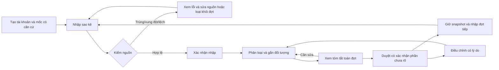
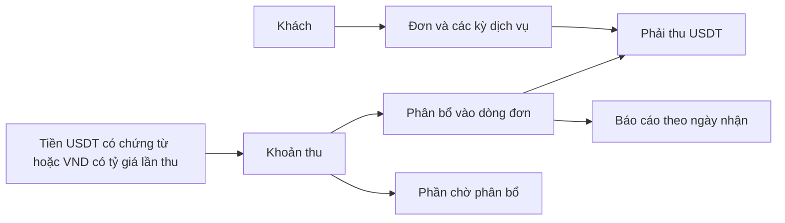

# PCMS — Luồng nghiệp vụ xuyên suốt

[← Tổng quan](overview.md) · [Xem màn hình](wireframes/index.html) · [Bản đồ UI](ui-map.md)

Thiết kế trải nghiệm 11/10/2026; luồng đích không đồng nghĩa mọi bước đã vận hành. Ma trận hiện trạng ở overview.md. Mọi số bên dưới là dữ liệu giả.

## J01 — Bắt đầu và duy trì sổ ngân hàng
Nguồn: R01–R06, R17–R21, R49–R62; spec 001.

- Khởi tạo: mốc 09/07/2026 nghĩa là bắt đầu theo dõi ngày 9 tháng 7. Nguồn bắt đầu 01/08 phải nêu khoảng 09–31/07 chưa có nguồn; không kết luận kỳ tháng 8 nằm trước tháng 7.
- File bị loại giữ lý do lịch sử. Đưa lại vào kiểm tra mới đánh giá theo tài khoản hiện tại; không tự ghi tiền vì sửa hồ sơ.
- Sau nhập, “chưa phân loại” là việc cần làm, không mất giao dịch. Chia gốc/lãi phải khớp tiền nguồn.
- Duyệt dùng toàn đợt, không chỉ trang/bộ lọc. Nếu còn chưa phân loại hoặc khoảng thiếu, thông báo và xác nhận rõ; snapshot không chứng minh lịch sử đầy đủ.
- Tạo sai tài khoản: cho sửa các trường trong phạm vi trạng thái cho phép; tài khoản rỗng có thể xóa mềm, tài khoản đã có lịch sử dùng lưu trữ. Không dùng đổi hồ sơ để thay tiền đã ghi.
- Sau duyệt: mở phiên điều chỉnh có lý do; bản cũ vẫn xem được.

## J02 — Một khoản nhận vào đi qua ngân hàng, công nợ và báo cáo
Nguồn: R07, R42–R43, R50–R53, R58–R60; specs 002–005.

1. Chọn giao dịch mẫu `DEMO-001`, tiền vào **22.000.000 VND**.
2. Phân bổ **20.000.000 thu gốc** và **2.000.000 lãi**, cùng người An, cùng món A01. Đây vẫn là một giao dịch.
3. Mở món A01: giả sử gốc trước thu 100 triệu thì còn 80 triệu; lãi thực nhận hiển thị riêng 2 triệu. Không tự suy ra đó là trả kỳ lãi nào.
4. Mở bảng kê lãi: chọn kỳ và tiền nguồn được áp dụng; có thể ngày nhận nằm ngoài kỳ. Không dùng lại phần tiền đã dành cho bản duyệt hiện hành khác.
5. Xem báo cáo ngày nhận: 20 triệu thu hồi gốc và 2 triệu lãi nhận, không gọi tổng 22 triệu là lợi nhuận.
6. Từ báo cáo → giao dịch → nguồn mẫu. UI phải giữ lựa chọn tài khoản khi quay lại.
7. Hết gốc nhưng còn lãi/bảng kê chưa đủ: hiện việc còn thiếu. Chỉ hoàn tất khi đáp ứng điều kiện và người dùng xác nhận có căn cứ; mở lại giữ lịch sử.

Bản tương tác minh họa bước 1–3 và truy nguồn. Bảng kê/duyệt trong bản tương tác chỉ được giải thích, không thực hiện giao dịch.

## J03 — Thu tiền khách Energy
Nguồn: R33–R41, R48, R63–R66; spec 006.

Ví dụ: ba kỳ ×100 USDT =300; thu 200 USDT cấn hai kỳ, còn 100; thu 2.500.000 VND @25.000 cấn 100, còn 0. Khoản VND liên kết giao dịch ngân hàng đã có không sinh thêm tiền ngân hàng. Không cộng 2,5 triệu VND và 100 USDT như hai khoản thu độc lập.

Kỳ dịch vụ, hạn cam kết, ngày nhận tiền tách biệt. Không có hạn thì không tự gắn quá hạn. Hủy khoản thu cần lý do, hoàn phần phân bổ và giữ lịch sử. Báo cáo tiền thực thu không là lợi nhuận bán TRX. Thưởng staking ghi số lượng riêng. App không cấp/cắt/gia hạn Energy hay giao dịch ví.

## J04 — Tài sản và phân bổ danh mục (thiết kế đích)
Nguồn: R15–R19, R23, R25–R27, R58; spec 007 đang backlog.

- Crypto: khai nơi giữ và mốc → số lượng theo coin → tách đang giữ/khóa và nghĩa vụ khi có căn cứ → xem theo coin hoặc nơi giữ. Số đầu không là thu nhập. Trùng ticker chưa chắc cùng tài sản.
- BĐS: hồ sơ tài sản/quyền lợi → liên kết các lần thanh toán → vốn có nguồn → giá hợp đồng/còn cam kết riêng → định giá có ngày và nguồn → liên kết khoản vay nếu thế chấp.
- Tổng quan: cho biết phần đã đủ dữ liệu và phần chưa có giá/nguồn. Không cộng danh mục con với tổng nơi giữ lần nữa, không tính TRX trong Energy và ví hai lần.
- Chỉ hiện lãi/lỗ, tổng quy đổi hoặc tỷ trọng khi chính sách cần thiết đã chốt. Trước đó hiển thị “chưa xác định” và lý do, không thay bằng 0.

## J05 — Kiểm tra quyết định từ báo cáo (thiết kế đích)
Mở tổng quan → chọn thời điểm/phạm vi → kiểm ngày nguồn và mức độ đầy đủ → mở hạng mục → xem nguồn/định giá → tự cân nhắc. Có thể so sánh nơi giữ và khả năng tiếp cận tài sản, nhưng chưa đặt ngưỡng rủi ro/tỷ trọng mục tiêu thay người dùng. Không tự mua/bán hoặc tạo quyết định tài chính thật.
