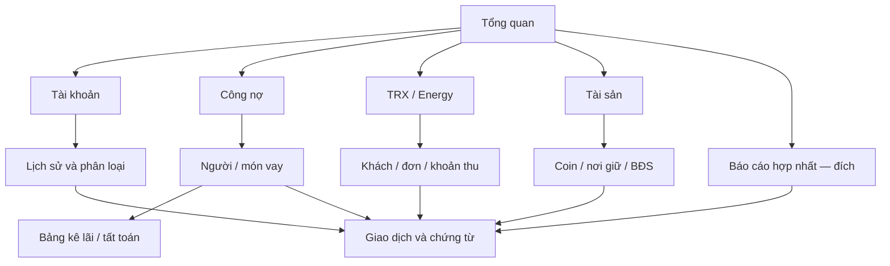

# PCMS — Bản đồ UI tổng thể

[← Tổng quan](overview.md) · [Luồng nghiệp vụ](journeys.md) · [Bản thiết kế tương tác](wireframes/index.html)

Bố cục dưới đây là đề xuất PO để review. Chưa thay UI vận hành. Đặt mục tiêu để người dùng đi từ câu hỏi → số liệu → nguồn và quay lại mà không mất ngữ cảnh.

## Cấu trúc điều hướng đề xuất

## Hợp đồng trải nghiệm từng màn
| Màn | Thấy ngay | Thao tác chính | Đi tiếp / quay lại | Trạng thái cần có |
|---|---|---|---|---|
| Tổng quan | Phạm vi VND/USDT, nguồn tới ngày nào, việc còn thiếu, nơi giữ tiền | Mở việc cần xử lý, mở hạng mục | Giữ phạm vi khi trở về | Chưa có nguồn; thiếu định giá; nháp/đã duyệt; không bịa tổng |
| Tài khoản | Danh sách, mốc theo dõi, số dư, khoảng thiếu, đợt hiện tại | Tạo/sửa; nhập; phân loại; xem tóm tắt; duyệt | Giao dịch → món vay/tài sản hoặc nguồn | Rỗng; file lỗi; trùng; nguồn bị loại; chỉ xem; điều chỉnh |
| Chi tiết giao dịch | Tiền/ngày/tài khoản; phân bổ; file/sheet/dòng | Xem nguồn, sửa trong quyền trạng thái | Về đúng danh sách đã mở | Thiếu nguồn; phân bổ chưa đủ; khóa sau duyệt |
| Công nợ | Phải thu/phải trả riêng, số người/khoản, mục cần thiết lập | Chọn người/món; điều khoản; bảng kê; hoàn tất | Món → nguồn ngân hàng; về người | Chưa có gốc; thiếu kỳ; hết gốc còn lãi; cần kiểm lại |
| TRX/Energy | Khách, đơn, đã thu, còn nợ, chờ phân bổ | Ghi đơn/thu/phân bổ/thưởng; hủy có lý do | Khách → đơn → khoản thu → nguồn | Chưa thu; thu thiếu/thừa; thiếu hạn; đã hủy |
| Tài sản | Theo nơi giữ/nhóm tài sản; vốn và giá trị tách | Khởi tạo, gắn nguồn vốn, định giá có căn cứ | Hồ sơ → lịch sử nguồn hoặc nghĩa vụ | Chưa có vốn/giá; giá cũ; số lượng khóa; quyền lợi chưa rõ |
| Báo cáo | Kỳ/phạm vi; thu gốc/lãi/chi phí tách; ngày nguồn | Đổi kỳ, mở chi tiết số tổng | Dòng báo cáo → nguồn | Kỳ chưa có nguồn; chỉ có một phần; chưa đủ chi phí |

## Quy ước hiển thị
- Số có nguyên tệ; ngày DD/MM/YYYY; giờ Việt Nam khi có giờ thực. Không bịa giờ ngân hàng.
- Nhãn trạng thái bằng chữ, không chỉ màu. “Có mã” và “đã nghiệm thu” tách biệt trong tài liệu.
- Luồng tài khoản giữ nhập/kiểm/phân loại cùng khu vực; tóm tắt duyệt là bước rõ, không bị bộ lọc cắt phạm vi.
- Trên màn hẹp, điều hướng và bảng vẫn đọc được; vùng chi tiết không che nút quay lại. Bản thiết kế cần kiểm riêng, không suy ra mobile app đã đạt.
- Không có dữ liệu khác với có dữ liệu nhưng số bằng 0. Mỗi trạng thái thiếu nêu bước tiếp theo.
- Các nút tương tác bản mẫu ghi “mẫu”; không có nút giả vờ đã lưu vào ứng dụng.

## Bản đồ này nằm ở đâu trong quy trình?
Yêu cầu gốc → tổng quan/luồng/UI này → specify tính năng → clarify điểm mở → plan kỹ thuật → tasks → analyze tính nhất quán → implement → nghiệm thu luồng → cập nhật trạng thái. Các bước tùy chọn ghi lý do không áp dụng. Thay đổi UI phải dẫn về màn/luồng và mã Rxx; thay đổi nghiệp vụ phải cập nhật nguồn có hiệu lực trước.

Không bắt người dùng thao tác slash command. PO tổ chức công việc; coder thực hiện; người dùng phản hồi bằng trải nghiệm nhìn thấy. Người dùng chưa feedback không được ghi là đã đồng ý thiết kế.
